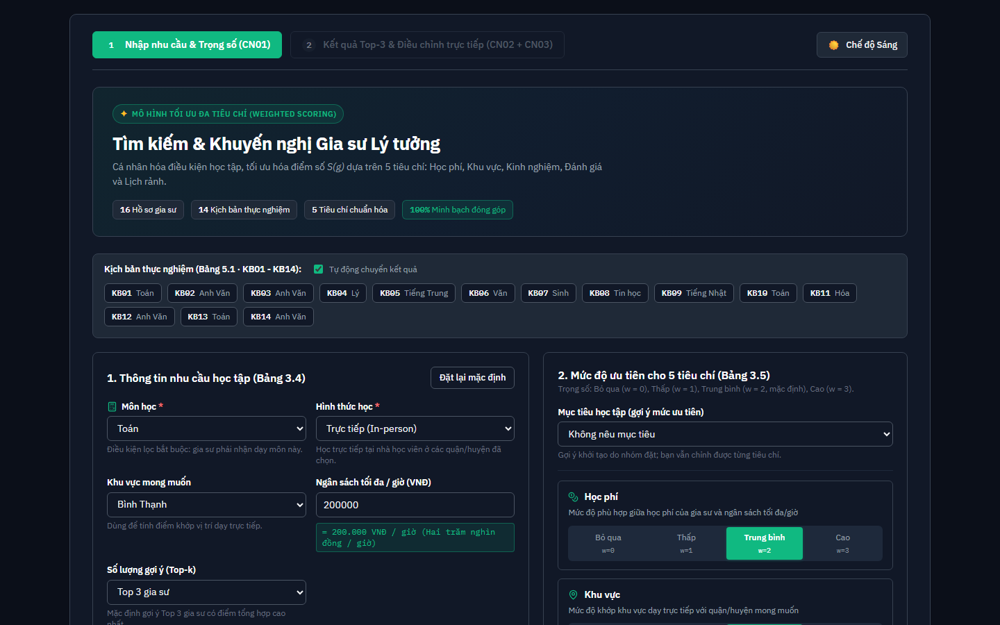
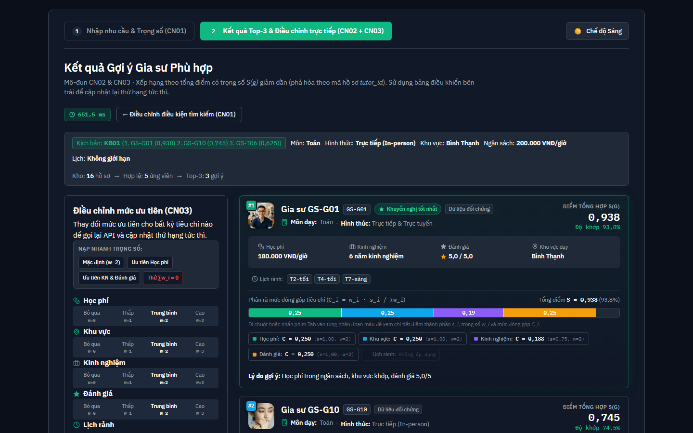
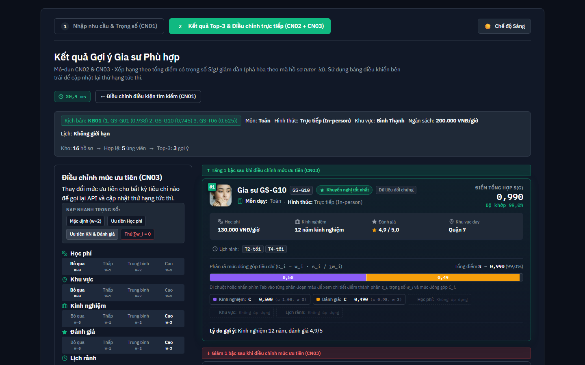
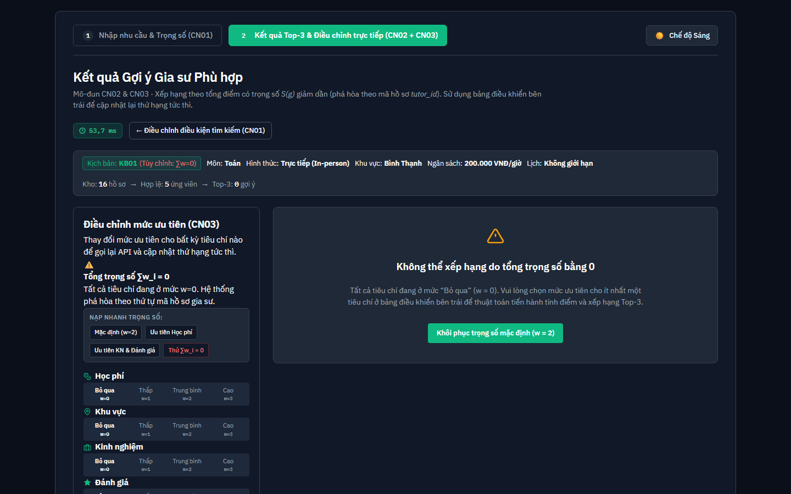

# Hệ thống khuyến nghị gia sư dựa trên mức độ phù hợp đa tiêu chí

Repository mã nguồn và tài liệu của đồ án tốt nghiệp đại học về hệ thống gợi ý gia sư đa tiêu chí.

> **Đề tài đã đăng ký:** "Hệ thống khuyến nghị gia sư dựa trên phương pháp Content-Base Filtering"  
> **Phạm vi hệ thống:** Đây là hệ thống gợi ý chuyên sâu (Recommendation Engine) kèm giao diện tương tác demo trên bộ dữ liệu mẫu nhỏ (16 hồ sơ), không phải nền tảng kết nối gia sư đầy đủ; hệ thống chưa có dữ liệu đánh giá từ người học thực tế và đang chờ ý kiến đóng góp chính thức từ Giáo viên hướng dẫn.

---

## 1. Thông tin nhóm thực hiện

- **Lê Thị Bích Chuyền** (KHMT2411037)
- **Trần Nguyễn Đức** (KHMT2411011)
- **Cao Khánh Ngọc** (KHMT2411025) - *Nhóm trưởng*

---

## 2. Công nghệ sử dụng

- **Backend:** Python 3.12, FastAPI 0.162, Pydantic 2.14, Uvicorn 0.54
- **Frontend:** React 19, Vite 8, JavaScript (JSX), CSS thuần (vẽ thanh xếp chồng Stacked Bar bằng HTML/CSS; hoàn toàn không sử dụng TailwindCSS hay Recharts)
- **Lưu trữ dữ liệu:** JSON và CSV (`data/processed/tutors.json`, `data/processed/tutors.csv`)
- **Kiểm thử & đảm bảo chất lượng:** Pytest 9.2, Pytest-cov 7.1, HTTPX 0.28, Ruff 0.17 (backend); Oxlint 1.89 (frontend)

---

## 3. Bản đồ cấu trúc thư mục và ánh xạ đề cương

| Thư mục / Tệp tin | Vai trò kỹ thuật | Mục tương ứng trong đề cương |
|---|---|---|
| `backend/app/scoring/` | Module tính điểm và xếp hạng đa tiêu chí độc lập (lọc cứng, kiểm tra ngưỡng dữ liệu, tính điểm thành phần $s_i$, tính trọng số hiệu dụng, xếp hạng Weighted Scoring) | Mục 3.6, Mục 4.3 |
| `backend/app/schemas/` | Lược đồ dữ liệu Pydantic cho hồ sơ gia sư, yêu cầu tìm kiếm và cấu trúc phản hồi gợi ý | Mục 3.5 (Bảng 3.3, 3.4), Mục 4.4 |
| `backend/app/api/` | Endpoint FastAPI tiếp nhận yêu cầu (`POST /api/recommend`) và kiểm tra sức khỏe (`GET /health`) | Mục 4.4 |
| `backend/tests/` | Bộ 200 bài kiểm thử tự động (unit test, ca biên toán học, API test, 14 kịch bản thực nghiệm và khảo sát độ nhạy) | Mục 5.1, Mục 5.2 |
| `frontend/` | Giao diện người dùng React 19 + Vite (nhập nhu cầu, chọn mức ưu tiên, hiển thị Top-3, biểu đồ thanh xếp chồng, ô mục tiêu học tập US-41) | Mục 3.8, Mục 4.5 |
| `data/` | Dữ liệu 16 hồ sơ gia sư mẫu (14 mô phỏng, 2 thu thập công khai có ẩn danh) dạng JSON và CSV | Mục 3.5, Phụ lục A |
| `docs/design/` | Đặc tả thuật toán (`scoring-spec.md`), hợp đồng API (`api-contract.md`), từ điển dữ liệu, đề xuất mở rộng mục tiêu học tập | Chương 3, Chương 4 |
| `docs/scrum/` | Tài liệu quản trị dự án Agile/Scrum qua 6 Sprint (backlog, roadmap, roles, sprint reviews) | Kế hoạch thực hiện đồ án |
| `docs/thesis/` | Báo cáo thực nghiệm Chương 5, Chương 6 (Phụ lục A–D) và slide bảo vệ | Báo cáo đồ án |
| `docs/decisions/` | Hồ sơ ghi nhận quyết định kiến trúc và công nghệ (ADR) | Thiết kế hệ thống |
| `scripts/` | Kịch bản kiểm tra toàn vẹn dữ liệu hồ sơ gia sư (`validate_tutors.py`) | Đảm bảo chất lượng dữ liệu |

---

## 4. Dùng thử trực tuyến

Hệ thống đã được triển khai sẵn sàng trên nền tảng đám mây công cộng:

- **Giao diện người dùng (Frontend):** [https://tutor-recommender.vercel.app](https://tutor-recommender.vercel.app)
- **Dịch vụ gợi ý (Backend API):** [https://tutor-recommender-api.onrender.com](https://tutor-recommender-api.onrender.com)
  - Endpoint kiểm tra sức khỏe: [https://tutor-recommender-api.onrender.com/health](https://tutor-recommender-api.onrender.com/health) (HTTP 200 OK)
  - Tài liệu tương tác OpenAPI (Swagger UI): [https://tutor-recommender-api.onrender.com/docs](https://tutor-recommender-api.onrender.com/docs)

> **Lưu ý về gói dịch vụ miễn phí (Render Free Tier):** Máy chủ backend trên Render có thể tạm dừng (ngủ) sau một khoảng thời gian không có lưu lượng truy cập. Theo mô tả trong tài liệu triển khai, lượt truy cập đầu tiên có thể gặp hiện tượng khởi động lại (cold start) kéo dài khoảng 30–40 giây (thời gian này chưa được đo đạc định lượng chính thức); các yêu cầu tiếp theo sẽ được xử lý bình thường.

---

## 5. Yêu cầu hệ thống và cài đặt cục bộ

### 5.1. Yêu cầu môi trường
- **Hệ điều hành:** Windows 10/11 (PowerShell) hoặc macOS/Linux (Bash).
- **Python:** Phiên bản 3.12 (đã kiểm chứng trên môi trường nhóm với Python 3.12.7).
- **Node.js:** Phiên bản tương thích `^20.19.0 || >=22.12.0` (đã kiểm chứng với Node.js v24.19.0 và npm 11.17.0).
- **Git:** Phiên bản 2.x (đã kiểm chứng với Git 2.55).

### 5.2. Các bước cài đặt và khởi chạy (thực hiện trong khoảng 3–5 phút)

#### Bước 1: Sao chép kho lưu trữ
```powershell
git clone https://github.com/tnduckhmt2411011-design/tutor-recommender.git
cd tutor-recommender
```

#### Bước 2: Cài đặt và khởi chạy Backend (Mở Terminal 1)
```powershell
cd backend
py -3.12 -m venv .venv
.\.venv\Scripts\Activate.ps1
python -m pip install --upgrade pip
python -m pip install -r requirements.txt -r requirements-dev.txt
python -m uvicorn app.main:app --port 8000
```
- Dịch vụ backend sẵn sàng tại `http://localhost:8000`.
- Kiểm tra trạng thái hoạt động: mở trình duyệt truy cập `http://localhost:8000/health` (trả về `{"status":"ok"}`).
- Xem tài liệu Swagger UI: `http://localhost:8000/docs`.

#### Bước 3: Cài đặt và khởi chạy Frontend (Mở Terminal 2)
```powershell
cd frontend
npm ci
npm run dev
```
- Mở trình duyệt và truy cập: `http://localhost:5173`.
- Khi chạy trên localhost, frontend tự động kết nối tới backend cục bộ tại cổng 8000 theo cấu hình trong `frontend/src/services/api.js`.

---

## 6. Thao tác thử nghiệm các tính năng cốt lõi (Demo CN01–CN03)

Sau khi mở giao diện tại `http://localhost:5173`, người dùng có thể thực hiện 4 thao tác thử nghiệm chính:

1. **Thao tác 1 — Nhập nhu cầu và nạp nhanh kịch bản (CN01):**
   - Tại thanh "Nạp nhanh kịch bản kiểm thử", nhấn nút **KB01**. Hệ thống tự động điền các tham số: môn Toán, học Trực tiếp, khu vực Bình Thạnh, ngân sách tối đa 200.000 VNĐ/giờ, các mức ưu tiên ở mức Trung bình ($w=2$).
   - Khảo sát ô lựa chọn "Mục tiêu học tập" (US-41) với 3 preset: *Mặc định*, *Luyện thi điểm cao / học chuyên*, *Đậu tốt nghiệp / lấy lại căn bản*.
   - Nhấn nút **"Tìm gia sư phù hợp"**.
2. **Thao tác 2 — Xem kết quả gợi ý và phân rã điểm đóng góp (CN02):**
   - Màn hình kết quả hiển thị danh sách Top-3 gia sư: Hạng 1 là `GS-G01` (điểm tổng 0,938), Hạng 2 là `GS-G10` (0,745), Hạng 3 là `GS-T06` (0,625).
   - Quan sát biểu đồ thanh xếp chồng (Stacked Bar Score) hiển thị trực quan tỷ lệ đóng góp của từng tiêu chí vào điểm tổng: $\frac{w_i \cdot s_i}{\sum w_i}$.
   - Đọc phần ghi chú giải thích lý do gợi ý nổi bật bên dưới mỗi thẻ gia sư.
3. **Thao tác 3 — Điều chỉnh mức ưu tiên trực tiếp (CN03):**
   - Tại thanh điều khiển mức ưu tiên trên màn hình kết quả, thử thay đổi mức ưu tiên: chuyển tiêu chí Học phí và Đánh giá về mức "Bỏ qua (w = 0)", chuyển tiêu chí Kinh nghiệm lên mức "Cao (w = 3)".
   - Quan sát danh sách gia sư được tính toán lại ngay lập tức và thứ tự xếp hạng thay đổi trực tiếp trên giao diện.
4. **Thao tác 4 — Kiểm thử trường hợp biên tổng trọng số bằng 0:**
   - Nhấn nút **"Thử ∑w_i = 0"** trên thanh điều khiển. Toàn bộ 5 tiêu chí được đưa về mức 0 ($w=0$).
   - Giao diện kích hoạt trạng thái biên (`zero_weight`) hiển thị cảnh báo thân thiện và hướng dẫn người học bật lại ít nhất một tiêu chí ưu tiên để tiếp tục gợi ý.

---

## 7. Kiểm thử và đảm bảo chất lượng

Tất cả các lệnh kiểm thử và kiểm tra mã nguồn được chạy độc lập từ terminal:

### 7.1. Kiểm tra toàn vẹn bộ dữ liệu (từ thư mục gốc repo)
```powershell
python scripts/validate_tutors.py
```
**Kết quả kỳ vọng:** `ĐẠT: 16 bản ghi (2 public_collected, 14 simulated); id duy nhất; enum hợp lệ; đủ 9 trường; không có thông tin liên hệ; JSON và CSV khớp nhau từng ô.`

### 7.2. Kiểm thử tự động Backend (từ thư mục `backend/`)
```powershell
# Chạy toàn bộ 200 bài kiểm thử
python -m pytest -q

# Đo độ bao phủ mã nguồn của gói app
python -m pytest --cov=app --cov-report=term-missing

# Kiểm tra linter mã nguồn
ruff check .
```
**Kết quả kỳ vọng:**
- `pytest`: **200 passed** (132 unit & môi trường, 27 kịch bản & độ nhạy, 41 API & ca biên).
- `pytest --cov=app`: **340/351 câu lệnh được phủ (đạt tỷ lệ 97%)**.
- `ruff check .`: `All checks passed!`.

### 7.3. Kiểm tra chất lượng Frontend (từ thư mục `frontend/`)
```powershell
# Kiểm tra linter
npm run lint

# Đóng gói ứng dụng production
npm run build
```
**Kết quả kỳ vọng:**
- `oxlint`: Không có cảnh báo hay lỗi cú pháp.
- `vite build`: Quá trình đóng gói hoàn tất thành công, tạo thư mục `dist/`.

---

## 8. Dữ liệu và giới hạn hệ thống

- **Bộ dữ liệu thử nghiệm:** Hệ thống sử dụng 16 hồ sơ gia sư tại `data/processed/tutors.json` và `tutors.csv`. Trong đó gồm 2 hồ sơ thu thập thực tế từ nền tảng công khai (`GS-T06`, `GS-T07`) có môn dạy, khu vực và kinh nghiệm là số liệu thật đã ẩn danh, còn học phí và lịch rảnh là số liệu ước tính của nhóm (đánh dấu hoa thị `*` trong Phụ lục A); 14 hồ sơ còn lại là dữ liệu mô phỏng nhằm phục vụ kiểm thử ca biên.
- **Giới hạn hệ thống:**
  - Tiêu chí khu vực chỉ so khớp nhị phân quận/huyện, chưa đo khoảng cách đường bộ thực tế.
  - Các tham số thuật toán ($\delta = 0,5$, $E_{\max} = 8$, điểm trung tính $0,5$) và bảng trọng số do nhóm ấn định theo phán đoán nghiệp vụ, chưa được tự động học qua mô hình học máy trên dữ liệu người dùng thực.
  - Kết quả Top-3 kỳ vọng trong 14 kịch bản do nhóm tự xác định; độ khớp 14/14 xác nhận thuật toán tính toán đúng theo công thức đã chốt.
  - Chưa tích hợp cơ sở dữ liệu người dùng, đăng ký học hay đánh giá sau buổi học.

---

## 9. Hình ảnh minh họa giao diện

Dưới đây là các hình ảnh giao diện thực tế chụp trực tiếp từ hệ thống đang chạy cục bộ:

### Hình 1 — Màn hình nhập nhu cầu học tập (CN01)
Màn hình tìm kiếm với bộ nạp nhanh 14 kịch bản kiểm thử, ô lựa chọn "Mục tiêu học tập" (US-41) và các thanh chọn mức ưu tiên:


### Hình 2 — Màn hình kết quả gợi ý Top-3 kịch bản KB01 (CN02)
Danh sách Top-3 gia sư kèm điểm tổng hợp và biểu đồ thanh xếp chồng phân rã điểm đóng góp từng tiêu chí:


### Hình 3 — Điều chỉnh mức ưu tiên trực tiếp trên màn hình kết quả (CN03)
Khi thay đổi mức ưu tiên các tiêu chí (ví dụ: Học phí và Đánh giá chuyển về Bỏ qua, Kinh nghiệm chuyển lên Cao), thứ tự xếp hạng và điểm số gia sư tự động cập nhật tức thì:


### Hình 4 — Trạng thái biên khi tổng trọng số bằng 0
Giao diện phản hồi thân thiện khi người học đưa toàn bộ các tiêu chí ưu tiên về mức Bỏ qua ($\sum w_i = 0$):


---

## 10. Cấu trúc tài liệu chi tiết

Để tìm hiểu sâu hơn về kiến trúc hệ thống, đặc tả toán học và báo cáo học thuật, vui lòng tham khảo các tài liệu trong thư mục [`docs/`](docs/README.md):
- [Tổng quan tài liệu đồ án](docs/README.md)
- [Đặc tả thuật toán tính điểm và xếp hạng](docs/design/scoring-spec.md)
- [Đặc tả hợp đồng API RESTful](docs/design/api-contract.md)
- [Từ điển dữ liệu](docs/design/data-dictionary.md)
- [Đề xuất mở rộng mô hình Cấp lớp và Mục tiêu học tập](docs/design/de-xuat-mo-rong-cap-lop-muc-tieu.md)
- [Hướng dẫn triển khai đám mây Vercel và Render](docs/deployment/deploy-vercel-render.md)
- [Báo cáo Chương 5: Kiểm thử và đánh giá](docs/thesis/report/chuong-05-thuc-nghiem-va-danh-gia.md)
- [Báo cáo Chương 6: Kết luận, hướng phát triển và Phụ lục A–D](docs/thesis/report/chuong-06-ket-luan-va-huong-phat-trien.md)

