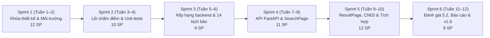

> [!NOTE]
> **Đề xuất, nhóm xác nhận**

# Lộ trình phát triển Scrum (Scrum Roadmap)

Lộ trình vận hành Scrum cho đồ án tốt nghiệp **"Hệ thống khuyến nghị gia sư dựa trên mức độ phù hợp đa tiêu chí"**, trải qua 6 Sprint hai tuần (tổng thời gian 12 tuần), hướng tới mục tiêu hoàn thành sản phẩm phần mềm chất lượng cao và báo cáo đồ án đúng hạn.

---

## 1. Ngân sách giờ và công suất nhóm

Nhóm đã thống nhất áp dụng **Mô hình A**:
- **Ngân sách:** **100 giờ cho mỗi thành viên** = **300 giờ toàn nhóm** trong toàn bộ đồ án (12 tuần / 6 sprint).
  - Tương đương mỗi thành viên dành khoảng ~8.3 giờ/tuần (~1.2 giờ/ngày), hoàn toàn phù hợp và khả thi với khối lượng 2 tín chỉ đồ án tốt nghiệp đại học.
- **Giả định quy đổi công suất:** Tạm quy đổi **1 Story Point (SP) ≈ 2 giờ làm việc tập trung** cho tới khi nhóm có chỉ số vận tốc (velocity) thực tế qua các sprint.
- **Phân bổ khối lượng theo Bảng 1.2 Đề cương:**
  - **Chương 1–3 (Giai đoạn đề cương):** Chiếm 48% tổng thời lượng (= 144 giờ nhóm). Giai đoạn này đã cơ bản hoàn tất khi xây dựng xong cơ sở lý thuyết, mô hình hóa bài toán và dữ liệu mẫu.
  - **Chương 4–6 (Giai đoạn triển khai 6 sprint):** Chiếm 52% tổng thời lượng (= **156 giờ nhóm**).
- **Công suất Story Points cho 6 sprint:**
  $$\text{Tổng công suất} = \frac{156\text{ giờ}}{2\text{ giờ/SP}} = 78\text{ SP}$$
- **Dự phòng rủi ro (Buffer 15%):**
  $$\text{Công suất an toàn cho hạng mục Must} \le \frac{78\text{ SP}}{1.15} \approx 67.8\text{ SP}$$
- **Đối chiếu thực tế Backlog đã hoạch định:**
  - **Tổng điểm Must:** **56 SP** (~112 giờ).
  - **Dự phòng 15%:** **8.4 SP** (~17 giờ).
  - **Tổng Must + Dự phòng:** **64.4 SP** (~129 giờ) $\le 78\text{ SP}$ (ngân sách còn dư an toàn 13.6 SP ~ 27 giờ).
  - **Tổng Should:** **7 SP** (~14 giờ).
  - **Tổng Could:** **4 SP** (~8 giờ, backlog dự phòng chưa xếp sprint).
  - **Kết luận:** Kế hoạch hoàn toàn nằm gọn trong công suất khả dụng của nhóm, có biên độ an toàn dự phòng rủi ro vững chắc.

---

## 2. Lộ trình chi tiết 6 Sprint

### Chi tiết kế hoạch từng Sprint:

| Sprint | Thời gian | Mục tiêu chính (Sprint Goal) | Điểm SP | Hạng mục bàn giao chính (Key Deliverables) | Tiêu chí nghiệm thu Sprint |
|:---|:---:|:---|:---:|:---|:---|
| **Sprint 1** | Tuần 1–2 | **Khóa thiết kế, sẵn sàng code** Chốt thiết kế với GVHD; số hóa dữ liệu 16 hồ sơ và 14 kịch bản; ban hành API contract; dựng khung backend/frontend và tài liệu Scrum. | 12 SP *(11 Must, 1 Should)* | - `data/processed/tutors.{json,csv}` (16 hồ sơ Phụ lục A) - `backend/tests/scenarios/scenarios.json` (14 kịch bản Bảng 5.1 nguyên văn) - `docs/design/api-contract.md` - `backend/requirements.txt`, CI workflow - `frontend/` scaffold Vite ReactJS - Cập nhật đề cương (GS360, Bảng 6.1) | - Dữ liệu 16 hồ sơ và 14 kịch bản đã nằm trong repo. - GVHD đã nhận phần khóa bài toán. - Chưa có bất kỳ story viết logic (4.3–4.6) nào được thực hiện. - **Qua Cổng chất lượng 1**. |
| **Sprint 2** | Tuần 3–4 | **Lõi chấm điểm** Cài đặt module repository nạp dữ liệu, bộ lọc điều kiện bắt buộc, 5 hàm chuẩn hóa điểm Bảng 3.6, module trọng số và 100% unit test. | 10 SP *(10 Must)* | - `backend/app/data/repository.py` - `backend/app/scoring/filter.py` - `backend/app/scoring/criteria.py` (5 hàm điểm) - `backend/app/scoring/weights.py` - Bộ unit test `test_criteria.py` (15 ca từ Bảng 3.6 + ca biên) | - 100% unit test cho 5 hàm điểm đạt trạng thái xanh. - Bộ lọc kiểm tra đúng điều kiện bắt buộc (môn, hình thức, khung giờ). - Xử lý mượt mà 4 mức trọng số và loại trừ tiêu chí. |
| **Sprint 3** | Tuần 5–6 | **Xếp hạng backend** Cài đặt quy tắc ngưỡng dữ liệu, thuật toán Weighted Scoring, tính đóng góp tiêu chí, kiểm thử tự động 14 kịch bản và điều tra sai lệch. | 9 SP *(9 Must)* | - `backend/app/scoring/threshold.py` - `backend/app/scoring/ranker.py` - Module giải thích lý do gợi ý - Test runner tự động 14 kịch bản từ `scenarios.json` - Tài liệu phân tích sai lệch thứ hạng | - 14 kịch bản chạy tự động không crash. - Đếm chính xác số gia sư trùng (0–3). - Mọi chỗ lệch thứ hạng được điều tra và giải thích cặn kẽ, tuyệt đối không sửa Top-3 kỳ vọng. - **Qua Cổng chất lượng 2**. |
| **Sprint 4** | Tuần 7–8 | **API và màn hình nhập** Hoàn thiện endpoint FastAPI `POST /api/recommend`, kiểm tra hợp lệ dữ liệu, integration test và màn hình `SearchPage` ReactJS. | 11 SP *(10 Must, 1 Should)* | - Endpoint `POST /api/recommend` trong `backend/app/api/` - Pydantic validation và các mã lỗi (`no_match`, `zero_weight`, 422) - Integration tests với `TestClient` - Màn hình nhập nhu cầu `SearchPage.jsx` (CN01) - Frontend API client service | - Endpoint API phản hồi dưới 1 giây với dữ liệu mẫu. - Integration test đạt 100% trong CI. - Form ReactJS nhập đầy đủ nhu cầu và chọn 4 mức ưu tiên cho 5 tiêu chí. |
| **Sprint 5** | Tuần 9–10 | **Màn hình kết quả và tích hợp** Hoàn thiện `ResultPage` hiển thị Top-k kèm điểm, thanh xếp chồng, tương tác CN03, tích hợp end-to-end và kiểm thử ca biên. | 12 SP *(7 Must, 5 Should)* | - Màn hình `ResultPage.jsx` (CN02) - Component thanh xếp chồng phân rã điểm đóng góp - Tính năng điều chỉnh ưu tiên trực tiếp (CN03) - Luồng tích hợp end-to-end frontend - backend - Kiểm thử ca biên giao diện & điền cột Top-3 hệ thống | - Demo chạy mượt mà từ giao diện tới kết quả. - Đổi mức ưu tiên CN03 tự động cập nhật thứ hạng dưới 1 giây. - Cột Top-3 hệ thống của Bảng 5.1 được điền đầy đủ. - **Qua Cổng chất lượng 3**. |
| **Sprint 6** | Tuần 11–12 | **Đánh giá và nộp** Phân tích thực nghiệm Mục 5.2, hoàn thiện nội dung Chương 5–6, tài liệu README, slide thuyết trình, bảo vệ thử và tag v1.0. | 9 SP *(9 Must)* | - Thử nghiệm độ nhạy tham số và phân tích Mục 5.2 - Báo cáo hoàn chỉnh Chương 5, 6 và Phụ lục B, C, D - `README.md` hướng dẫn cài đặt và chạy trong 5 phút - Slide thuyết trình và kịch bản demo bảo vệ - Cập nhật mục lục, đóng gói hồ sơ, git tag `v1.0` | - Báo cáo đồ án khớp 100% với hệ thống thực tế. - Diễn tập bảo vệ thử thành công. - Repository gắn tag phát hành `v1.0`. - **Qua Cổng chất lượng 4**. |

---

## 3. Bốn cổng chất lượng kiểm soát tiến độ (Quality Gates)

Các cổng chất lượng đóng vai trò là chốt chặn nghiêm ngặt (Hard Gates), ngăn chặn việc nhảy cóc giai đoạn:

1. **Cổng 1 (Cuối Sprint 1) — Khóa bài toán & Sẵn sàng kỹ thuật:**
   - Điều kiện đo được: Công thức tính điểm (Bảng 3.6), dữ liệu 16 hồ sơ (`tutors.json`), 14 kịch bản (`scenarios.json`) với Top-3 kỳ vọng nguyên văn, và hợp đồng API đã nằm trong repo. GVHD đã nhận phần khóa bài toán.
   - *Ràng buộc:* Chưa vượt qua Cổng 1 thì tuyệt đối không được thực hiện bất kỳ story viết code logic nào (Mục 4.3–4.6).
2. **Cổng 2 (Cuối Sprint 3) — Tính đúng đắn của Lõi thuật toán:**
   - Điều kiện đo được: 100% unit test từ ví dụ Bảng 3.6 xanh, 14 kịch bản chạy thành công qua bộ máy xếp hạng, các trường hợp sai lệch thứ hạng đã được điều tra, phân tích nguyên nhân toán học và lập biên bản. Tuyệt đối không sửa đổi Top-3 kỳ vọng.
3. **Cổng 3 (Cuối Sprint 5) — Trải nghiệm Demo hoàn chỉnh:**
   - Điều kiện đo được: Hệ thống chạy trơn tru từ giao diện ReactJS tới backend FastAPI; tính năng đổi mức ưu tiên CN03 cập nhật lại thứ hạng dưới 1 giây; đã kiểm thử ca biên trên giao diện và điền đầy đủ cột Top-3 hệ thống vào Bảng 5.1.
4. **Cổng 4 (Cuối Sprint 6) — Khớp nối Báo cáo và Phát hành:**
   - Điều kiện đo được: Toàn bộ số liệu trong báo cáo khóa luận (Chương 5, 6) khớp chính xác với hệ thống thực tế; slide thuyết trình và kịch bản demo sẵn sàng; repo được gắn tag `v1.0`.

---

## 4. Phân định phạm vi MoSCoW

| Mức ưu tiên | Nhãn GitHub | Phạm vi chức năng & Công việc |
|:---|:---|:---|
| **Must Have** *(Bắt buộc phải có)* | `priority:high` | - Dữ liệu 16 hồ sơ (`data/processed/`) và 14 kịch bản fixture trong repo. - Module lọc điều kiện bắt buộc (môn, hình thức, khung giờ). - 5 hàm tính điểm thành phần theo Bảng 3.6 và module trọng số Bảng 3.5. - Quy tắc ngưỡng dữ liệu tối thiểu và thuật toán Weighted Scoring. - Xếp hạng Top-k kèm lý do gợi ý. - Endpoint FastAPI `POST /api/recommend` kèm validation. - Màn hình nhập nhu cầu `SearchPage` (CN01) và màn hình kết quả `ResultPage` (CN02). - Chạy tự động 14 kịch bản và phân tích sai lệch. - Báo cáo hoàn thiện Chương 5, Chương 6, slide và kịch bản demo. |
| **Should Have** *(Nên có nếu kịp tiến độ)* | `priority:medium` | - Quy trình CI tự động kiểm tra code (`ruff`, `pytest`) trên GitHub Actions (US-02). - Cấu hình CORS và Swagger UI tài liệu hóa chi tiết (US-22). - Thanh xếp chồng (stacked bar) trực quan hóa tỉ lệ đóng góp của từng tiêu chí (US-26). - Tính năng tương tác điều chỉnh mức ưu tiên cập nhật thứ hạng tức thì CN03 (US-27). |
| **Could Have** *(Có thể làm nếu dư giờ)* | `priority:low` | - Nâng cấp cơ chế lưu trữ dữ liệu từ JSON sang bảng SQLite đơn giản (US-37). - Lưu lịch sử các lần tìm kiếm gần nhất vào LocalStorage (US-38). - Xuất danh sách gợi ý gia sư ra tệp PDF tóm tắt (US-39). |
| **Won't Have** *(Dứt khoát không làm trong đồ án)* | *(Không tạo Issue)* | - Đăng ký tài khoản, đăng nhập và phân quyền người dùng (học sinh, phụ huynh, gia sư, admin). - Thanh toán trực tuyến hoặc nạp tiền. - Đặt lịch học, điểm danh và quản lý lớp học. - Áp dụng Machine Learning / Learning-to-Rank để tự động học trọng số. - Xây dựng nền tảng mạng xã hội kết nối gia sư đầy đủ. |

---

## 5. Quản trị rủi ro và phương án ứng phó (Risks & Mitigations)

1. **Rủi ro 1: Kết quả hệ thống khác biệt so với Top-3 kỳ vọng thủ công ở Bảng 5.1.**
   - *Mức độ:* Cao.
   - *Phương án ứng phó:* Tuyệt đối không điều chỉnh dữ liệu Top-3 kỳ vọng để ép khớp. Tiến hành phân tích cặn kẽ nguyên nhân toán học (do ảnh hưởng của hàm phạt học phí $\delta$, do ngưỡng dữ liệu hay do trọng số mặc định). Trình bày trung thực sự khác biệt này vào Mục 5.2 và phân tích như một phát hiện có giá trị ở Mục 5.3 của báo cáo.
2. **Rủi ro 2: Bất đồng bộ dữ liệu giữa Frontend và Backend khi tích hợp.**
   - *Mức độ:* Trung bình.
   - *Phương án ứng phó:* Ban hành tài liệu Hợp đồng API (`docs/design/api-contract.md`) ngay từ Sprint 1. Backend dùng Pydantic để thực thi schema chặt chẽ; frontend gọi API qua service chuẩn hóa.
3. **Rủi ro 3: Trễ tiến độ do dồn việc viết báo cáo vào cuối kỳ.**
   - *Mức độ:* Trung bình.
   - *Phương án ứng phó:* Áp dụng ngân sách dự phòng 15% (khoảng ~17 giờ). Tài liệu đồ án được cập nhật cuốn chiếu theo từng sprint (Sprint 1 cập nhật Chương 1 và 6; Sprint 3 chuẩn bị dữ liệu Chương 5; Sprint 6 tập trung hoàn thiện báo cáo và slide).
