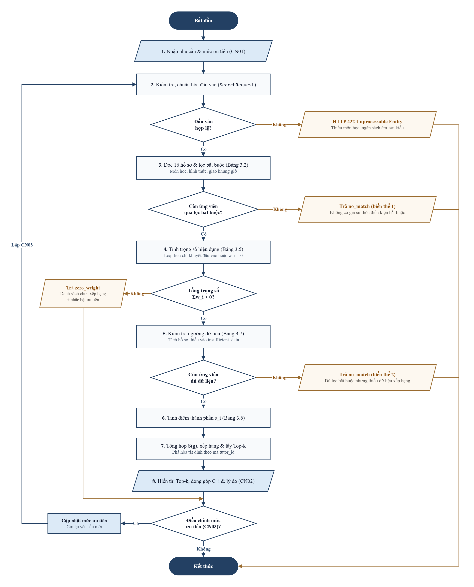
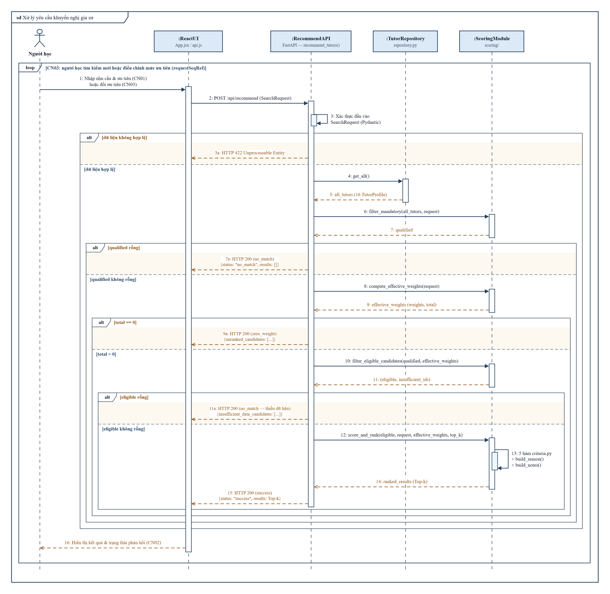
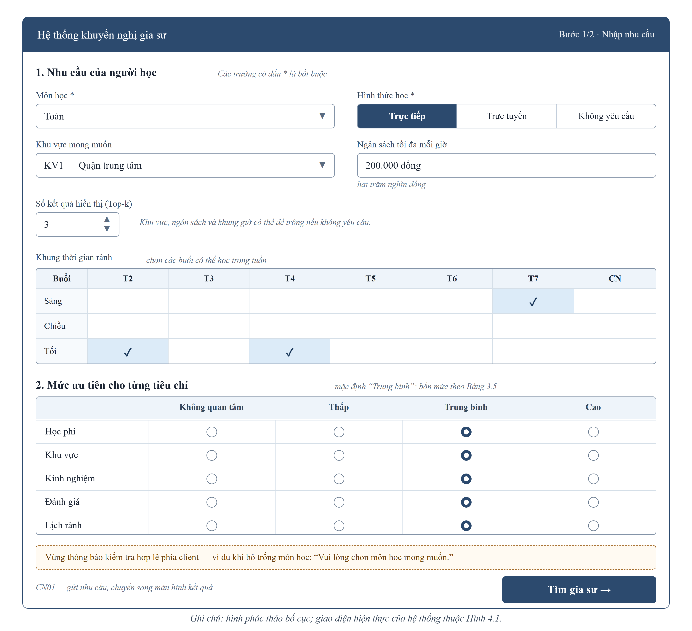

# CHƯƠNG 3. PHÂN TÍCH VÀ THIẾT KẾ HỆ THỐNG

## 3.1. Phát biểu bài toán

Dựa trên cơ sở lý thuyết ở Chương 1 và Chương 2, nhóm em phát biểu bài toán khuyến nghị gia sư từ phía người học. Trong báo cáo này, “người học” là học sinh hoặc phụ huynh thay mặt học sinh. Đây là tác nhân duy nhất tương tác với hệ thống, nên nhóm em không đưa quản trị viên hay hệ thống thanh toán bên ngoài vào mô hình.

**Đầu vào.** Người học cho hệ thống biết môn học cần tìm, hình thức học, khu vực mong muốn, ngân sách tối đa theo giờ và khung thời gian rảnh. Ngoài ra, họ chọn mức ưu tiên cho từng tiêu chí.

**Đầu ra.** Hệ thống trả về danh sách Top-$k$ gia sư thỏa các điều kiện bắt buộc, xếp giảm dần theo điểm phù hợp, kèm điểm thành phần và lý do khuyến nghị. Nếu không có gia sư nào thỏa điều kiện bắt buộc, hệ thống nói rõ nguyên nhân thay vì trả về một danh sách rỗng không giải thích.

## 3.2. Yêu cầu chức năng

Với quy mô đồ án học phần, nhóm em chỉ làm ba chức năng chính, tóm tắt ở Bảng 3.1.

**Bảng 3.1: Danh sách chức năng chính**

| Mã | Tên chức năng | Mô tả |
|:---:|:---|:---|
| CN01 | Nhập nhu cầu và mức ưu tiên | Người học nhập môn học, hình thức học, khu vực, ngân sách, khung thời gian rảnh và chọn mức ưu tiên cho từng tiêu chí |
| CN02 | Xem danh sách gợi ý kèm điểm | Hệ thống trả về Top-$k$ gia sư xếp hạng theo điểm phù hợp, kèm điểm từng tiêu chí thành phần và lý do khuyến nghị; thông báo rõ khi không có gia sư thỏa điều kiện bắt buộc |
| CN03 | Điều chỉnh mức ưu tiên minh họa | Người học thay đổi mức ưu tiên của từng tiêu chí và quan sát danh sách xếp hạng lại tương ứng |

## 3.3. Yêu cầu phi chức năng

Nhóm em đặt ra bốn yêu cầu phi chức năng.

- **Hiệu năng:** API phải phản hồi dưới một giây với tập dữ liệu mẫu cỡ vài trăm bản ghi. Ngưỡng này đủ cho việc minh họa thuật toán tương tác trực tiếp. Kết quả đo thực tế nằm ở Mục 5.1.2.
- **Khả năng mở rộng:** module tính điểm tách khỏi tầng API và giao diện. Nhờ vậy, khi cần thêm tiêu chí mới hoặc đổi hàm điểm (chẳng hạn nâng cấp lên mô hình Hybrid), nhóm em không phải làm lại toàn bộ hệ thống.
- **Khả năng giải thích:** mọi kết quả xếp hạng đều kèm điểm thành phần và mức đóng góp của từng tiêu chí vào tổng điểm.
- **Khả năng tái lập:** tham số của các hàm điểm (Mục 3.6) và bảng quy đổi trọng số mặc định đều nằm trong một tệp cấu hình chung, để chạy lại đúng các kịch bản đánh giá.

## 3.4. Mô hình hóa mức độ phù hợp

Nhóm em chia tiêu chí thành ba loại. Tiêu chí bắt buộc: gia sư không thỏa thì bị loại khỏi tập ứng viên. Tiêu chí ưu tiên: dùng để chấm điểm xếp hạng. Tiêu chí tùy chọn: chỉ đưa vào công thức khi người học quan tâm. Bảng 3.2 cho biết từng tiêu chí thuộc loại nào và được xử lý ra sao.

**Bảng 3.2: Phân loại tiêu chí**

| Tiêu chí | Loại | Cách xử lý | Lý do |
|:---|:---|:---|:---|
| Môn học | Bắt buộc | Người học chọn một môn mỗi lần tìm; gia sư phải dạy môn đó | Sai môn thì không có giá trị, dù điểm khác cao |
| Hình thức học | Bắt buộc có điều kiện | Nếu người học chọn Trực tiếp hoặc Trực tuyến: gia sư phải dạy hình thức đó (gia sư “Cả hai” thỏa cả hai). Nếu chọn “Không yêu cầu”: không lọc | Hình thức không tương thích thì không học được |
| Lịch rảnh | Bắt buộc có điều kiện + ưu tiên | Nếu người học nhập khung giờ: phải có ít nhất một khung giờ giao nhau (lọc); số khung giờ giao càng nhiều điểm càng cao (chấm điểm) | Không có giờ chung thì không thể học |
| Học phí | Ưu tiên (ngân sách mềm) | Học phí không vượt ngân sách: điểm tối đa; vượt thì điểm giảm dần, không loại ngay | Cho phép chấp nhận vượt nhẹ nếu gia sư tốt (theo động lực ở Mục 1.1) |
| Khu vực | Ưu tiên | Chỉ áp dụng khi người học chọn Trực tiếp hoặc “Không yêu cầu” hình thức và có nhập khu vực; nếu học Trực tuyến thì không áp dụng | Học trực tuyến không phụ thuộc vị trí |
| Kinh nghiệm | Ưu tiên | Càng nhiều năm càng tốt, có mức trần; người học không nhập yêu cầu tối thiểu | Giữ đầu vào đơn giản |
| Đánh giá | Ưu tiên | Điểm trung bình càng cao càng tốt; người học không nhập yêu cầu tối thiểu | Giữ đầu vào đơn giản |

Trong đồ án, tiêu chí tùy chọn thực ra là tiêu chí ưu tiên mà người học đặt mức “Không quan tâm” (trọng số $w_i = 0$). Lúc đó tiêu chí này bị loại khỏi phép tổng hợp điểm. Các quy tắc ở Bảng 3.2 là quyết định thiết kế của nhóm em. Nếu giả định nghiệp vụ đổi, chẳng hạn học phí thành ràng buộc lọc cứng, thì công thức ở Mục 3.6 và bộ kịch bản ở Chương 5 cũng phải chỉnh theo.

## 3.5. Thiết kế dữ liệu

Bộ dữ liệu mẫu lưu dưới dạng tệp phẳng JSON và CSV, không có quan hệ khóa ngoại giữa nhiều bảng. Vì vậy nhóm em không vẽ sơ đồ thực thể – kết hợp (ERD) mà mô tả thẳng cấu trúc bản ghi của hai thực thể chính ở Bảng 3.3 và Bảng 3.4.

**Bảng 3.3: Cấu trúc bản ghi hồ sơ gia sư**

| Trường dữ liệu | Ý nghĩa |
|:---|:---|
| `id` | Mã định danh gia sư (như `GS-T06`, `GS-G01`, `GS006`), thay cho họ tên để bảo vệ thông tin cá nhân |
| `môn_dạy` | Một hoặc nhiều môn học gia sư đảm nhận |
| `khu_vực` | Danh sách khu vực gia sư dạy trực tiếp; để trống nếu chỉ dạy trực tuyến |
| `học_phí_giờ` | Đơn giá học phí theo giờ (VNĐ/giờ) |
| `số_năm_kinh_nghiệm` | Số năm kinh nghiệm giảng dạy, dùng để tính điểm kinh nghiệm |
| `hình_thức_dạy` | Trực tiếp / Trực tuyến / Cả hai |
| `lịch_rảnh` | Tập khung giờ rảnh trong tuần; mỗi khung là một ô (ngày trong tuần × buổi sáng/chiều/tối) |
| `điểm_đánh_giá_tb` | Điểm đánh giá trung bình (thang 5); có thể để trống nếu gia sư chưa có đánh giá |
| `nguồn_dữ_liệu` | Thu thập công khai / Giả lập (mô phỏng) — tách rõ dữ liệu thu thập thực tế và dữ liệu mô phỏng |

**Bảng 3.4: Cấu trúc bản ghi nhu cầu của người học**

| Trường dữ liệu | Ý nghĩa |
|:---|:---|
| `môn_học` | Môn học cần tìm gia sư (chọn một môn) |
| `hình_thức_học` | Trực tiếp / Trực tuyến / Không yêu cầu |
| `khu_vực_mong_muốn` | Một khu vực, hoặc để trống nếu không yêu cầu |
| `ngân_sách_tối_đa` | Mức học phí tối đa mỗi giờ người học mong muốn (VNĐ/giờ), hoặc để trống |
| `khung_thời_gian` | Tập khung giờ rảnh của người học (cùng cách chia ô như `lịch_rảnh`), hoặc để trống |
| `mức_ưu_tiên` | Mức ưu tiên của năm tiêu chí: học phí, khu vực, kinh nghiệm, đánh giá, lịch rảnh |

**Mức ưu tiên và trọng số.** Nhóm em không bắt người học tự nhập năm tỷ lệ phần trăm có tổng bằng 100%. Thay vào đó, hệ thống đưa ra bốn mức ưu tiên rời rạc và đổi sang trọng số nguyên theo Bảng 3.5. Mặc định cả năm tiêu chí đều ở mức “Trung bình” ($w_i = 2$), một cấu hình xuất phát trung lập để minh họa thuật toán.

**Bảng 3.5: Quy đổi mức ưu tiên sang trọng số**

| Mức ưu tiên | Trọng số $w_i$ |
|:---|---:|
| Không quan tâm (hiển thị “Bỏ qua” trên giao diện tinh chỉnh) | 0 |
| Thấp | 1 |
| Trung bình (mặc định) | 2 |
| Cao | 3 |

**Nguyên tắc thiết kế dữ liệu mẫu.** Nhóm em thiết kế bộ dữ liệu mẫu có chủ đích, để chạm được mọi nhánh của thuật toán. Bản ghi thu thập từ nguồn công khai và bản ghi giả lập (mô phỏng) được phân biệt qua trường `nguồn_dữ_liệu`, và tất cả đã được ẩn danh. Bộ dữ liệu theo năm nguyên tắc sau:
- Có các cặp hồ sơ xung đột tiêu chí, ví dụ gia sư học phí thấp nhưng ít kinh nghiệm đặt cạnh gia sư học phí cao nhưng giàu kinh nghiệm và đánh giá cao.
- Có các cặp hồ sơ chỉ khác nhau đúng một tiêu chí, để kiểm tra riêng từng hàm tính điểm thành phần.
- Có ít nhất một truy vấn mà không gia sư nào thỏa điều kiện bắt buộc.
- Có hồ sơ gia sư thiếu điểm đánh giá trung bình, để kiểm tra cơ chế gán điểm trung tính.
- Không sắp đặt dữ liệu theo hướng làm thuật toán dễ đạt kết quả tốt một cách giả tạo.

Danh mục quận/huyện dùng để so khớp khu vực được quy ước thống nhất và liệt kê ở Phụ lục A, để các kịch bản thực nghiệm cho kết quả ổn định.

## 3.6. Thiết kế thuật toán

Quy trình lọc và xếp hạng gia sư chạy qua bốn bước tuần tự:

- **Bước 1.** Kiểm tra và chuẩn hóa dữ liệu đầu vào (phải có môn học, ngân sách không âm, các lựa chọn phân loại hợp lệ).
- **Bước 2.** Lọc các gia sư đạt điều kiện bắt buộc theo Bảng 3.2. Nếu không còn ai, hệ thống dừng lại và báo không tìm thấy gia sư phù hợp.
- **Bước 3.** Xác định trọng số hiệu dụng theo Bảng 3.5 (kiểm tra $\sum w_i > 0$), áp ngưỡng dữ liệu tối thiểu (Bảng 3.7), sau đó chấm điểm thành phần $s_i(g) \in [0, 1]$ cho từng tiêu chí ưu tiên đang áp dụng theo Bảng 3.6.
- **Bước 4.** Tính tổng điểm phù hợp $S(g)$ theo công thức Weighted Scoring (2.1) và sắp xếp giảm dần. Nếu hai gia sư bằng điểm, hệ thống xếp theo mã gia sư tăng dần để thứ tự luôn cố định qua mỗi lần chạy. Cuối cùng, hệ thống lấy Top-$k$ kèm điểm thành phần $s_i(g)$ và mức đóng góp $C_i = w_i \times s_i(g) \div \sum w_j$ của từng tiêu chí.

**Bảng 3.6: Công thức điểm thành phần**

| Tiêu chí | Đầu vào | Công thức điểm $s_i$ | Tham số | Ví dụ |
|:---|:---|:---|:---|:---|
| Học phí | $P$: học phí gia sư; $B$: ngân sách | $s = 1$ nếu $P \le B$; $s = \max(0, 1 - (P - B) \div (\delta \times B))$ nếu $P > B$ | $\delta = 0{,}5$ (vượt 50% ngân sách thì điểm về 0) | $B = 200.000$: $P = 180.000 \rightarrow 1{,}00$; $P = 230.000 \rightarrow 0{,}70$; $P = 300.000 \rightarrow 0{,}00$ |
| Khu vực | $K$: khu vực người học; tập khu vực của gia sư | $s = 1$ nếu $K$ thuộc khu vực dạy của gia sư; ngược lại $s = 0$ | Không áp dụng nếu học Trực tuyến hoặc không nhập $K$ | $K = \text{KV1}$: gia sư dạy $\{\text{KV1}, \text{KV2}\} \rightarrow 1$; gia sư dạy $\{\text{KV3}\} \rightarrow 0$; chỉ trực tuyến $\rightarrow 0$ |
| Kinh nghiệm | $E$: số năm kinh nghiệm | $s = \min(E \div E_{\max}, 1)$ | $E_{\max} = 8$ | $E = 0 \rightarrow 0{,}00$; $E = 4 \rightarrow 0{,}50$; $E = 10 \rightarrow 1{,}00$ |
| Đánh giá | $R$: điểm trung bình (thang 5) | $s = R \div 5$; nếu chưa có đánh giá thì $s = 0{,}5$ (giá trị trung tính) | Giá trị trung tính $0{,}5$ | $R = 5 \rightarrow 1{,}00$; $R = 4{,}5 \rightarrow 0{,}90$; $R = 3 \rightarrow 0{,}60$ |
| Lịch rảnh | $L$: khung giờ người học; $T$: khung giờ gia sư | $s = \lvert L \cap T \rvert \div \lvert L \rvert$ (Bước 2 đã bảo đảm $\lvert L \cap T \rvert \ge 1$) | Không áp dụng nếu người học không nhập $L$ | $L$ có 3 khung, giao 2 khung $\rightarrow 2/3 \approx 0{,}67$; $L$ có 7 khung, giao 6 khung $\rightarrow 6/7 \approx 0{,}86$; $L$ có 4 khung, giao 1 khung $\rightarrow 1/4 = 0{,}25$ |

**Cơ sở của các tham số.** Nhóm em chọn hai tham số khởi đầu là $\delta = 0{,}5$ và $E_{\max} = 8$, sau đó khảo sát độ nhạy ở Mục 5.2.3. Các hàm điểm trong Bảng 3.6 đều giữ tính đơn điệu: học phí tăng thì điểm giảm hoặc giữ nguyên, còn kinh nghiệm, điểm đánh giá và số khung giờ trùng tăng thì điểm tăng hoặc giữ nguyên. Tính chất này được kiểm tra tự động bằng bộ ca biên ở Mục 5.1.3.

**Các trường hợp đặc biệt:**

- Người học chọn học Trực tuyến: tiêu chí khu vực không áp dụng, bị loại khỏi cả tử số và mẫu số của công thức tổng hợp.
- Người học bỏ trống ngân sách, khu vực hoặc khung giờ rảnh: tiêu chí tương ứng không áp dụng và cũng bị loại khỏi tổng trọng số.
- Tiêu chí đặt mức “Không quan tâm” ($w_i = 0$): không tính vào tổng điểm.
- Tổng trọng số của các tiêu chí đang áp dụng bằng 0 ($\sum w_i = 0$): hệ thống không chia cho 0, mà trả về danh sách các gia sư đã qua lọc bắt buộc. Kèm theo đó là thông báo nhắc người học bật lại ít nhất một tiêu chí ưu tiên.
- Hồ sơ gia sư chưa có điểm đánh giá: nhận điểm trung tính $0{,}5$ kèm ghi chú “chưa có đánh giá” trên kết quả trả về.

**Điều kiện đủ dữ liệu để xếp hạng.** Sau bước lọc bắt buộc và trước khi chấm điểm, hệ thống đếm xem trong $n$ tiêu chí ưu tiên mà người học đang dùng, hồ sơ gia sư có dữ liệu cho bao nhiêu tiêu chí. Tiêu chí Đánh giá không tính vào $n$ vì gia sư chưa có đánh giá vẫn nhận sẵn điểm trung tính $0{,}5$. Nếu số tiêu chí có dữ liệu ít hơn ngưỡng ở Bảng 3.7, hồ sơ đó được tách sang danh sách thiếu dữ liệu và không đưa vào bảng xếp hạng.

**Bảng 3.7: Ngưỡng dữ liệu tối thiểu để được xếp hạng**

| Số tiêu chí ưu tiên đang áp dụng ($n$) | Ngưỡng tối thiểu phải có dữ liệu |
|:---:|:---:|
| 1 | 1 |
| 2 | 2 |
| 3 | 2 |
| 4 | 3 |
| 5 | 4 |

*(Tiêu chí Đánh giá luôn xác định nhờ giá trị trung tính $0{,}5$ nên không tính vào $n$; do đó với năm tiêu chí hiện tại, $n$ nhận giá trị từ $0$ đến $4$, còn mốc $n = 5$ được dự phòng khi mở rộng thêm tiêu chí mới. Khi $n = 0$, ngưỡng tối thiểu bằng $0$ và không loại hồ sơ nào vì thiếu dữ liệu.)*

**Ví dụ tính điểm đầy đủ.** Giả sử người học tìm gia sư môn Toán, học Trực tiếp tại KV1, ngân sách $200.000$ VNĐ/giờ, khung giờ $L = \{\text{T2-tối}, \text{T4-tối}, \text{T7-sáng}\}$ và để mọi mức ưu tiên ở “Trung bình” ($w_i = 2$). Xét một gia sư dạy Toán, hình thức “Cả hai”, nhận dạy tại KV1, học phí $230.000$ VNĐ/giờ, $4$ năm kinh nghiệm, đánh giá $4{,}5/5$ và trùng $2$ trên $3$ khung giờ. Gia sư này qua bước lọc bắt buộc và đạt năm điểm thành phần: học phí $0{,}70$, khu vực $1{,}00$, kinh nghiệm $0{,}50$, đánh giá $0{,}90$, lịch rảnh $2/3 \approx 0{,}67$. Điểm tổng hợp là $S = (0{,}70 + 1{,}00 + 0{,}50 + 0{,}90 + 0{,}67) \div 5 \approx 0{,}75$. Nếu giữ nguyên phân số $2/3$ không làm tròn giữa chừng, $S = 113/150 \approx 0{,}753$, vẫn cho cùng thứ tự xếp hạng.

## 3.7. Kiến trúc hệ thống và luồng xử lý

### 3.7.1. Luồng xử lý ở mức logic bài toán

Về mặt nghiệp vụ, luồng xử lý chính gồm tám bước tuần tự:
1. Người học nhập nhu cầu tìm kiếm và chọn mức ưu tiên (CN01).
2. Hệ thống kiểm tra hợp lệ và chuẩn hóa dữ liệu đầu vào (`SearchRequest`).
3. Đọc tập hồ sơ và lọc bỏ các gia sư không thỏa điều kiện bắt buộc (Bảng 3.2).
4. Quy đổi mức ưu tiên sang trọng số hiệu dụng theo Bảng 3.5 và kiểm tra điều kiện $\sum w_i > 0$.
5. Kiểm tra ngưỡng dữ liệu tối thiểu theo Bảng 3.7 để tách các hồ sơ thiếu dữ liệu.
6. Tính điểm thành phần $s_i(g) \in [0, 1]$ cho từng tiêu chí ưu tiên đang áp dụng (Bảng 3.6).
7. Tổng hợp điểm phù hợp $S(g)$ theo công thức Weighted Scoring (2.1), xếp hạng giảm dần (phá hòa theo mã gia sư) và trích xuất Top-$k$.
8. Hiển thị danh sách Top-$k$ kèm điểm thành phần, mức đóng góp $C_i$ và lý do gợi ý (CN02); nếu người học điều chỉnh mức ưu tiên (CN03), hệ thống cập nhật ưu tiên và lặp lại từ bước 2.

Hình 3.1 trình bày đầy đủ tám bước trên theo quy chuẩn lưu đồ ISO 5807, làm rõ năm điểm rẽ nhánh khi đầu vào sai (HTTP 422), khi không còn ứng viên qua lọc (`no_match`), khi tổng trọng số bằng $0$ (`zero_weight`), khi toàn bộ ứng viên thiếu dữ liệu và khi người học điều chỉnh lại mức ưu tiên (CN03).

**Hình 3.1: Sơ đồ luồng xử lý khuyến nghị**

### 3.7.2. Kiến trúc ba lớp

Nhóm em chia hệ thống thành ba lớp tách biệt nhau (Hình 3.2):
- **Lớp giao diện (React):** nhận nhu cầu từ người học, hiển thị danh sách xếp hạng và biểu đồ đóng góp điểm.
- **Lớp dịch vụ API (FastAPI):** kiểm tra dữ liệu đầu vào, đọc danh sách gia sư qua `TutorRepository` và gọi sang module tính điểm.
- **Lớp tính điểm và xếp hạng (`scoring`):** chạy thuật toán bốn bước và trả kết quả về lại tầng API.

**Hình 3.2: Kiến trúc hệ thống ba lớp**

Vì hệ thống chỉ xoay quanh một luồng tìm kiếm và xếp hạng duy nhất, nhóm em không tách theo mô hình BCE (*Boundary-Control-Entity*) mà mô tả thẳng tương tác giữa các lớp qua sơ đồ trình tự ở Hình 3.3.

**Hình 3.3: Sơ đồ trình tự xử lý yêu cầu khuyến nghị**

## 3.8. Thiết kế giao diện

Giao diện minh họa gồm hai màn hình chính. Ở màn hình nhập nhu cầu (Hình 3.4), người học chọn môn học, hình thức học, khu vực, ngân sách, khung giờ rảnh và mức ưu tiên cho năm tiêu chí (Không quan tâm / Thấp / Trung bình / Cao). Ở màn hình kết quả (Hình 3.5), hệ thống liệt kê Top-$k$ gia sư kèm tổng điểm, điểm từng tiêu chí và thanh xếp chồng biểu diễn mức đóng góp $C_i$. Ngay trên màn hình này có khung chỉnh nhanh mức ưu tiên (CN03) để người học đổi trọng số và xem lại thứ hạng ngay. Hình 3.4 và Hình 3.5 mới là bản phác thảo (*wireframe*), còn ảnh màn hình chạy thật nằm ở Hình 4.1–4.4 trong Chương 4.

**Hình 3.4: Phác thảo màn hình nhập nhu cầu**

**Hình 3.5: Phác thảo màn hình kết quả**
