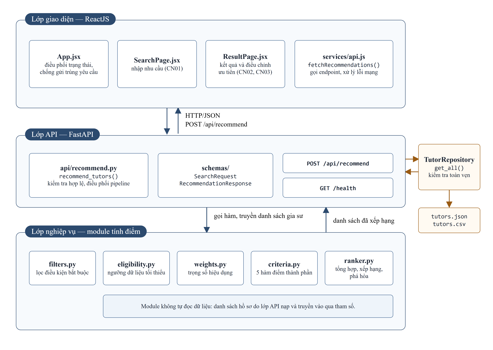
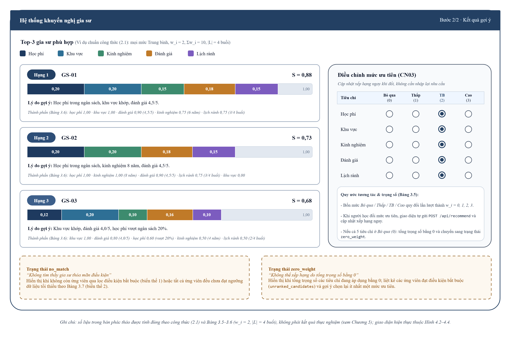

# CHƯƠNG 3. PHÂN TÍCH VÀ THIẾT KẾ HỆ THỐNG

Chương này chuyển yêu cầu ở Chương 1–2 thành thiết kế cụ thể: phát biểu bài toán (Mục 3.1), yêu cầu chức năng (Mục 3.2) và phi chức năng (Mục 3.3), mô hình hóa mức độ phù hợp (Mục 3.4), thiết kế dữ liệu (Mục 3.5), thiết kế thuật toán (Mục 3.6), kiến trúc và luồng xử lý (Mục 3.7), thiết kế giao diện (Mục 3.8).

---

## 3.1. Phát biểu bài toán

Trong báo cáo này, “người học” chỉ học sinh hoặc phụ huynh thay mặt học sinh; thuật ngữ này được dùng thống nhất cho tác nhân duy nhất của hệ thống (không có tác nhân quản trị hay tác nhân hệ thống ngoài).

**Đầu vào:** nhu cầu của người học gồm môn học cần tìm, hình thức học, khu vực mong muốn, ngân sách tối đa theo giờ, khung thời gian rảnh, cùng mức ưu tiên cho từng tiêu chí.

**Đầu ra:** danh sách Top-$k$ gia sư thỏa các điều kiện bắt buộc, xếp hạng giảm dần theo điểm phù hợp, kèm điểm thành phần và lý do gợi ý. Trường hợp không có gia sư nào thỏa điều kiện bắt buộc, hệ thống thông báo rõ thay vì trả về danh sách rỗng không giải thích.

## 3.2. Yêu cầu chức năng

Ở quy mô đồ án học phần, hệ thống tập trung vào ba chức năng cốt lõi (Bảng 3.1).

**Bảng 3.1 - Danh sách chức năng chính**

| Mã | Tên chức năng | Mô tả |
|:---:|:---|:---|
| CN01 | Nhập nhu cầu và mức ưu tiên | Người học nhập môn học, hình thức học, khu vực, ngân sách, khung thời gian rảnh và chọn mức ưu tiên cho từng tiêu chí |
| CN02 | Xem danh sách gợi ý kèm điểm | Hệ thống trả về Top-$k$ gia sư xếp hạng theo điểm phù hợp, kèm điểm từng tiêu chí thành phần và lý do gợi ý; thông báo rõ khi không có gia sư thỏa điều kiện bắt buộc |
| CN03 | Điều chỉnh mức ưu tiên minh họa | Người học thay đổi mức ưu tiên của từng tiêu chí và quan sát danh sách xếp hạng lại tương ứng |

*Nguồn: thiết kế chức năng của nhóm (Mục 3.2).*

## 3.3. Yêu cầu phi chức năng

- **Hiệu năng:** API phản hồi dưới một giây với tập dữ liệu mẫu quy mô vài trăm bản ghi. Đây là ngưỡng phù hợp cho minh họa thuật toán, không phải chỉ tiêu vận hành của hệ thống thực tế; mức đạt được khi chạy thực tế trình bày ở Mục 5.1.2.
- **Khả năng mở rộng:** module tính điểm tách rời phần API và giao diện để có thể thêm tiêu chí mới hoặc thay công thức (ví dụ chuyển sang hướng Hybrid) mà không viết lại toàn bộ hệ thống.
- **Khả năng giải thích:** mọi kết quả phải kèm điểm thành phần và đóng góp của từng tiêu chí vào điểm tổng.
- **Khả năng tái lập:** tham số của các hàm điểm (Mục 3.6) và bộ trọng số mặc định lưu ở một nơi cấu hình riêng để lặp lại được các kịch bản đánh giá.

## 3.4. Mô hình hóa mức độ phù hợp

Mỗi tiêu chí được phân vào một trong ba loại: bắt buộc (không thỏa thì loại), ưu tiên (tính điểm để xếp hạng) và tùy chọn (chỉ tính khi người học thực sự quan tâm). Bảng 3.2 nêu cách phân loại và cách xử lý.

**Bảng 3.2 - Phân loại tiêu chí**

| Tiêu chí | Loại | Cách xử lý | Lý do |
|:---|:---|:---|:---|
| Môn học | Bắt buộc | Người học chọn một môn mỗi lần tìm; gia sư phải dạy môn đó | Sai môn thì không có giá trị, dù điểm khác cao |
| Hình thức học | Bắt buộc có điều kiện | Nếu người học chọn Trực tiếp hoặc Trực tuyến: gia sư phải dạy hình thức đó (gia sư “Cả hai” thỏa cả hai). Nếu chọn “Không yêu cầu”: không lọc | Hình thức không tương thích thì không học được |
| Lịch rảnh | Bắt buộc có điều kiện + ưu tiên | Nếu người học nhập khung giờ: phải có ít nhất một khung giờ giao nhau (lọc); số khung giờ giao càng nhiều điểm càng cao (chấm điểm) | Không có giờ chung thì không thể học |
| Học phí | Ưu tiên (ngân sách mềm) | Học phí không vượt ngân sách: điểm tối đa; vượt thì điểm giảm dần, không loại ngay | Cho phép chấp nhận vượt nhẹ nếu gia sư tốt (theo động lực ở Mục 1.1) |
| Khu vực | Ưu tiên | Chỉ áp dụng khi người học chọn Trực tiếp hoặc “Không yêu cầu” hình thức và có nhập khu vực; nếu học Trực tuyến thì không áp dụng | Học trực tuyến không phụ thuộc vị trí |
| Kinh nghiệm | Ưu tiên | Càng nhiều năm càng tốt, có mức trần; người học không nhập yêu cầu tối thiểu | Giữ đầu vào đơn giản |
| Đánh giá | Ưu tiên | Điểm trung bình càng cao càng tốt; người học không nhập yêu cầu tối thiểu | Giữ đầu vào đơn giản |

*Nguồn: thiết kế của nhóm (Mục 3.4).*

Tiêu chí tùy chọn trong đồ án là các tiêu chí ưu tiên mà người học đặt mức “Không quan tâm” (trọng số $0$) — khi đó tiêu chí bị bỏ qua hoàn toàn. Các quy tắc ở Bảng 3.2 là quyết định thiết kế của nhóm, không phải quy luật có sẵn; nếu thay đổi (ví dụ chuyển ngân sách thành ràng buộc cứng), Mục 3.6 và các kịch bản ở Chương 5 phải được cập nhật tương ứng.

## 3.5. Thiết kế dữ liệu

Vì dữ liệu chỉ lưu dạng JSON và CSV, không có quan hệ khóa ngoại giữa nhiều bảng, đồ án không xây dựng sơ đồ ER; cấu trúc bản ghi của hai đối tượng dữ liệu chính được mô tả trực tiếp ở Bảng 3.3 và Bảng 3.4.

**Bảng 3.3 - Cấu trúc bản ghi hồ sơ gia sư**

| Trường dữ liệu | Ý nghĩa |
|:---|:---|
| `id` | Mã gia sư (dạng `GS001`), thay cho họ tên để tránh dùng thông tin cá nhân không cần thiết |
| `môn_dạy` | Một hoặc nhiều môn học gia sư đảm nhận |
| `khu_vực` | Danh sách khu vực gia sư dạy trực tiếp; để trống nếu chỉ dạy trực tuyến |
| `học_phí_giờ` | Đơn giá theo giờ (VNĐ) |
| `số_năm_kinh_nghiệm` | Số năm kinh nghiệm, dùng để tính điểm kinh nghiệm |
| `hình_thức_dạy` | Trực tiếp / Trực tuyến / Cả hai |
| `lịch_rảnh` | Tập khung giờ rảnh trong tuần; mỗi khung là một ô (ngày trong tuần × buổi sáng/chiều/tối) |
| `điểm_đánh_giá_tb` | Điểm đánh giá trung bình (thang 5); có thể trống nếu gia sư chưa có đánh giá |
| `nguồn_dữ_liệu` | Thu thập công khai / Giả lập — tách rõ dữ liệu thật và dữ liệu giả lập |

*Nguồn: thiết kế của nhóm (Mục 3.5); ánh xạ sang định danh mã nguồn tại `docs/design/data-dictionary.md`.*

**Bảng 3.4 - Cấu trúc bản ghi nhu cầu của người học**

| Trường dữ liệu | Ý nghĩa |
|:---|:---|
| `môn_học` | Môn học cần tìm gia sư (chọn một môn) |
| `hình_thức_học` | Trực tiếp / Trực tuyến / Không yêu cầu |
| `khu_vực_mong_muốn` | Một khu vực, hoặc để trống nếu không yêu cầu |
| `ngân_sách_tối_đa` | Mức học phí tối đa mỗi giờ người học mong muốn (VNĐ), hoặc để trống |
| `khung_thời_gian` | Tập khung giờ rảnh của người học (cùng cách chia ô như `lịch_rảnh`), hoặc để trống |
| `mức_ưu_tiên` | Mức ưu tiên của năm tiêu chí: học phí, khu vực, kinh nghiệm, đánh giá, lịch rảnh |

*Nguồn: thiết kế của nhóm (Mục 3.5); ánh xạ sang định danh mã nguồn tại `docs/design/data-dictionary.md`.*

**Mức ưu tiên và trọng số.** Thay vì yêu cầu người học tự chỉnh năm tỷ lệ phần trăm, mỗi tiêu chí được chọn một trong bốn mức và quy đổi thành trọng số theo Bảng 3.5. Mặc định mọi tiêu chí ở mức “Trung bình” (trọng số bằng nhau); đây chỉ là giá trị khởi tạo để minh họa, không phải bộ cấu hình đã được kiểm chứng.

**Bảng 3.5 - Quy đổi mức ưu tiên sang trọng số**

| Mức ưu tiên | Trọng số $w_i$ |
|:---|---:|
| Không quan tâm | 0 |
| Thấp | 1 |
| Trung bình (mặc định) | 2 |
| Cao | 3 |

*Nguồn: thiết kế của nhóm (Mục 3.5); hiện thực tại `backend/app/core/config.py` (`PRIORITY_WEIGHTS`).*

**Nguyên tắc thiết kế dữ liệu mẫu.** Dữ liệu mẫu được thiết kế để kiểm thử thuật toán chứ không chỉ để hệ thống chạy được. Bản ghi thu thập từ hồ sơ công khai và bản ghi giả lập được đánh dấu riêng qua trường `nguồn_dữ_liệu`, không lưu họ tên hay thông tin liên hệ. Tập dữ liệu phải bảo đảm năm yêu cầu:
- Có các trường hợp xung đột tiêu chí (ví dụ gia sư rẻ nhưng ít kinh nghiệm so với gia sư đắt nhưng đánh giá cao).
- Có các cặp gia sư chỉ khác nhau ở đúng một tiêu chí để kiểm tra từng hàm điểm.
- Có ít nhất một tình huống không có gia sư nào thỏa điều kiện bắt buộc.
- Có một số gia sư chưa có điểm đánh giá.
- Không tạo dữ liệu theo cách vô tình làm thuật toán luôn cho kết quả thuận lợi một cách giả tạo.

Danh mục khu vực do nhóm tự quy ước và ghi rõ trong Phụ lục A, vì phân chia đơn vị hành chính cấp dưới tỉnh/thành đã có thay đổi trong thời gian gần đây và đồ án không cần phụ thuộc vào cách phân chia đó.

## 3.6. Thiết kế thuật toán

Quy trình tính điểm gồm bốn bước:

- **Bước 1.** Kiểm tra và chuẩn hóa đầu vào (ví dụ ngân sách không âm, bắt buộc có môn học).
- **Bước 2.** Lọc điều kiện bắt buộc theo Bảng 3.2; nếu không còn gia sư nào, trả về thông báo “không có gia sư thỏa điều kiện”.
- **Bước 3.** Tính điểm thành phần $s_i \in [0, 1]$ cho các tiêu chí ưu tiên theo Bảng 3.6.
- **Bước 4.** Gộp bằng công thức Weighted Scoring (2.1), sắp xếp giảm dần theo $S$ (đồng điểm thì xếp theo mã gia sư để kết quả ổn định), lấy Top-$k$ và trả kèm điểm thành phần cùng đóng góp $w_i \times s_i \div \sum w_i$ của từng tiêu chí.

**Bảng 3.6 - Công thức điểm thành phần**

| Tiêu chí | Đầu vào | Công thức điểm $s_i$ | Tham số | Ví dụ |
|:---|:---|:---|:---|:---|
| Học phí | $P$: học phí gia sư; $B$: ngân sách | $s = 1$ nếu $P \le B$; $s = \max(0, 1 - (P - B) \div (\delta \times B))$ nếu $P > B$ | $\delta = 0{,}5$ (vượt 50% ngân sách thì điểm về 0) | $B = 200.000$: $P = 180.000 \rightarrow 1{,}00$; $P = 230.000 \rightarrow 0{,}70$; $P = 300.000 \rightarrow 0{,}00$ |
| Khu vực | $K$: khu vực người học; tập khu vực của gia sư | $s = 1$ nếu $K$ thuộc khu vực dạy của gia sư; ngược lại $s = 0$ | Không áp dụng nếu học Trực tuyến hoặc không nhập $K$ | $K = \text{KV1}$: gia sư dạy $\{\text{KV1}, \text{KV2}\} \rightarrow 1$; gia sư dạy $\{\text{KV3}\} \rightarrow 0$; chỉ trực tuyến $\rightarrow 0$ |
| Kinh nghiệm | $E$: số năm kinh nghiệm | $s = \min(E \div E_{\max}, 1)$ | $E_{\max} = 8$ | $E = 0 \rightarrow 0{,}00$; $E = 4 \rightarrow 0{,}50$; $E = 10 \rightarrow 1{,}00$ |
| Đánh giá | $R$: điểm trung bình (thang 5) | $s = R \div 5$; nếu chưa có đánh giá thì $s = 0{,}5$ (giá trị trung tính) | Giá trị trung tính $0{,}5$ | $R = 5 \rightarrow 1{,}00$; $R = 4{,}5 \rightarrow 0{,}90$; $R = 3 \rightarrow 0{,}60$ |
| Lịch rảnh | $L$: khung giờ người học; $T$: khung giờ gia sư | $s = \lvert L \cap T \rvert \div \lvert L \rvert$ (Bước 2 đã bảo đảm $\lvert L \cap T \rvert \ge 1$) | Không áp dụng nếu người học không nhập $L$ | $L$ có 3 khung, giao 2 khung $\rightarrow 2/3 \approx 0{,}67$; $L$ có 7 khung, giao 6 khung $\rightarrow 6/7 \approx 0{,}86$; $L$ có 4 khung, giao 1 khung $\rightarrow 1/4 = 0{,}25$ |

*Nguồn: thiết kế của nhóm (Mục 3.6); hiện thực tại `backend/app/scoring/criteria.py`, đối chiếu chi tiết trong `docs/design/scoring-spec.md` mục 4.*

**Cơ sở của các tham số.** Các tham số $\delta = 0{,}5$ và $E_{\max} = 8$ là giá trị khởi tạo do nhóm thiết lập để minh họa, được khảo sát độ nhạy ở Mục 5.2. Các hàm điểm được thiết kế đơn điệu: học phí tăng thì điểm không tăng; kinh nghiệm, đánh giá và số khung giờ giao tăng thì điểm không giảm. Tính chất này được kiểm tra bằng các ca biên ở Mục 5.1.

**Các trường hợp đặc biệt:**

- Người học chọn học Trực tuyến: tiêu chí khu vực không áp dụng, bị loại khỏi cả tử số và mẫu số của công thức tổng hợp.
- Người học không nhập ngân sách, khu vực hoặc khung giờ: tiêu chí tương ứng không áp dụng, xử lý như trên.
- Tiêu chí có mức “Không quan tâm” ($w = 0$): không được tính.
- Tổng trọng số của các tiêu chí đang áp dụng bằng 0: không thể xếp hạng. Khi đó, hệ thống hiển thị danh sách gia sư thỏa điều kiện bắt buộc kèm thông báo yêu cầu người học chọn ít nhất một tiêu chí ưu tiên.
- Gia sư chưa có điểm đánh giá: dùng giá trị trung tính $0{,}5$ và ghi chú “chưa có đánh giá” trên giao diện; đây là giải pháp tạm, được ghi nhận ở Mục 5.3.

**Điều kiện đủ dữ liệu để được xếp hạng.** Sau bước lọc điều kiện bắt buộc và trước bước tính điểm có trọng số, hệ thống đếm số tiêu chí ưu tiên mà gia sư có dữ liệu trong số các tiêu chí ưu tiên đang áp dụng của truy vấn đó (ký hiệu $n$). Tiêu chí Đánh giá không tính vào $n$ vì luôn dùng được nhờ giá trị trung tính $0{,}5$. Nếu số tiêu chí có dữ liệu nhỏ hơn ngưỡng tối thiểu tương ứng với $n$ (Bảng 3.7), gia sư bị loại khỏi kết quả xếp hạng của truy vấn này với ghi chú “Không đủ dữ liệu để xếp hạng”, không tính điểm trên phần dữ liệu thiếu hụt. Công thức tính điểm của từng tiêu chí giữ nguyên.

**Bảng 3.7 - Ngưỡng dữ liệu tối thiểu để được xếp hạng**

| Số tiêu chí ưu tiên đang áp dụng ($n$) | Ngưỡng tối thiểu phải có dữ liệu |
|:---:|:---:|
| 1 | 1 |
| 2 | 2 |
| 3 | 2 |
| 4 | 3 |
| 5 | 4 |

*Nguồn: thiết kế của nhóm (Mục 3.6); hiện thực tại `backend/app/scoring/eligibility.py` (`MIN_DATA_THRESHOLD`, kèm hàng $n = 0 \rightarrow$ ngưỡng $0$), đối chiếu `docs/design/scoring-spec.md` mục 3 và 7.*

*Ghi chú:* hàng $n = 5$ được giữ nguyên nhưng không kích hoạt, vì tiêu chí Đánh giá không tính vào $n$ nên $n$ tối đa là $4$. Khi $n = 0$ (chỉ tiêu chí Đánh giá có trọng số lớn hơn $0$), ngưỡng tối thiểu là $0$, tức là không loại gia sư nào vì thiếu dữ liệu.

**Ví dụ tính điểm đầy đủ** (ví dụ minh họa công thức, không phải dữ liệu thực). Người học cần môn Toán, học Trực tiếp, khu vực KV1, ngân sách $200.000$ đồng/giờ, khung giờ $L = \{\text{T2-tối}, \text{T4-tối}, \text{T7-sáng}\}$, mọi mức ưu tiên là “Trung bình” ($w = 2$). Xét một gia sư dạy Toán, hình thức “Cả hai”, dạy tại KV1, học phí $230.000$ đồng/giờ, kinh nghiệm $4$ năm, đánh giá $4{,}5$ và giao được $2$ trong $3$ khung giờ. Gia sư này vượt qua bước lọc và nhận các điểm thành phần: học phí $0{,}70$; khu vực $1{,}00$; kinh nghiệm $0{,}50$; đánh giá $0{,}90$; lịch rảnh $0{,}67$. Điểm tổng hợp là $S = (0{,}70 + 1{,}00 + 0{,}50 + 0{,}90 + 0{,}67) \div 5 \approx 0{,}75$ (khi không làm tròn từng thành phần, $S = 113/150 \approx 0{,}753$ — cùng kết luận xếp hạng).

## 3.7. Kiến trúc hệ thống và luồng xử lý

### 3.7.1. Luồng xử lý ở mức logic bài toán

Luồng xử lý độc lập với công nghệ triển khai và gồm tám bước:
1. Người học nhập nhu cầu và mức ưu tiên.
2. Kiểm tra, chuẩn hóa tiêu chí đầu vào.
3. Lọc các gia sư không thỏa điều kiện bắt buộc.
4. Tính điểm phù hợp theo từng tiêu chí ưu tiên.
5. Tổng hợp điểm theo trọng số.
6. Xếp hạng các gia sư còn lại.
7. Trả Top-$k$ kèm điểm thành phần và lý do gợi ý.
8. Người học điều chỉnh mức ưu tiên và xem thứ hạng thay đổi.

Hình 3.1 minh họa luồng tám bước này cùng bước kiểm tra ngưỡng dữ liệu tối thiểu (Bảng 3.7) sau bước (3). Sơ đồ cũng thể hiện các nhánh thông báo khi không còn gia sư thỏa điều kiện bắt buộc, khi tổng trọng số bằng $0$ và khi đầu vào không hợp lệ.

**Hình 3.1 - Sơ đồ luồng xử lý khuyến nghị**

*Nguồn: thiết kế của nhóm (Mục 3.7.1); đối chiếu mã nguồn `backend/app/api/recommend.py` và `backend/app/scoring/`.*

### 3.7.2. Kiến trúc ba lớp

Hệ thống được tổ chức thành ba lớp tách biệt:
- Giao diện ReactJS nhận nhu cầu từ người học và gửi yêu cầu đến API.
- Lớp API (FastAPI) tiếp nhận yêu cầu, kiểm tra hợp lệ, nạp danh sách gia sư mẫu từ `TutorRepository` rồi truyền cho module tính điểm.
- Module tính điểm thực hiện quy trình ở Mục 3.6 và trả danh sách đã xếp hạng để API phản hồi lại giao diện.

Hình 3.2 mô tả kiến trúc ba lớp này.

**Hình 3.2 - Kiến trúc hệ thống ba lớp**

*Nguồn: thiết kế của nhóm (Mục 3.7.2); đối chiếu `backend/app/main.py`, `backend/app/data/repository.py` và thư mục `frontend/src/`.*

Vì hệ thống chỉ có một luồng xử lý đi qua một module tính điểm và không có nhiều đối tượng nghiệp vụ tương tác qua nhiều lớp điều khiển, nhóm không áp dụng mô hình BCE (*Boundary-Control-Entity*). Thay vào đó, tương tác giữa các thành phần được mô tả trực tiếp qua sơ đồ trình tự: client → API → module tính điểm → kết quả (Hình 3.3).

**Hình 3.3 - Sơ đồ trình tự: client → API → module tính điểm → kết quả**

*Nguồn: thiết kế của nhóm (Mục 3.7.2); tên hàm theo mã nguồn tại thời điểm viết báo cáo.*

## 3.8. Thiết kế giao diện

Giao diện demo gồm hai màn hình. Màn hình nhập nhu cầu cho phép chọn môn học, hình thức học, khu vực, ngân sách, khung thời gian rảnh và chọn mức ưu tiên (Không quan tâm / Thấp / Trung bình / Cao) cho từng tiêu chí (Hình 3.4). Màn hình kết quả hiển thị mã định danh của Top-$k$ gia sư, kèm điểm tổng, điểm từng tiêu chí và biểu đồ thanh xếp chồng thể hiện đóng góp của từng tiêu chí để người học hiểu vì sao một gia sư được xếp cao. Người học có thể đổi mức ưu tiên ngay tại màn hình kết quả để xem danh sách xếp hạng lại (CN03, Hình 3.5). Hai hình dưới đây là phác thảo bố cục; giao diện hiện thực của hệ thống được trình bày ở Hình 4.1–4.4.

**Hình 3.4 - Phác thảo màn hình nhập nhu cầu**

*Nguồn: thiết kế của nhóm (Mục 3.8); bố cục theo Bảng 3.4 và Bảng 3.5.*

**Hình 3.5 - Phác thảo màn hình kết quả**

*Nguồn: thiết kế của nhóm (Mục 3.8); số liệu trong hình là ví dụ minh họa bố cục, không phải kết quả thực nghiệm (xem Chương 5).*
