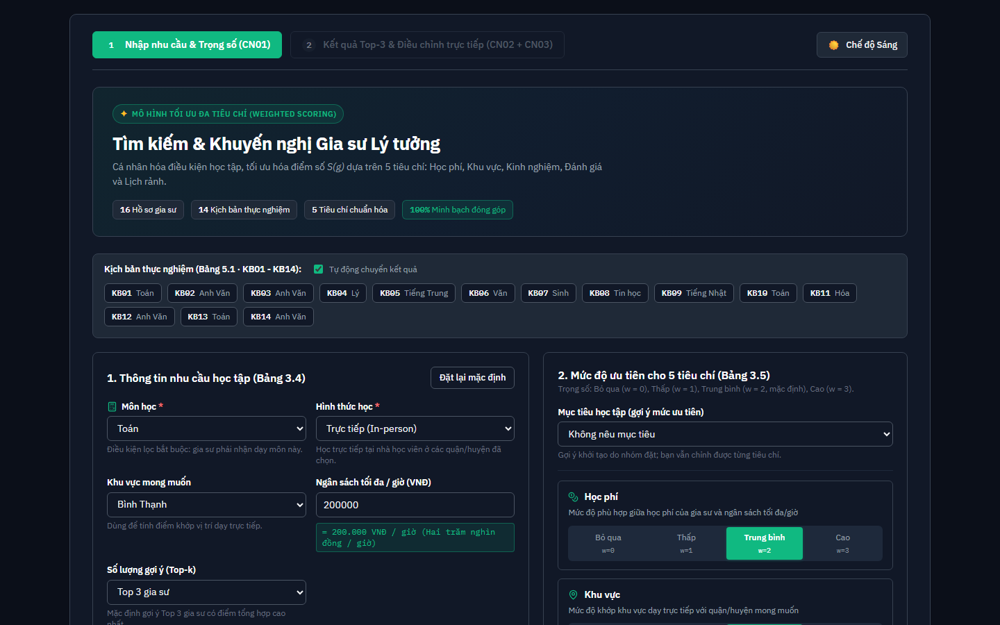
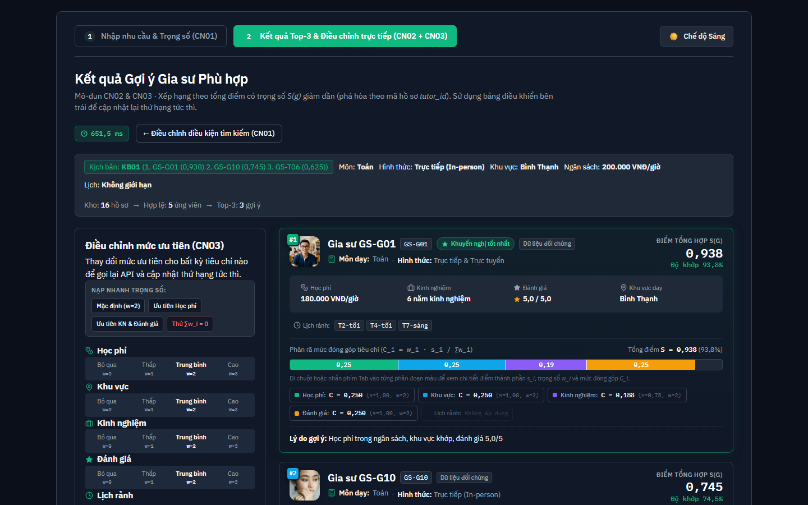
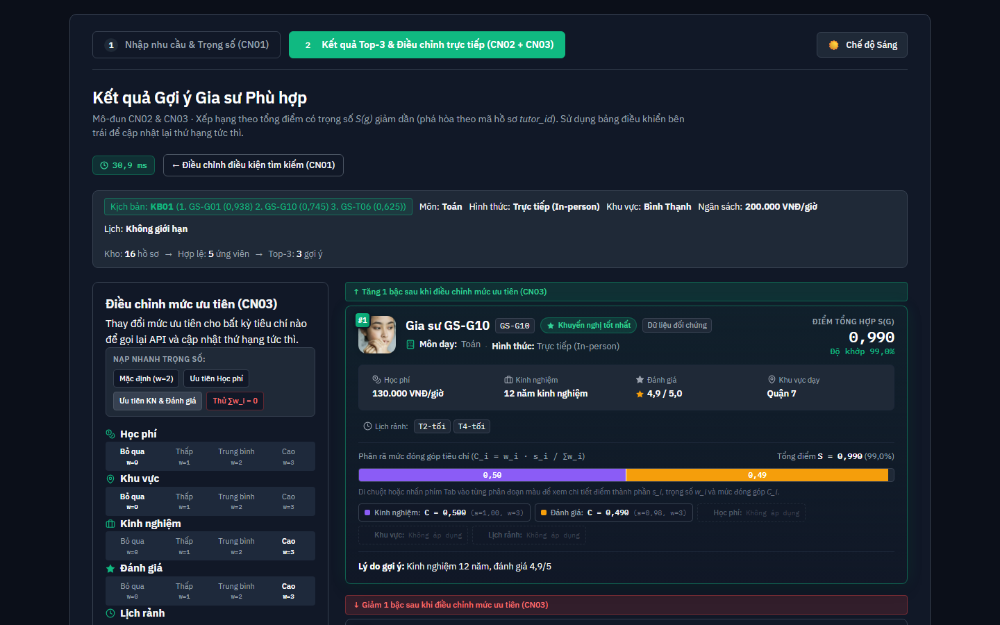
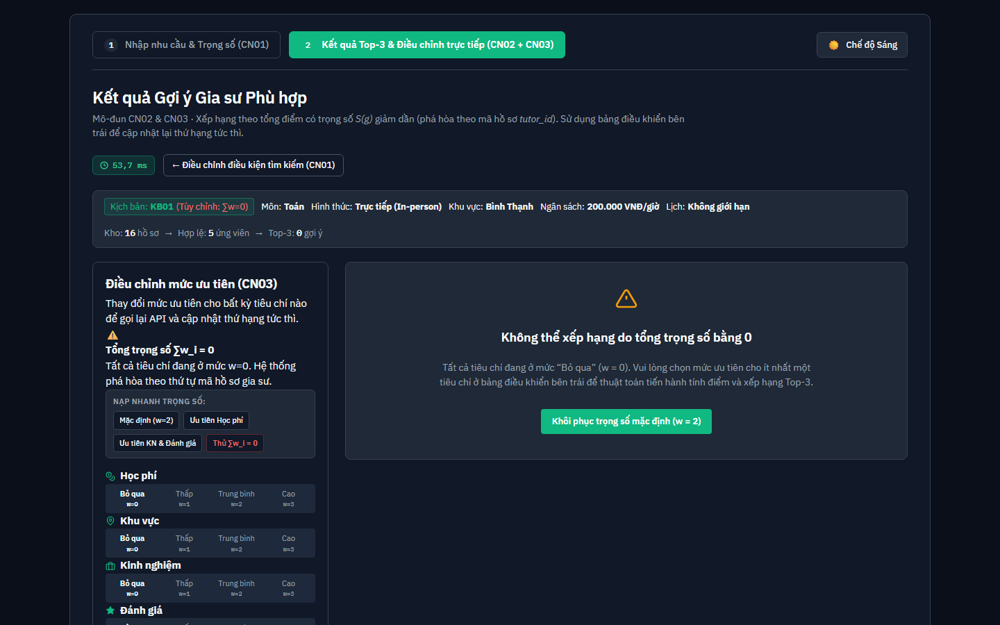

# CHƯƠNG 4. XÂY DỰNG HỆ THỐNG

> [!NOTE]
> **Đề xuất, nhóm xác nhận**

Chương này trình bày quá trình hiện thực hệ thống khuyến nghị gia sư thuộc đề tài "Hệ thống khuyến nghị gia sư dựa trên phương pháp Content-Base Filtering" theo sáu mục của kế hoạch hiện thực trong đề cương: chuẩn bị môi trường phát triển (4.1), xây dựng tập dữ liệu mẫu (4.2), cài đặt module tính điểm (4.3), xây dựng API gợi ý (4.4), xây dựng giao diện demo (4.5) và tích hợp giao diện với API cùng kiểm tra luồng end-to-end (4.6). Mô tả trong chương phản ánh đúng những gì đã được hiện thực trong kho mã nguồn trên nhánh chính `origin/main` (tại thời điểm soạn chương, 2026-11); mọi tên tệp, tên hàm và phiên bản phần mềm nêu dưới đây đều truy ngược được về tệp tương ứng hoặc là output của lệnh chạy lại được. Những điểm mà kế hoạch trong đề cương khác với hiện thực (ví dụ cơ sở dữ liệu SQLite) được nêu thẳng tại từng mục. Số liệu kiểm thử định lượng không lập lại trong chương này mà dẫn về Chương 5.

---

## 4.1. Chuẩn bị môi trường phát triển

Nhóm tách hệ thống thành hai thư mục độc lập: `backend/` (dịch vụ API) và `frontend/` (giao diện), cùng thư mục dữ liệu dùng chung `data/processed/`. Phiên bản các thư viện được ghim tĩnh: phía Python bằng tệp `backend/requirements.txt` và `backend/requirements-dev.txt` (theo chú thích trong tệp, phiên bản ghim từ `pip freeze` của môi trường Python 3.12), phía JavaScript bằng `frontend/package.json` và `frontend/package-lock.json`.

**Bảng 4.1 - Thành phần và công nghệ của hệ thống tại thời điểm hiện thực**

| Thành phần | Công nghệ (phiên bản) | Vai trò |
|:---|:---|:---|
| Nền tảng backend | Python 3.12.7 (môi trường ảo `.venv`; đo bằng `python --version`) | Nền tảng chạy dịch vụ và kiểm thử |
| Khung API | FastAPI 0.162.0 | Định nghĩa endpoint, sinh tài liệu OpenAPI |
| Xác thực dữ liệu | Pydantic 2.14.2 | Mô hình hóa hồ sơ, yêu cầu và phản hồi; kiểm tra ràng buộc đầu vào |
| Máy chủ ASGI | Uvicorn 0.54.0 (gói `uvicorn[standard]`) | Khởi chạy dịch vụ HTTP |
| Nền tảng frontend | Node.js (yêu cầu `^20.19.0 \|\| >=22.12.0` theo README; máy nhóm chạy Node v24.19.0, npm 11.17.0) | Môi trường dựng và đóng gói |
| Thư viện giao diện | React 19.3.1, React DOM 19.3.1 | Giao diện Single Page Application hai màn hình |
| Công cụ dựng | Vite 8.3.5, `@vitejs/plugin-react` 6.1.2 | Build và phát triển cục bộ (sinh thư mục `dist/`) |
| Hiệu ứng chuyển cảnh | motion 14.9.0 | Chuyển động giữa hai màn hình, thanh xếp chồng, huy hiệu biến động hạng |
| Lưu trữ dữ liệu | Tệp `data/processed/tutors.json` và `tutors.csv` | 16 hồ sơ gia sư chuẩn hóa (không dùng cơ sở dữ liệu, xem Mục 4.2) |

*Ghi chú:* `frontend/package.json` còn khai báo thư viện `boring-avatars` 2.0.4 nhưng trong mã nguồn `frontend/src/` không có tệp nào import thư viện này; thành phần avatar `TutorAvatar.jsx` tự dựng ảnh chân dung WebP kèm fallback (Mục 4.5).

*Nguồn: `backend/requirements.txt`, `backend/requirements-dev.txt`, `frontend/package.json`, `frontend/package-lock.json` (lockfileVersion 3; react 19.3.1, vite 8.3.5, @vitejs/plugin-react 6.1.2, motion 14.9.0, oxlint 1.90.0); đo lường môi trường bằng lệnh `python --version`, `node --version`, `npm --version`.*

Về công cụ chất lượng, phía backend dùng pytest 9.2.0 (cấu hình tại `backend/pytest.ini` với `testpaths = tests` và `pythonpath = .`), pytest-cov 7.1.0 (đo độ bao phủ), httpx 0.28.1 (cung cấp `TestClient` cho kiểm thử tích hợp API) và ruff 0.17.3 (kiểm tra định dạng mã nguồn). Phía frontend dùng oxlint 1.90.0 với cấu hình `frontend/.oxlintrc.json` (kích hoạt quy tắc `react/rules-of-hooks` ở mức error) và hai script `npm run lint`, `npm run build`.

Trình tự chất lượng được tự động hóa bằng GitHub Actions tại `.github/workflows/ci.yml` (workflow `CI backend`): với mỗi `push` vào nhánh `main` và mỗi pull request, CI dựng môi trường `ubuntu-latest`, cài Python 3.12 (có cache pip theo hai tệp requirements), cài phụ thuộc, rồi chạy `ruff check .` và `pytest` trong thư mục `backend/`. Cần nêu rõ giới hạn: CI hiện chỉ bao phủ backend; frontend chưa có job riêng trong CI (oxlint và `vite build` được trình bày trong README mục 7 dưới dạng lệnh chạy từ terminal). Cấu trúc thư mục chi tiết và ánh xạ từng thư mục vào mục đề cương đã trình bày ở README mục 3, chương này không lặp lại.

## 4.2. Xây dựng tập dữ liệu mẫu

### 4.2.1. Định dạng lưu trữ

Dữ liệu được lưu bằng hai tệp đồng bộ: `data/processed/tutors.json` (nạp cho chương trình) và `data/processed/tutors.csv` (đối chiếu bằng mắt, phục vụ Phụ lục A). Đề cương thiết kế cho phép lưu bằng "JSON/CSV hoặc SQLite"; hiện thực cuối cùng chỉ dùng JSON và CSV. Trong tài liệu của repo không có bản ghi nêu lý do riêng cho việc này; lý do kỹ thuật để nêu là bộ dữ liệu gồm bản ghi phẳng 9 trường theo Bảng 3.3, không có quan hệ nhiều bảng cần cơ sở dữ liệu quan hệ (theo Mục 3.5 đề cương). Việc chuyển sang "bảng SQLite đơn" nằm ở User Story US-37, xếp hạng `Could Have` trong `docs/scrum/roadmap.md`, chưa xếp vào sprint nào nên chưa hiện thực; hai docstring `backend/app/data/repository.py` và `backend/app/core/config.py` vẫn ghi tên SQLite như một phương án lưu trữ dự kiến, nhưng lớp `TutorRepository` mới chỉ đọc tệp JSON.

### 4.2.2. Cấu trúc dữ liệu

Cấu trúc bản ghi được mã hóa thành các mô hình Pydantic tại `backend/app/schemas/`, ánh xạ từ Bảng 3.3 và Bảng 3.4 của đề cương theo `docs/design/data-dictionary.md` (từ điển dữ liệu chuyển tên trường tiếng Việt thành định danh tiếng Anh).

**Bảng 4.2 - Ánh xạ trường dữ liệu đề cương sang định danh trong code (rút gọn từ data-dictionary.md)**

| Nhóm | Trường trong đề cương | Định danh trong code | Kiểu trong code |
|:---|:---|:---|:---|
| Hồ sơ gia sư (Bảng 3.3) | `id` | `tutor_id` | `string` |
| | `môn_dạy` | `subjects` | `list[string]` |
| | `khu_vực` | `districts` | `list[string]` (rỗng nếu chỉ dạy trực tuyến) |
| | `học_phí_giờ` | `hourly_fee_vnd` | `int \| None` |
| | `số_năm_kinh_nghiệm` | `years_experience` | `float \| None` |
| | `hình_thức_dạy` | `teaching_mode` | enum `in_person`, `online`, `both` |
| | `lịch_rảnh` | `availability` | `list[string]` |
| | `điểm_đánh_giá_tb` | `avg_rating` | `float \| None` (null nếu chưa có đánh giá) |
| | `nguồn_dữ_liệu` | `data_source` | enum `public_collected`, `simulated`, `estimated` |
| Nhu cầu người học (Bảng 3.4) | `môn_học` | `subject` | `string` (bắt buộc, không chỉ khoảng trắng) |
| | `hình_thức_học` | `learning_mode` | enum `in_person`, `online`, `any` |
| | `khu_vực_mong_muốn` | `preferred_district` | `string \| None` |
| | `ngân_sách_tối_đa` | `max_budget_vnd` | `StrictInt \| None` (`ge = 0`) |
| | `khung_thời_gian` | `time_slots` | `list[string] \| None` |
| | `mức_ưu_tiên` | `priorities` | `dict[enum tiêu chí, enum none/low/medium/high]` |
| | (thêm so với đề cương) | `top_k` | `StrictInt`, mặc định 3, ràng buộc `1 ≤ top_k ≤ 20` |

Hai mô hình đều đặt `extra="forbid"` — bản ghi chứa trường thừa sẽ bị từ chối, giúp phát hiện lệch hợp đồng dữ liệu sớm. Trường `top_k` là bổ sung so với Bảng 3.4, thuộc hợp đồng API (giới hạn 1–20, trả 422 khi vi phạm).

*Nguồn: `docs/design/data-dictionary.md`; `backend/app/schemas/tutor.py`, `backend/app/schemas/search_request.py` (các ràng buộc `Field`, `StrictInt`, `field_validator`).*

### 4.2.3. Nguồn và nhãn dữ liệu

Tập dữ liệu gồm đúng 16 hồ sơ: 2 hồ sơ thu thập công khai `GS-T06`, `GS-T07` (nhãn `public_collected`) và 14 hồ sơ mô phỏng `GS006`, `GS020`, `GS-G01` đến `GS-G12` (nhãn `simulated`). Theo `data/README.md` mục 3, môn dạy, khu vực và số năm kinh nghiệm của hai hồ sơ thu thập là số liệu thật đã ẩn danh; học phí và lịch rảnh là ước tính của nhóm (nội suy theo số năm kinh nghiệm từ khoảng giá quan sát được tại daythem.com 130.000–400.000 VNĐ/giờ; lịch rảnh là giả định theo các khung giờ phổ biến), được đánh dấu hoa thị `(*)` ở Phụ lục A. Điểm đánh giá trung bình của hai hồ sơ này để trống và nhận giá trị trung tính 0,5 khi tính điểm. `data/README.md` mục 3 cũng ghi nhận một điểm lệch đang chờ nhóm quyết định: quy ước nhãn `estimated` chưa được dùng cho hai hồ sơ ước tính, `data_source` vẫn giữ `public_collected` theo Phụ lục A.

Tài liệu `data/README.md` mục 4 ghi nhận một hiệu chỉnh dữ liệu: nhãn môn dạy của `GS-G03` sửa từ "Tiếng Anh" thành "Anh Văn" để đồng nhất với các hồ sơ tiếng Anh khác và để kịch bản KB14 có ứng viên (ngày 2026-11-01, theo ghi chú trong tệp). Kiểm tra tệp `tutors.json` hiện tại xác nhận `GS-G03` có `subjects: ["Anh Văn"]`.

### 4.2.4. Kiểm tra toàn vẹn dữ liệu

Script `scripts/validate_tutors.py` (chỉ đọc, không chứa công thức tính điểm) kiểm tra 5 nhóm điều kiện: số lượng và tỷ lệ nguồn; tính duy nhất của `tutor_id` trong JSON và CSV; đủ 9 trường với kiểu và enum hợp lệ; không chứa dấu hiệu thông tin định danh cá nhân (số điện thoại, email, từ khóa liên hệ) theo nguyên tắc ẩn danh ở Mục 3.5; và sự khớp từng ô giữa JSON với CSV. Kết quả chạy lại tại thư mục gốc worktree (Python 3.12.7):

```text
ĐẠT: 16 bản ghi (2 public_collected, 14 simulated); id duy nhất; enum hợp lệ;
     đủ 9 trường; không có thông tin liên hệ; JSON và CSV khớp nhau từng ô.
```

### 4.2.5. Nguyên tắc thiết kế dữ liệu và minh chứng trong 16 hồ sơ

Bốn nguyên tắc thiết kế dữ liệu đều tìm thấy minh chứng cụ thể trong `data/processed/tutors.json`:

1. **Tạo xung đột tiêu chí:** cặp `GS-G09` (học phí 350.000, kinh nghiệm 2 năm, đánh giá 3,5) và `GS-G10` (130.000, 12 năm, 4,9) cùng dạy Toán, cùng nhận Quận 7, cùng rảnh T2-tối và T4-tối — người học ưu tiên học phí và ưu tiên kinh nghiệm sẽ chọn khác nhau. Cặp `GS-G01` (180.000; 6 năm; 5,0) và `GS-G02` (300.000; 3 năm; 3,0) tại Bình Thạnh có cấu trúc tương tự.
2. **Cặp chỉ khác một tiêu chí:** `GS006` và `GS020` giống nhau ở mọi trường, chỉ khác học phí (190.000 so với 240.000); `GS-G11` và `GS-G12` giống nhau ở mọi trường, chỉ khác danh sách khu vực (Quận 2 + Bình Thạnh so với Quận 2 + Thủ Đức). Cặp sau được dùng trực tiếp trong kịch bản KB02 (đồng điểm, phá hòa theo `tutor_id`) và KB03 (tách hạng nhờ khớp khu vực Thủ Đức).
3. **Tình huống không ai thỏa điều kiện bắt buộc:** không hồ sơ nào dạy môn Tiếng Trung trong khi danh sách môn trên giao diện có lựa chọn này; chạy API thật với `subject = "Tiếng Trung"` trả `no_match` (Mục 4.4), tương ứng kịch bản KB05.
4. **Gia sư chưa có đánh giá:** `GS-T06` và `GS-T07` có `avg_rating = null`, được gán điểm trung tính 0,5 kèm ghi chú "chưa có đánh giá" trong phản hồi API (xác nhận trong output ở Mục 4.3 và 4.4).

## 4.3. Cài đặt module tính điểm

Module tính điểm nằm trong gói `backend/app/scoring/` và được thiết kế tách rời khỏi tầng API. Bảng 4.3 ánh xạ từng tệp với hàm/lớp chính và bước tương ứng trong quy trình tính điểm 4 bước của Mục 3.6.

**Bảng 4.3 - Tệp, hàm/lớp chính và bước quy trình tương ứng (Mục 3.6)**

| Tệp | Hàm / lớp chính | Vai trò trong quy trình Mục 3.6 |
|:---|:---|:---|
| `app/data/repository.py` | `TutorRepository.get_all`, `_parse_record`, ngoại lệ `TutorDataError` | Truy xuất 16 hồ sơ JSON, xác thực từng bản ghi theo `TutorProfile` |
| `app/scoring/filters.py` | `filter_mandatory`, `_matches_subject`, `_matches_mode`, `_matches_availability` | Bước 2 — lọc điều kiện bắt buộc (môn học, hình thức, `|L ∩ T| ≥ 1`) |
| `app/scoring/weights.py` | `compute_effective_weights`, `priority_to_weight`, `_applicable_criteria`, `EffectiveWeights` | Quy đổi mức ưu tiên sang trọng số theo Bảng 3.5; xác định tiêu chí áp dụng (loại tiêu chí không nhập dữ liệu và `w = 0`) |
| `app/scoring/eligibility.py` | `check_tutor_eligibility`, `count_available_criteria`, `filter_eligible_candidates`, `MIN_DATA_THRESHOLD` | Kiểm tra ngưỡng dữ liệu tối thiểu để xếp hạng (bảng ngưỡng theo n = 1…5), giữa Bước 2 và Bước 4 |
| `app/scoring/criteria.py` | `score_fee`, `score_location`, `score_experience`, `score_rating`, `score_schedule` | Bước 3 — năm hàm thuần tính điểm thành phần `s_i ∈ [0, 1]` theo Bảng 3.6 |
| `app/scoring/ranker.py` | `score_and_rank`, `_compute_single_criterion_score`, `build_reason`, `build_notes` | Bước 4 — tổng hợp `S = Σ w_i·s_i / Σ w_i`, đóng góp `C_i`, sắp xếp giảm dần (phá hòa theo `tutor_id`), trích Top-k |
| `app/core/config.py` | `DELTA = 0.5`, `E_MAX = 8`, `RATING_DEFAULT = 0.5`, `PRIORITY_WEIGHTS = {"none": 0, "low": 1, "medium": 2, "high": 3}`, `DEFAULT_PRIORITY = "medium"`, `CRITERIA_KEYS` | Tham số thuật toán theo Mục 3.6 và Bảng 3.5 |

Ba bước trong quy trình (Bước 2, Bước 3, Bước 4) được gọi bằng đúng hàm của module scoring; Bước 1 (kiểm tra và chuẩn hóa đầu vào) do mô hình `SearchRequest` của Pydantic đảm nhận, kèm các ngoại lệ `ValueError` trong hàm thuần (quyết định QĐ-B dưới đây). Lớp `repository.py` không nằm trong 4 bước nhưng là nguồn cấp dữ liệu cho Bước 2.

*Nguồn: docstring đầu mỗi tệp trong `backend/app/scoring/`, `backend/app/core/config.py`, `backend/app/data/repository.py`; đối chiếu quy trình 4 bước tại `docs/design/scoring-spec.md` mục 1.*

### 4.3.1. Các quyết định triển khai QĐ-A đến QĐ-E

Năm quyết định triển khai phát sinh khi Bảng 3.6 chưa nêu tường minh các trường hợp biên; nội dung của cả năm quyết định đều tìm thấy trong repo (docstring, test và biên bản sprint) như sau:

- **QĐ-A — Ngân sách bằng 0:** khi `B = 0`, học phí `P = 0` nhận điểm 1, `P > 0` nhận điểm 0, tránh phép chia cho `δ × B = 0`. Nguồn: docstring `score_fee` (`criteria.py` dòng 24), `backend/tests/unit/test_criteria.py` (hai test QĐ-A với `B = 0`), `docs/scrum/sprints/sprint-02/planning.md` (rủi ro 1 và phương án QĐ-A).
- **QĐ-B — Kiểm tra miền đầu vào bằng ngoại lệ `ValueError`:** `score_fee` ném lỗi khi `P < 0` hoặc `B < 0`; `score_experience` khi `E < 0`; `score_rating` khi `R` ngoài đoạn [0, 5]; `score_schedule` khi tập khung giờ của người học rỗng. Nguồn: docstring và thân hàm trong `criteria.py`, nhóm test "Đầu vào ngoài miền hợp lệ (QĐ-B)" trong `test_criteria.py`.
- **QĐ-C — Việc bỏ tiêu chí khu vực khi học trực tuyến thuộc `weights.py`:** `score_location` chỉ chấm 1 hoặc 0; tiêu chí khu vực bị loại khỏi tập áp dụng do `_applicable_criteria` trong `weights.py` (khi `learning_mode = "online"` hoặc không nhập khu vực). Nguồn: docstring `score_location` (`criteria.py` dòng 40–41) và thân `weights.py`.
- **QĐ-D — So khớp chuỗi chính xác, phân biệt hoa/thường:** so khớp môn học, khu vực và khung giờ dùng phép so chuỗi chính xác (`subject in tutor.subjects`, phép giao tập khung giờ), không chuẩn hóa hoa/thường. Nguồn: docstring `score_location`, `test_criteria.py` (test QĐ-D "không chuẩn hóa hoa/thường"), `test_filters.py`.
- **QĐ-E — Không làm tròn trung gian:** phép tính giữ giá trị số thực đầy đủ; làm tròn chỉ thực hiện khi hiển thị (3 chữ số thập phân). Nguồn: `docs/design/api-contract.md` mục 5.2; `docs/thesis/report/discrepancy_analysis.md` (trích dẫn "đúng theo QĐ-E"); `docs/scrum/sprints/sprint-02/retrospective.md` (liệt kê "không làm tròn số thực trung gian" trong nhóm quyết định QĐ-A..E).

### 4.3.2. Tính tách rời khỏi tầng API

Module scoring không phụ thuộc khung web: lệnh tra cứu (`grep -E "fastapi|starlette|uvicorn"`) trên toàn bộ `backend/app/scoring/` trả về không có kết quả nào; toàn bộ khối `import` trong năm tệp của gói này chỉ gồm `collections.abc`, `dataclasses` và các mô-đun nội bộ `app.core.config`, `app.schemas.*`, `app.scoring.*`. Nhờ đó, module tính điểm chạy được độc lập với FastAPI (kịch bản kiểm thử trong `backend/tests/scenarios/` gọi trực tiếp hàm `score_and_rank` không qua HTTP).

### 4.3.3. Ví dụ chạy thật: kịch bản KB01

Chạy lại pipeline thật (script tạm ngoài repo, gọi trực tiếp các hàm `filter_mandatory` → `compute_effective_weights` → `filter_eligible_candidates` → `score_and_rank` trên dữ liệu 16 hồ sơ) cho kịch bản KB01 — Toán, trực tiếp, Bình Thạnh, ngân sách 200.000 VNĐ/giờ, mọi mức ưu tiên Trung bình, `top_k = 3` (output rút gọn):

```text
total_candidates: 16
qualified_candidates: 5  [GS-T06, GS-G01, GS-G02, GS-G09, GS-G10]
insufficient_data_candidates: []
effective weights: {'fee': 2, 'district': 2, 'experience': 2, 'rating': 2}  total: 8
rank=1 tutor_id=GS-G01 total_score=0.9375
  criteria_scores: fee 1.0 | district 1.0 | experience 0.75 | rating 1.0 | availability None
  contributions:   fee 0.25 | district 0.25 | experience 0.1875 | rating 0.25 | availability None
  reason: "Học phí trong ngân sách, khu vực khớp, đánh giá 5,0/5"
rank=2 tutor_id=GS-G10 total_score=0.745
  criteria_scores: fee 1.0 | district 0.0 | experience 1.0 | rating 0.98 | availability None
rank=3 tutor_id=GS-T06 total_score=0.625
  criteria_scores: fee 0.0 | district 1.0 | experience 1.0 | rating 0.5 | availability None
  notes: ['chưa có đánh giá']
```

Kết quả minh họa các cơ chế đã cài đặt: tiêu chí lịch rảnh không áp dụng vì KB01 không nhập khung giờ (giá trị `null`); `GS-T06` có học phí ước tính 400.000 vượt trần dung sai nên `s_fee = 0` nhưng không bị loại cứng; hồ sơ chưa có đánh giá nhận điểm trung tính 0,5 kèm ghi chú. Dãy điểm khớp đúng với Bảng 5.7 của Chương 5.

## 4.4. Xây dựng API gợi ý

### 4.4.1. Endpoint và cấu trúc ứng dụng

Dịch vụ được khai báo trong `backend/app/main.py`: khởi tạo ứng dụng FastAPI, đăng ký `CORSMiddleware` (cho phép mọi origin, mọi phương thức — cấu hình mở để frontend gọi được từ tên miền Vercel) và gắn router từ `backend/app/api/recommend.py`, kèm endpoint kiểm tra sức khỏe `GET /health` trả `{"status": "ok"}`. Tài liệu tương tác Swagger UI được FastAPI sinh tự động tại `/docs`.

Endpoint chính `POST /api/recommend` (hàm `recommend_tutors`) nhận `SearchRequest` và trả `RecommendationResponse` — hợp của ba mô hình phản hồi `RecommendationSuccessResponse`, `NoMatchResponse`, `ZeroWeightResponse` trong `backend/app/schemas/recommendation.py`. Xử lý theo đúng thứ tự 5 bước của `docs/design/api-contract.md` mục 6:

1. Kiểm tra đầu vào: ràng buộc Pydantic trên `SearchRequest` (môn học không trắng, `max_budget_vnd` là số nguyên không âm, `top_k` từ 1 đến 20, giá trị enum hợp lệ, từ chối khóa `priorities` lạ và trường thừa) — vi phạm trả 422.
2. Lọc bắt buộc: `filter_mandatory`; nếu rỗng trả `no_match` với thông báo "Không có gia sư thỏa điều kiện bắt buộc".
3. Kiểm tra tổng trọng số: `compute_effective_weights`; nếu tổng bằng 0 trả `zero_weight` kèm `unranked_candidates`.
4. Áp ngưỡng dữ liệu: `filter_eligible_candidates`; nếu mọi ứng viên bị loại trả biến thể `no_match` với thông báo "Có gia sư thỏa điều kiện bắt buộc nhưng không đủ dữ liệu để xếp hạng" kèm `insufficient_data_candidates`.
5. Tính điểm, xếp hạng, lấy Top-k: `score_and_rank` với `top_k` của yêu cầu.

Lớp truy xuất dữ liệu được cấp qua cơ chế dependency injection của FastAPI: hàm `get_tutor_repository()` trả `TutorRepository()`, gắn vào endpoint bằng `Annotated[TutorRepository, Depends(get_tutor_repository)]`. Cách làm này cho phép kiểm thử thay thế nguồn dữ liệu bằng dependency override trong bộ test API mà không sửa mã endpoint.

**Bảng 4.4 - Các trạng thái phản hồi của `POST /api/recommend`**

| Trạng thái | Điều kiện phát sinh | Mã HTTP |
|:---|:---|:---:|
| `success` | Có ít nhất một gia sư qua lọc, đủ ngưỡng dữ liệu và xếp hạng được | 200 |
| `no_match` (biến thể 1) | Không có gia sư nào thỏa điều kiện bắt buộc | 200 |
| `no_match` (biến thể 2) | Có gia sư qua lọc bắt buộc nhưng tất cả bị loại do thiếu dữ liệu (kèm `insufficient_data_candidates` không rỗng) | 200 |
| `zero_weight` | Tổng trọng số các tiêu chí đang áp dụng bằng 0 (kèm `unranked_candidates`) | 200 |
| Lỗi kiểm thực dữ liệu | Vi phạm ràng buộc `SearchRequest` (thiếu `subject`, ngân sách âm, `top_k` ngoài khoảng, enum sai, khóa lạ, trường thừa) | 422 |

*Nguồn: `backend/app/api/recommend.py` (4 nhánh trả về trong hàm `recommend_tutors`); `docs/design/api-contract.md` mục 4–6; `backend/app/schemas/recommendation.py`, `backend/app/schemas/search_request.py`.*

### 4.4.2. Ví dụ request/response thật

Khởi chạy dịch vụ cục bộ bằng `python -m uvicorn app.main:app` (máy nhóm, Python 3.12.7) và gọi `POST /api/recommend` với đúng thân yêu cầu KB01 (nêu ở Mục 4.3.3); phản hồi thực tế nhận được (HTTP 200, rút gọn):

```json
{
  "status": "success",
  "total_candidates": 16,
  "qualified_candidates": 5,
  "insufficient_data_candidates": [],
  "results": [
    {
      "rank": 1, "tutor_id": "GS-G01", "total_score": 0.9375,
      "criteria_scores": {"fee": 1.0, "district": 1.0, "experience": 0.75, "rating": 1.0, "availability": null},
      "contributions":  {"fee": 0.25, "district": 0.25, "experience": 0.1875, "rating": 0.25, "availability": null},
      "reason": "Học phí trong ngân sách, khu vực khớp, đánh giá 5,0/5",
      "notes": []
    },
    { "rank": 2, "tutor_id": "GS-G10", "total_score": 0.745, "…": "…" },
    { "rank": 3, "tutor_id": "GS-T06", "total_score": 0.625, "notes": ["chưa có đánh giá"], "…": "…" }
  ]
}
```

Các ca biên gọi thật cùng lúc đó: thiếu `subject` trả HTTP 422 với `{"detail":[{"type":"missing","loc":["body","subject"],"msg":"Field required",…}]}`; `max_budget_vnd = -5` trả 422 `greater_than_equal`; môn Tiếng Trung trả `no_match` (HTTP 200); toàn bộ mức ưu tiên `none` trả `zero_weight` (HTTP 200) với `unranked_candidates` gồm 5 mã gia sư qua lọc. Số liệu hiệu năng và kết quả kiểm thử đầy đủ của bộ kiểm thử tự động gồm 200 bài — trong đó 41 bài API và ca biên — được trình bày tại Chương 5; chương này không lập lại.

## 4.5. Xây dựng giao diện demo

Giao diện là một Single Page Application React 19 (Vite), CSS thuần trong `frontend/src/App.css` (2.089 dòng) và `index.css` — không dùng TailwindCSS và không dùng thư viện biểu đồ; thanh xếp chồng được tự dựng bằng HTML/CSS. Kho lưu trữ trạng thái dùng các hook chuẩn React trong `App.jsx`.

**Bảng 4.5 - Thành phần giao diện và chức năng theo CN01–CN03**

| Tệp | Vai trò | Chức năng |
|:---|:---|:---|
| `src/App.jsx` | Điều phối trung tâm | Điều hướng 2 bước (tab CN01 và tab CN02+CN03); lưu trạng thái chung (`searchForm`, `recommendationResult`, `isLoading`, `apiError`, `latencyMs`, `rankDeltas`); `executeRecommendationRequest` gọi API; chống chồng lấn request bằng `requestSeqRef` (Mục 4.6) |
| `src/pages/SearchPage.jsx` | Màn hình nhập nhu cầu (CN01) | Biểu mẫu theo Bảng 3.4 (môn học, hình thức, khu vực, ngân sách kèm dòng quy đổi bằng chữ, Top-k); bảng chọn lịch 7 ngày × 3 buổi và 3 mẫu chọn nhanh; kiểm tra hợp lệ phía client — môn học ("Vui lòng chọn môn học mong muốn."), khu vực bắt buộc khi học Trực tiếp ("Hình thức học Trực tiếp (In-person) bắt buộc chọn khu vực Quận/Huyện mong muốn."), ngân sách không âm ("Ngân sách tối đa phải là một số không âm hợp lệ."); thanh chip "Nạp nhanh" 14 kịch bản KB01–KB14 (tiêu đề "Kịch bản thực nghiệm (Bảng 5.1 · KB01 - KB14)") kèm tùy chọn "Tự động chuyển kết quả" |
| `src/pages/ResultPage.jsx` | Màn hình kết quả (CN02 + CN03) | Dải KPI (kịch bản, môn, hình thức, khu vực, ngân sách, lịch) và phễu "Kho → Hợp lệ → Top-k"; rail CN03 với 5 tiêu chí và 4 nút nạp nhanh trọng số có nhãn lần lượt "Mặc định (w=2)", "Ưu tiên Học phí", "Ưu tiên KN & Đánh giá", "Thử ∑w_i = 0"; hiển thị 3 trạng thái `success`/`no_match`/`zero_weight`; chip độ trễ đo tại trình duyệt |
| `src/components/TutorCard.jsx` | Thẻ gia sư | Avatar, huy hiệu hạng, huy hiệu "Khuyến nghị tốt nhất" cho hạng 1, nhãn nguồn dữ liệu ("Dữ liệu thực tế" cho `public_collected`, "Dữ liệu đối chứng" cho `simulated`), lưới thuộc tính 4 ô và hàng lịch rảnh, lý do gợi ý và ghi chú dữ liệu |
| `src/components/StackedBarScore.jsx` | Thanh xếp chồng tự dựng | Vẽ phân đoạn theo đóng góp `C_i = w_i·s_i/∑w_i`; tooltip s_i, w_i, C_i và tỷ trọng; legend đếm cả tiêu chí "Không áp dụng" (`null` bị ẩn khỏi thanh) |
| `src/components/TutorAvatar.jsx` | Ảnh đại diện | Ảnh chân dung `/avatars/{tutor_id}.webp` (16 tệp WebP trong `frontend/public/avatars/`), fallback sang monogram gradient khi ảnh thiếu |
| `src/components/CriteriaIcon.jsx`, `SubjectIcon.jsx`, `SkeletonLoader.jsx` | Phụ trợ | Biểu tượng tiêu chí/môn học; khung xương chờ khi đang tính điểm |
| `src/services/api.js` | Dịch vụ gọi API | Chọn `API_BASE_URL` theo tên miền và biến `VITE_API_URL`; `buildRecommendationPayload` chuẩn hóa biểu mẫu theo hợp đồng API; `fetchRecommendations` xử lý lỗi mạng/HTTP |
| `src/data/scenariosCatalog.js` | Dữ liệu kịch bản | 14 kịch bản KB01–KB14 đồng bộ từ `backend/tests/scenarios/scenarios.json` (kèm `expected_raw` để hiển thị kỳ vọng) |
| `src/data/goalPresets.js` | Mục tiêu học tập (US-41) | 3 preset điền sẵn 5 mức ưu tiên: "Không nêu mục tiêu" (mặc định), "Điểm cao / luyện thi chuyên – học sinh giỏi" (Kinh nghiệm và Đánh giá mức Cao), "Đủ điểm đậu / lấy lại kiến thức căn bản" (Học phí mức Cao) |
| `src/data/tutorsCatalog.js` | Tra cứu hồ sơ | Bản sao chuẩn hóa 16 hồ sơ theo `tutor_id` để hiển thị thẻ mà không đổi hợp đồng API; bảng màu 5 tiêu chí; các hàm định dạng số dùng dấu phẩy (`formatScoreVi`) |

*Nguồn: các tệp `frontend/src/` liệt kê trong bảng; `frontend/src/App.css`; `frontend/package.json`.*

Ô "Mục tiêu học tập" (US-41) được đặt trên khối 5 tiêu chí ở CN01. Đặc điểm triển khai đã được ghi lại trong `docs/design/de-xuat-mo-rong-cap-lop-muc-tieu.md`: preset chỉ sinh bộ mức ưu tiên khởi tạo ở tầng giao diện; ô không có state riêng mà suy ra giá trị hiển thị bằng cách so khớp 5 mức ưu tiên hiện tại với từng preset (không khớp thì hiện "Tùy chỉnh"); payload gửi API vẫn đúng 7 trường và 5 khóa ưu tiên. Cấp lớp nhận dạy chưa hiện thực vì `TutorProfile` chỉ có 9 trường, không có dữ liệu cấp lớp (theo tài liệu nêu trên và `frontend/README.md`).

Bốn ảnh giao diện sau (theo README mục 9, chụp trực tiếp từ hệ thống đang chạy cục bộ) đã có trên `origin/main` trong `docs/thesis/figures/`:



**Hình 4.1 - Màn hình nhập nhu cầu học tập (CN01).** Mở ảnh thấy giao diện chế độ tối với thanh chip 14 kịch bản KB01–KB14 (KB01 đang được chọn), biểu mẫu "Thông tin nhu cầu học tập (Bảng 3.4)" — môn Toán, hình thức Trực tiếp, khu vực Bình Thạnh, ngân sách 200000 kèm dòng quy đổi "= 200.000 VNĐ / giờ (hai trăm nghìn đồng / giờ)" — và cột phải "Mức độ ưu tiên cho 5 tiêu chí (Bảng 3.5)" với ô "Mục tiêu học tập (gợi ý mức ưu tiên)" đang ở "Không nêu mục tiêu" cùng nút mức ưu tiên có nhãn w = 0, 1, 2, 3 (Học phí đang ở Trung bình, w = 2).



**Hình 4.2 - Màn hình kết quả gợi ý Top-3 kịch bản KB01 (CN02).** Mở ảnh thấy dải KPI ghi đúng kỳ vọng "1. GS-G01 (0,938) 2. GS-G10 (0,745) 3. GS-T06 (0,625)", phễu "Kho: 16 hồ sơ → Hợp lệ: 5 ứng viên → Top-3: 3 gợi ý", rail CN03 bên trái, và thẻ hạng 1 GS-G01: huy hiệu "#1" và "Khuyến nghị tốt nhất", nhãn "Dữ liệu đối chứng", điểm tổng hợp S(g) 0,938 (Độ khớp 93,8%), thanh xếp chồng bốn phân đoạn 0,25 / 0,25 / 0,19 / 0,25 với legend kèm `C`, `s`, `w` từng tiêu chí và ô "Lịch rảnh: Không áp dụng", dòng "Lý do gợi ý: Học phí trong ngân sách, khu vực khớp, đánh giá 5,0/5"; chip 651,5 ms là độ trễ đo tại trình duyệt ở lần chạy chụp ảnh, không phải số liệu đo có hệ thống và không so sánh với số liệu Chương 5.



**Hình 4.3 - Điều chỉnh mức ưu tiên trực tiếp (CN03) làm đổi hạng.** Mở ảnh thấy sau khi đưa Học phí và Khu vực về "Bỏ qua (w=0)", Kinh nghiệm và Đánh giá lên "Cao (w=3)": GS-G10 (130.000 VNĐ/giờ, 12 năm, 4,9/5) vươn lên hạng 1 với điểm 0,990 (99,0%), huy hiệu "↑ Tăng 1 bậc sau khi điều chỉnh mức ưu tiên (CN03)" xuất hiện phía trên thẻ (và một huy hiệu "↓ Giảm 1 bậc…" trên thẻ tụt hạng), thanh xếp chồng chỉ còn hai phân đoạn Kinh nghiệm 0,50 và Đánh giá 0,49, ba tiêu chí còn lại hiển thị "Không áp dụng".



**Hình 4.4 - Trạng thái biên tổng trọng số bằng 0 (∑w_i = 0).** Mở ảnh thấy chip kịch bản đổi thành "KB01 (Tùy chỉnh: ∑w=0)", phễu kết quả "Top-3: 0 gợi ý", cảnh báo ở rail CN03 "Tổng trọng số ∑w_i = 0", cả 5 tiêu chí đang ở mức "Bỏ qua (w=0)", và thẻ trạng thái giữa trang "Không thể xếp hạng do tổng trọng số bằng 0" kèm nút "Khôi phục trọng số mặc định (w = 2)".

## 4.6. Tích hợp giao diện với API và kiểm tra luồng end-to-end

### 4.6.1. Luồng xử lý end-to-end

Luồng chính thực hiện theo chuỗi: người học nhập nhu cầu tại `SearchPage` (CN01) hoặc nạp nhanh một kịch bản → `App.jsx` gọi `executeRecommendationRequest`, qua `buildRecommendationPayload` chuyển trạng thái biểu mẫu thành payload theo hợp đồng API → `fetchRecommendations` gửi `POST /api/recommend` đến backend → kết quả (cả 3 trạng thái) được `ResultPage` (CN02) hiển thị kèm thanh xếp chồng và lý do gợi ý → khi người học đổi mức ưu tiên trên rail CN03, `onUpdatePriorities` gọi lại API với `trackDeltaFrom` là kết quả trước đó; đối chiếu hạng cũ mới sinh `rankDeltas` để vẽ huy hiệu "Tăng/Giảm n bậc" trên từng thẻ. Nút "Thử ∑w_i = 0" trên rail đưa cả 5 tiêu chí về `none` và hiển thị trạng thái `zero_weight` của backend (Hình 4.4).

Cơ chế chọn địa chỉ backend trong `frontend/src/services/api.js`: `API_BASE_URL` nhận lần lượt biến môi trường `VITE_API_URL`, rồi `VITE_API_BASE_URL`; nếu cả hai không đặt, chọn theo tên miền hiện hành — khi hostname khác `localhost`/`127.0.0.1` (triển khai trên Vercel) dùng `https://tutor-recommender-api.onrender.com`, ngược lại (chạy cục bộ) dùng `http://localhost:8000`; cuối cùng cắt mọi dấu gạch chéo cuối. Trong kho không commit tệp `.env*` của frontend. Tài liệu triển khai (`docs/deployment/deploy-vercel-render.md`, phần B3) yêu cầu đặt biến `VITE_API_URL` bằng URL backend Render khi cấu hình dự án trên Vercel; việc biến này đã được đặt trên bảng điều khiển Vercel hay không **không xác minh được từ repo** — cơ chế chắc chắn (có trong code) là `frontend/src/services/api.js` tự chọn URL theo tên miền hiện hành như mô tả trên.

### 4.6.2. Xử lý lỗi cơ bản ở cả hai phía

**Bảng 4.6 - Các tình huống lỗi và nơi xử lý**

| Tình huống | Nơi xử lý (tệp) | Hành vi quan sát được |
|:---|:---|:---|
| Thiếu môn học | `frontend/src/pages/SearchPage.jsx` (chặn trước khi gửi); `backend/app/schemas/search_request.py` (chặn lần hai) | Client hiển thị "Vui lòng chọn môn học mong muốn."; nếu vẫn gửi được (ví dụ gọi API trực tiếp), backend trả 422 với thông báo "Môn học (subject) không được để trống." |
| Ngân sách âm hoặc không nguyên | `SearchPage.jsx`; `api.js` (parseInt); `search_request.py` (`StrictInt`, `ge = 0`) | Client hiển thị "Ngân sách tối đa phải là một số không âm hợp lệ."; yêu cầu vượt qua client (gọi trực tiếp) trả 422 `greater_than_equal` |
| Không có gia sư thỏa điều kiện bắt buộc | `backend/app/api/recommend.py`; `frontend/src/pages/ResultPage.jsx` | Backend trả `no_match`; giao diện hiển thị thẻ "Không tìm thấy gia sư thỏa mãn điều kiện" kèm danh sách ứng viên qua lọc nhưng thiếu dữ liệu (nếu có) |
| Tổng trọng số bằng 0 | `recommend.py`; `ResultPage.jsx`; `App.jsx` (tính `totalActiveWeight` hiển thị cảnh báo ở rail) | Backend trả `zero_weight` kèm `unranked_candidates`; giao diện hiển thị thẻ cảnh báo và nút khôi phục trọng số mặc định (Hình 4.4) |
| Backend không phản hồi | `frontend/src/services/api.js` | Bắt lỗi `fetch` và hiển thị "Không thể kết nối tới máy chủ gợi ý gia sư. Vui lòng kiểm tra dịch vụ Backend đang chạy." trên cả hai màn hình |
| Phản hồi HTTP lỗi / không phải JSON | `frontend/src/services/api.js` | Hiển thị "Phản hồi từ máy chủ không hợp lệ (HTTP <mã trạng thái>)."; khi backend trả 422, dùng chuỗi `detail` của backend nếu là chuỗi, ngược lại hiển thị "Dữ liệu đầu vào không hợp lệ (HTTP 422). Vui lòng kiểm tra lại các trường đã nhập." |
| Đổi mức ưu tiên liên tiếp (CN03) | `frontend/src/App.jsx` (`requestSeqRef`) | Mỗi yêu cầu nhận một số thứ tự; phản hồi của yêu cầu không còn là yêu cầu mới nhất bị bỏ qua, không ghi đè kết quả hiển thị |

*Nguồn: `frontend/src/App.jsx` (hàm `executeRecommendationRequest`; `requestSeqRef` khai báo tại dòng 52, kiểm tra `seq !== requestSeqRef.current` tại dòng 77, 104, 113), `frontend/src/pages/SearchPage.jsx` (hàm `handleSubmit`; thông báo tại dòng 231, 241, 248), `frontend/src/pages/ResultPage.jsx` (cảnh báo "Tổng trọng số ∑w_i = 0" dòng 216, nút "Khôi phục trọng số mặc định (w = 2)" dòng 442, thẻ "Không tìm thấy gia sư thỏa mãn điều kiện" dòng 459), `frontend/src/services/api.js` (hàm `fetchRecommendations`; thông báo tại dòng 164, 172, 179), `backend/app/schemas/search_request.py` (thông báo tại dòng 90), `backend/app/api/recommend.py`.*

Luồng end-to-end được kiểm tra theo hai lớp: kiểm thử tự động phía backend (bộ 41 bài test API và ca biên trong `backend/tests/api/`, gồm cả luồng đổi ưu tiên CN03) và kiểm tra thủ công trên giao diện khi demo (nạp kịch bản, đổi ưu tiên, ca `zero_weight`). Phía frontend chưa có bộ kiểm thử tự động — `frontend/package.json` chỉ định nghĩa bốn script `dev`, `build`, `lint`, `preview`.

### 4.6.3. Triển khai công khai

Hệ thống được đưa lên nền tảng đám mây theo `docs/deployment/deploy-vercel-render.md`: frontend (thư mục `frontend`, build `npm run build`, định tuyến SPA qua `vercel.json`) chạy trên Vercel tại `https://tutor-recommender.vercel.app`; backend chạy trên Render Web Service (cấu hình khai báo trong `render.yaml`: runtime Python 3.12.7, `rootDir: backend`, lệnh khởi chạy `uvicorn app.main:app --host 0.0.0.0 --port $PORT`, kiểm tra sức khỏe tại `/health`) tại `https://tutor-recommender-api.onrender.com`, kèm Swagger UI tại `/docs`. Tài liệu này mô tả hiện tượng khởi động nguội (cold start) khoảng 30–40 giây trên gói miễn phí của Render sau thời gian không có lưu lượng; nhóm ghi rõ đây là thông số mô tả trong tài liệu triển khai, **chưa được đo đạc độc lập**. Độ trễ mạng toàn trình giữa trình duyệt và hai dịch vụ đám mây cũng chưa được đo đạc; kết quả kiểm thử định lượng của hệ thống (200/200 bài kiểm thử tự động, hiệu năng xử lý nội bộ qua `TestClient`) trình bày tại Chương 5.

---

## Giới hạn của việc hiện thực

- **Cơ sở dữ liệu chưa hiện thực:** lưu trữ chỉ dùng JSON/CSV; phương án SQLite (US-37) xếp `Could Have`, chưa xếp sprint.
- **CI chỉ bao phủ backend:** frontend chưa có job trong GitHub Actions và chưa có bộ kiểm thử tự động riêng (chỉ oxlint và `vite build` chạy từ terminal).

Các giới hạn còn lại — quy mô và tính đại diện của bộ dữ liệu 16 hồ sơ, tham số và bộ trọng số ấn định thủ công, việc chỉ hiện thực Phương án 1 (ô "Mục tiêu học tập") trong khi Cấp lớp và tiêu chí thứ sáu `s_6` chưa hiện thực, cùng việc chưa đo đạc độ trễ mạng toàn trình và cold start của Render — được trình bày tại Mục 5.3 (Hạn chế của hệ thống, Chương 5) và Mục 6.2 (Hạn chế và hướng phát triển, Chương 6) để tránh lặp.
