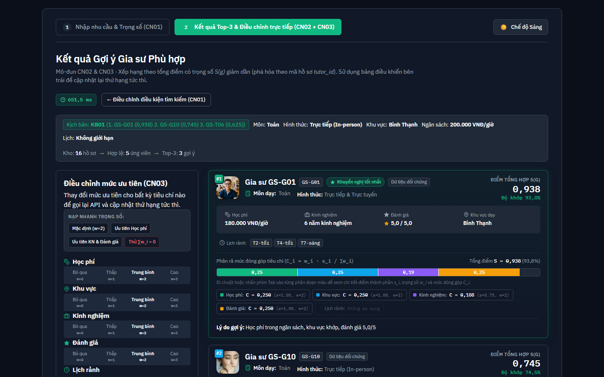
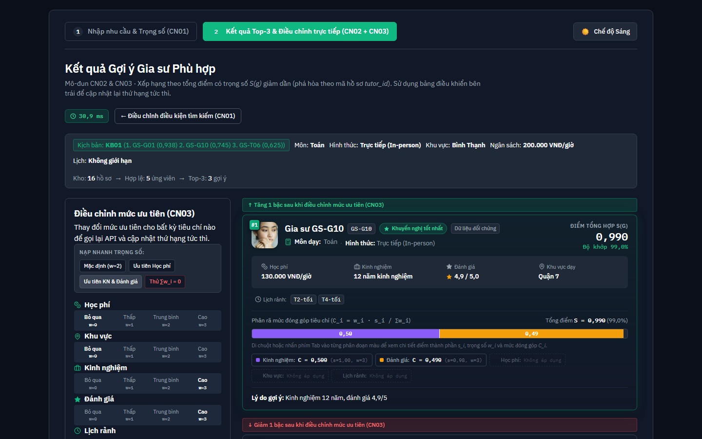

# CHƯƠNG 4. XÂY DỰNG HỆ THỐNG

## 4.1. Chuẩn bị môi trường phát triển

Hệ thống được xây dựng bám sát thiết kế ở Chương 3. Mã nguồn chia làm hai phần tách biệt: `backend/` chứa dịch vụ API và lõi tính điểm, còn `frontend/` chứa giao diện người dùng. Dữ liệu gia sư mẫu đặt chung trong thư mục `data/processed/`. Để bảo đảm môi trường nhất quán trên các máy khác nhau, phiên bản từng thư viện được khóa chặt trong `requirements.txt`, `requirements-dev.txt` (Python 3.12) và `package-lock.json` (JavaScript).

Bảng 4.1 tổng hợp các thành phần công nghệ và phiên bản sử dụng trong hệ thống.

**Bảng 4.1: Thành phần và công nghệ của hệ thống tại thời điểm hiện thực**

| Thành phần | Công nghệ (phiên bản) | Vai trò |
|:---|:---|:---|
| Nền tảng backend | Python 3.12.7 (môi trường ảo `.venv`) | Nền tảng thực thi dịch vụ và bộ kiểm thử |
| Khung dịch vụ API | FastAPI 0.162.0 | Định nghĩa điểm cuối (*endpoint*), tự sinh tài liệu OpenAPI |
| Xác thực dữ liệu | Pydantic 2.14.2 | Mô hình hóa hồ sơ, yêu cầu và phản hồi; kiểm tra ràng buộc đầu vào |
| Máy chủ ASGI | Uvicorn 0.54.0 (`uvicorn[standard]`) | Khởi chạy dịch vụ HTTP bất đồng bộ |
| Nền tảng frontend | Node.js v24.19.0, npm 11.17.0 | Môi trường phát triển và đóng gói giao diện |
| Thư viện giao diện | React 19.3.1, React DOM 19.3.1 | Xây dựng ứng dụng web một trang (SPA) gồm hai màn hình |
| Công cụ đóng gói | Vite 8.3.5, `@vitejs/plugin-react` 6.1.2 | Biên dịch và đóng gói tài sản tĩnh (`dist/`) |
| Hiệu ứng và phụ trợ giao diện | motion 14.9.0 (kèm `boring-avatars` 2.0.4 khai báo dự phòng trong `package.json`) | Hiệu ứng chuyển cảnh, thanh xếp chồng và huy hiệu biến động hạng (ảnh đại diện thực tế dùng tệp `.webp` tĩnh và khung chữ viết tắt CSS) |
| Lưu trữ dữ liệu | Tệp `data/processed/tutors.json` và `tutors.csv` | Lưu trữ 16 hồ sơ gia sư chuẩn hóa (Mục 4.2) |

Để kiểm tra chất lượng mã nguồn, phía backend dùng `pytest` 9.2.0 và `pytest-cov` 7.1.0 để chạy test tự động và đo độ bao phủ. Giao tiếp API được thử bằng `httpx` 0.28.1 qua `TestClient`, còn định dạng mã Python được rà bằng `ruff` 0.17.3. Phía frontend dùng `oxlint` 1.90.0 (`npm run lint`) để kiểm tra tĩnh mã React trước khi đóng gói bằng `npm run build`.

Mỗi lần đẩy mã lên nhánh chính hoặc mở pull request, GitHub Actions (`.github/workflows/ci.yml`) tự động dựng môi trường Ubuntu với Python 3.12, cài thư viện rồi chạy lần lượt `ruff check .` và `pytest`.

## 4.2. Xây dựng tập dữ liệu mẫu

### 4.2.1. Định dạng lưu trữ

Bộ dữ liệu mẫu lưu đồng thời trên hai tệp: `data/processed/tutors.json` để nạp vào bộ nhớ khi chạy dịch vụ, và `data/processed/tutors.csv` để mở xem hoặc đối chiếu nhanh ở Phụ lục A. Mỗi hồ sơ gia sư là một bản ghi phẳng gồm 9 thuộc tính theo Bảng 3.3, không có khóa ngoại nối bảng. Vì vậy định dạng JSON và CSV đủ gọn để phục vụ bộ máy khuyến nghị, còn việc chuyển sang cơ sở dữ liệu như SQLite sẽ để ở phần mở rộng sau này.

### 4.2.2. Cấu trúc dữ liệu

Hai cấu trúc dữ liệu thiết kế ở Bảng 3.3 và Bảng 3.4 được chuyển đổi thành hai lớp mô hình Pydantic trong thư mục `backend/app/schemas/`. Bảng 4.2 liệt kê tên trường tương ứng giữa bản thiết kế và mã nguồn.

**Bảng 4.2: Ánh xạ trường dữ liệu thiết kế sang định danh trong mã nguồn**

| Nhóm | Trường thiết kế (Chương 3) | Định danh trong mã nguồn | Kiểu dữ liệu và ràng buộc |
|:---|:---|:---|:---|
| Hồ sơ gia sư (Bảng 3.3) | `id` | `tutor_id` | `string` |
| | `môn_dạy` | `subjects` | `list[string]` |
| | `khu_vực` | `districts` | `list[string]` (rỗng nếu chỉ dạy trực tuyến) |
| | `học_phí_giờ` | `hourly_fee_vnd` | `int \| None` |
| | `số_năm_kinh_nghiệm` | `years_experience` | `float \| None` |
| | `hình_thức_dạy` | `teaching_mode` | enum `in_person`, `online`, `both` |
| | `lịch_rảnh` | `availability` | `list[string]` |
| | `điểm_đánh_giá_tb` | `avg_rating` | `float \| None` (`null` nếu chưa có đánh giá) |
| | `nguồn_dữ_liệu` | `data_source` | enum `public_collected`, `simulated`, `estimated` |
| Nhu cầu người học (Bảng 3.4) | `môn_học` | `subject` | `string` (bắt buộc, không chỉ gồm khoảng trắng) |
| | `hình_thức_học` | `learning_mode` | enum `in_person`, `online`, `any` |
| | `khu_vực_mong_muốn` | `preferred_district` | `string \| None` |
| | `ngân_sách_tối_đa` | `max_budget_vnd` | `StrictInt \| None` (`ge = 0`) |
| | `khung_thời_gian` | `time_slots` | `list[string] \| None` |
| | `mức_ưu_tiên` | `priorities` | `dict[enum tiêu chí, enum none/low/medium/high]` |
| | `số_kết_quả` | `top_k` | `StrictInt`, mặc định 3, ràng buộc $1 \le \text{top\_k} \le 20$ |

Cả hai mô hình đều bật `extra="forbid"` để báo lỗi ngay nếu dữ liệu có thêm trường lạ ngoài đặc tả. Trong mô hình truy vấn `SearchRequest`, tham số `top_k` ánh xạ từ trường `số_kết_quả` ở Bảng 3.4 để người gọi API chọn số kết quả muốn nhận (từ 1 đến 20, mặc định là 3). Nếu truyền ngoài khoảng này, API trả về mã lỗi HTTP 422.

### 4.2.3. Nguồn và nhãn dữ liệu

Tập dữ liệu mẫu có 16 hồ sơ gia sư. Hai hồ sơ lấy từ nguồn công khai là `GS-T06` và `GS-T07` (nhãn `public_collected`, ghi “Thu thập công khai” ở Phụ lục A). Số còn lại gồm 14 hồ sơ mô phỏng mang mã `GS006`, `GS020` và `GS-G01` đến `GS-G12` (nhãn `simulated`, ghi “Giả lập” ở Phụ lục A). Với hai hồ sơ công khai, môn dạy, khu vực và số năm kinh nghiệm là thông tin thực tế đã được ẩn danh. Học phí và lịch rảnh không có sẵn đầy đủ trên trang gốc nên được nhóm thực hiện ước tính theo mặt bằng khảo sát trên `daythem.com` (130.000-400.000 VNĐ/giờ, nội suy theo số năm kinh nghiệm) và đánh dấu `(*)` ở Bảng A.1. Điểm đánh giá trung bình của hai hồ sơ này để trống (`null`), nên khi chấm điểm sẽ nhận giá trị trung tính $0{,}5$.

Tên môn học trong cả 16 hồ sơ được đặt thống nhất theo danh mục của hệ thống. Chẳng hạn tiếng Anh dùng nhãn `"Anh Văn"`, riêng hồ sơ `GS-T07` có dạy thêm tiếng Anh giao tiếp nên ghi `"Anh Văn GT"`. Cách đặt chuẩn này giúp dữ liệu khớp hoàn toàn với 14 kịch bản đánh giá KB01-KB14 (Bảng 5.3).

### 4.2.4. Kiểm tra toàn vẹn dữ liệu

Kịch bản `scripts/validate_tutors.py` được xây dựng riêng để tự động kiểm tra năm điều kiện toàn vẹn dữ liệu:
- Đủ 16 bản ghi với đúng cơ cấu nguồn (`public_collected` và `simulated`).
- Mã `tutor_id` không trùng lặp trên cả JSON và CSV.
- Đủ 9 trường dữ liệu, đúng kiểu và đúng giá trị phân loại (*enum*).
- Không lẫn thông tin liên hệ cá nhân như số điện thoại hay địa chỉ email.
- Dữ liệu từng ô trên `tutors.json` và `tutors.csv` khớp nhau hoàn toàn.

Kết quả thực thi chương trình kiểm tra trên môi trường Python 3.12.7:

```text
ĐẠT: 16 bản ghi (2 public_collected, 14 simulated); id duy nhất; enum hợp lệ;
     đủ 9 trường; không có thông tin liên hệ; JSON và CSV khớp nhau từng ô.
```

### 4.2.5. Nguyên tắc thiết kế dữ liệu và minh chứng trong 16 hồ sơ

Năm nguyên tắc thiết kế dữ liệu ở Mục 3.5 được cụ thể hóa vào 16 hồ sơ trong `data/processed/tutors.json`:

1. **Tạo xung đột giữa các tiêu chí:** cặp `GS-G09` (350.000 VNĐ/giờ, 2 năm kinh nghiệm, đánh giá 3,5/5) và `GS-G10` (130.000 VNĐ/giờ, 12 năm kinh nghiệm, đánh giá 4,9/5) cùng dạy Toán ở Quận 7 và rảnh T2-tối, T4-tối. Tương tự là cặp `GS-G01` (180.000 VNĐ/giờ, 6 năm, 5,0/5) và `GS-G02` (300.000 VNĐ/giờ, 3 năm, 3,0/5) ở Bình Thạnh. Những cặp này giúp thấy rõ thứ hạng đổi khi thay đổi trọng số.
2. **Cặp hồ sơ chỉ khác một tiêu chí:** `GS006` và `GS020` giống hệt nhau trừ học phí (190.000 so với 240.000 VNĐ/giờ). Cặp `GS-G11` và `GS-G12` chỉ khác khu vực (Quận 2, Bình Thạnh so với Quận 2, Thủ Đức). Cặp này dùng cho kịch bản KB02 (đồng điểm để kiểm tra xếp hạng theo `tutor_id`) và KB03 (tách hạng khi tìm ở Thủ Đức).
3. **Tình huống không có ứng viên đạt điều kiện:** 16 hồ sơ mẫu bao phủ 9 môn học (`Toán`, `Lý`, `Hóa`, `Sinh`, `Văn`, `Anh Văn`, `Anh Văn GT`, `Tin học`, `Tiếng Nhật`), trong khi danh sách lựa chọn trên giao diện cung cấp 10 môn bao gồm `Tiếng Trung` để người đánh giá kiểm thử tình huống rỗng. Khi chạy kịch bản KB05 (`subject = "Tiếng Trung"`), hệ thống trả về trạng thái `no_match`.
4. **Hồ sơ chưa có điểm đánh giá:** `GS-T06` và `GS-T07` có `avg_rating = null`. Khi chấm điểm, hệ thống gán điểm trung tính $0{,}5$ và thêm ghi chú `"chưa có đánh giá"`.
5. **Tránh thiên lệch dữ liệu dễ:** các hồ sơ được gài ưu thế đan xen thay vì sắp sẵn một người giỏi toàn diện. Ví dụ ở KB01 (Bình Thạnh), `GS-T06` đúng quận và 20 năm kinh nghiệm nhưng học phí vượt trần, còn `GS-G10` học phí rẻ và đánh giá cao nhưng lại ở Quận 7. Nhờ vậy thuật toán buộc phải cân bằng nhiều tiêu chí theo trọng số.

## 4.3. Cài đặt module tính điểm

Module tính điểm nằm trong gói `backend/app/scoring/`, tách riêng khỏi tầng API. Bảng 4.3 đối chiếu từng tệp mã nguồn với các bước xử lý ở Mục 3.6.

**Bảng 4.3: Tệp, hàm/lớp chính và bước quy trình tương ứng (Mục 3.6)**

| Tệp | Hàm / lớp chính | Vai trò trong quy trình Mục 3.6 |
|:---|:---|:---|
| `app/data/repository.py` | `TutorRepository.get_all`, ngoại lệ `TutorDataError` | Đọc 16 hồ sơ từ tệp JSON và xác thực cấu trúc theo mô hình `TutorProfile` |
| `app/scoring/filters.py` | `filter_mandatory` và các hàm kiểm tra môn, hình thức, lịch rảnh | Bước 2 - lọc điều kiện bắt buộc (môn học, hình thức học, $\lvert L \cap T \rvert \ge 1$) |
| `app/scoring/weights.py` | `compute_effective_weights`, `priority_to_weight`, `EffectiveWeights` | Quy đổi mức ưu tiên sang trọng số theo Bảng 3.5; xác định tập tiêu chí áp dụng (loại tiêu chí khuyết đầu vào hoặc có $w_i = 0$) |
| `app/scoring/eligibility.py` | `check_tutor_eligibility`, `count_available_criteria`, `filter_eligible_candidates`, `MIN_DATA_THRESHOLD` | Kiểm tra ngưỡng dữ liệu tối thiểu theo Bảng 3.7 ($n = 1\text{-}5$), thực hiện trước khi chấm điểm xếp hạng |
| `app/scoring/criteria.py` | `score_fee`, `score_location`, `score_experience`, `score_rating`, `score_schedule` | Bước 3 - năm hàm thuần tính điểm thành phần $s_i \in [0, 1]$ theo công thức tại Bảng 3.6 |
| `app/scoring/ranker.py` | `score_and_rank`, `build_reason`, `build_notes` | Bước 4 - tổng hợp điểm $S(g) = \sum_{i \in A} w_i \cdot s_i / \sum_{j \in A} w_j$, tính mức đóng góp $C_i$, sắp xếp giảm dần (xử lý đồng điểm theo `tutor_id`) và trích Top-$k$ |
| `app/core/config.py` | `DELTA = 0.5`, `E_MAX = 8`, `RATING_DEFAULT = 0.5`, `PRIORITY_WEIGHTS`, `DEFAULT_PRIORITY = "medium"`, `CRITERIA_KEYS` | Quản lý tập trung các tham số thuật toán và bảng ánh xạ trọng số theo Mục 3.6 và Bảng 3.5 |

Khi chạy, Bước 1 (kiểm tra đầu vào) do `SearchRequest` xử lý, còn `TutorRepository` đọc và xác thực danh sách hồ sơ gia sư. Ba bước tiếp theo được thực thi tuần tự bởi các hàm trong `app/scoring/`.

### 4.3.1. Các quyết định triển khai QĐ-A đến QĐ-E

Trong quá trình cài đặt các công thức ở Bảng 3.6, năm tình huống biên được quy ước rõ để tránh lỗi khi chạy:

- **QĐ-A (Khi ngân sách bằng 0):** nếu người học nhập $B = 0$, hàm `score_fee` trả về $1{,}0$ khi học phí $P = 0$ và $0{,}0$ khi $P > 0$. Cách này tránh được phép chia cho $\delta \times B = 0$.
- **QĐ-B (Tự kiểm tra miền giá trị trong hàm thuần):** các hàm tính điểm thành phần đều kiểm tra đầu vào. Nếu gặp số sai miền ($P < 0$ hoặc $B < 0$ ở `score_fee`; $E < 0$ ở `score_experience`; $R \notin [0, 5]$ ở `score_rating`; lịch rỗng ở `score_schedule`), hàm tự ném `ValueError`. Nhờ vậy hàm vẫn an toàn khi gọi trực tiếp ngoài API.
- **QĐ-C (Tắt tiêu chí khu vực ở bước tính trọng số):** hàm `score_location` chỉ làm một việc là kiểm tra khớp khu vực ($1$ hoặc $0$). Việc bỏ tiêu chí khu vực khi học trực tuyến (`learning_mode = "online"`) hoặc khi không chọn quận do `compute_effective_weights` xử lý.
- **QĐ-D (So khớp chuỗi chính xác):** môn học, khu vực và khung giờ đều so khớp chính xác theo nhãn đã chuẩn hóa (ví dụ `subject in tutor.subjects` hay giao hai tập khung giờ).
- **QĐ-E (Không làm tròn trung gian khi tính điểm):** điểm thành phần, mức đóng góp $C_i$ và tổng điểm $S(g)$ giữ nguyên dạng số thực dấu phẩy động chuẩn IEEE 754 suốt lúc xếp hạng. Hệ thống chỉ làm tròn 3 chữ số thập phân khi đưa ra giao diện.

### 4.3.2. Tính tách rời khỏi tầng API

Gói `backend/app/scoring/` không `import` bất kỳ thành phần nào của FastAPI, Starlette hay Uvicorn. Năm tệp mã nguồn bên trong chỉ dùng thư viện chuẩn Python (`collections.abc`, `dataclasses`) và các mô hình dữ liệu nội bộ (`app.core.config`, `app.schemas.*`). Nhờ vậy, bộ kiểm thử đơn vị có thể gọi trực tiếp các hàm Python mà không cần khởi chạy máy chủ web.

### 4.3.3. Minh họa thực thi kịch bản KB01

Chuỗi hàm tính điểm (`filter_mandatory` → `compute_effective_weights` → `filter_eligible_candidates` → `score_and_rank`) được chạy thử trên 16 hồ sơ mẫu. Đầu vào là kịch bản KB01: môn Toán, học trực tiếp ở Bình Thạnh, ngân sách 200.000 VNĐ/giờ, mọi ưu tiên Trung bình, `top_k = 3`. Kết quả thu được như sau:

```text
total_candidates: 16
qualified_candidates: 5  [GS-T06, GS-G01, GS-G02, GS-G09, GS-G10]
insufficient_data_candidates: []
effective weights: {'fee': 2, 'district': 2, 'experience': 2, 'rating': 2}  total: 8
rank=1 tutor_id=GS-G01 total_score=0.9375
  criteria_scores: fee 1.0 | district 1.0 | experience 0.75 | rating 1.0 | availability None
  contributions:   fee 0.25 | district 0.25 | experience 0.1875 | rating 0.25 | availability None
  reason: "Học phí trong ngân sách, khu vực khớp, đánh giá 5,0/5"
rank=2 tutor_id=GS-G10 total_score=0.745
  criteria_scores: fee 1.0 | district 0.0 | experience 1.0 | rating 0.98 | availability None
rank=3 tutor_id=GS-T06 total_score=0.625
  criteria_scores: fee 0.0 | district 1.0 | experience 1.0 | rating 0.5 | availability None
  notes: ['chưa có đánh giá']
```

Kết quả này chạy đúng theo thiết kế. Vì KB01 không nhập lịch rảnh nên tiêu chí này mang giá trị `None`. Hồ sơ `GS-T06` có học phí ước tính 400.000 VNĐ/giờ nên nhận $s_{\text{fee}} = 0$, nhưng vẫn được giữ lại xếp hạng nhờ cơ chế ngân sách mềm và nhận điểm đánh giá trung tính $0{,}5$ kèm ghi chú `"chưa có đánh giá"`. Các con số này khớp hoàn toàn với phân tích ở Bảng 5.9 (Chương 5).

## 4.4. Xây dựng API khuyến nghị

### 4.4.1. Endpoint và cấu trúc ứng dụng

Dịch vụ web khởi tạo tại `backend/app/main.py`: cấu hình FastAPI, bật `CORSMiddleware` để trình duyệt gọi chéo miền được và gắn bộ định tuyến từ `recommend.py`. Ngoài API chính, máy chủ có đường dẫn `GET /health` trả về `{"status": "ok"}` và trang `/docs` (Swagger UI) để thử trực tiếp.

Điểm cuối chính `POST /api/recommend` nhận `SearchRequest` và trả về một trong ba kiểu phản hồi (`RecommendationSuccessResponse`, `NoMatchResponse`, `ZeroWeightResponse`). Hàm `recommend_tutors` chạy qua năm bước:

1. Kiểm tra đầu vào bằng Pydantic (môn học không được trống, `max_budget_vnd` không âm, `top_k` từ $1$ đến $20$, đúng các giá trị phân loại, không có trường thừa). Nếu sai, API trả ngay mã HTTP 422.
2. Gọi `filter_mandatory` để lọc điều kiện bắt buộc. Nếu không còn gia sư nào, trả về `no_match` (HTTP 200) kèm thông báo “Không có gia sư thỏa điều kiện bắt buộc”.
3. Gọi `compute_effective_weights` để tính trọng số hiệu dụng. Nếu tổng trọng số bằng $0$, trả về `zero_weight` (HTTP 200) kèm danh sách ứng viên qua lọc trong `unranked_candidates`.
4. Gọi `filter_eligible_candidates` để kiểm tra ngưỡng dữ liệu tối thiểu. Nếu tất cả ứng viên đều thiếu dữ liệu, trả về biến thể thứ hai của `no_match` (HTTP 200) kèm danh sách mã gia sư trong `insufficient_data_candidates`.
5. Gọi `score_and_rank` để chấm điểm, xếp hạng và lấy Top-$k$ ứng viên, trả về `success` (HTTP 200).

Nguồn dữ liệu được truyền vào API qua cơ chế tiêm phụ thuộc (`Depends(get_tutor_repository)`). Nhờ vậy khi chạy kiểm thử tự động, dữ liệu mẫu có thể được thay thế trực tiếp mà không cần sửa mã API. Bảng 4.4 tóm tắt các trạng thái phản hồi của `POST /api/recommend`.

**Bảng 4.4: Các trạng thái phản hồi của `POST /api/recommend`**

| Trạng thái | Điều kiện phát sinh | Mã HTTP |
|:---|:---|:---:|
| `success` | Có ít nhất một gia sư qua lọc, đủ ngưỡng dữ liệu và xếp hạng được | 200 |
| `no_match` (biến thể 1) | Không có gia sư nào thỏa điều kiện bắt buộc | 200 |
| `no_match` (biến thể 2) | Có gia sư qua lọc bắt buộc nhưng tất cả bị loại do thiếu dữ liệu (kèm `insufficient_data_candidates` không rỗng) | 200 |
| `zero_weight` | Tổng trọng số các tiêu chí đang áp dụng bằng 0 (kèm `unranked_candidates`) | 200 |
| Lỗi xác thực dữ liệu | Vi phạm ràng buộc `SearchRequest` (thiếu `subject`, ngân sách âm, `top_k` ngoài khoảng, enum sai, khóa lạ, trường thừa) | 422 |

### 4.4.2. Minh họa yêu cầu và phản hồi thực tế của API

Khi bật máy chủ bằng lệnh `python -m uvicorn app.main:app` (Python 3.12.7) và gửi yêu cầu kịch bản KB01, API trả về JSON (HTTP 200) như đoạn trích hạng 1 dưới đây:

```json
{
  "status": "success",
  "total_candidates": 16,
  "qualified_candidates": 5,
  "insufficient_data_candidates": [],
  "results": [
    {
      "rank": 1,
      "tutor_id": "GS-G01",
      "total_score": 0.9375,
      "criteria_scores": {"fee": 1.0, "district": 1.0, "experience": 0.75, "rating": 1.0, "availability": null},
      "contributions":  {"fee": 0.25, "district": 0.25, "experience": 0.1875, "rating": 0.25, "availability": null},
      "reason": "Học phí trong ngân sách, khu vực khớp, đánh giá 5,0/5",
      "notes": []
    }
  ]
}
```

Hai vị trí tiếp theo trong mảng `results` là `GS-G10` (`total_score: 0.745`, `notes: []`) và `GS-T06` (`total_score: 0.625`, `notes: ["chưa có đánh giá"]`). Các tình huống biên khi gọi qua HTTP đều trả về đúng như Bảng 4.4:
- Không gửi trường `subject`: API trả về mã HTTP 422 với lỗi thiếu trường bắt buộc tại `["body", "subject"]` (trường hợp gửi chuỗi rỗng hoặc toàn khoảng trắng cũng bị chặn với mã HTTP 422).
- Truyền `max_budget_vnd = -5`: API trả về mã HTTP 422 do vi phạm ràng buộc số nguyên không âm (`greater_than_equal`).
- Tìm môn Tiếng Trung: API trả về trạng thái `no_match` (HTTP 200).
- Đặt cả 5 mức ưu tiên về `none`: API trả về trạng thái `zero_weight` (HTTP 200) kèm 5 mã gia sư qua lọc trong mảng `unranked_candidates`.

## 4.5. Xây dựng giao diện demo

Phần giao diện được phát triển thành ứng dụng web một trang (SPA) bằng React 19 và Vite, viết CSS thuần ở `frontend/src/App.css` (2.089 dòng) và `index.css`. Thanh xếp chồng phân rã điểm đóng góp được vẽ thẳng bằng HTML và CSS chứ không cài thêm thư viện biểu đồ ngoài. Bảng 4.5 tóm tắt các tệp giao diện theo ba chức năng CN01-CN03.

**Bảng 4.5: Thành phần giao diện và chức năng theo CN01-CN03**

| Tệp | Vai trò | Chức năng |
|:---|:---|:---|
| `src/App.jsx` | Điều phối trung tâm | Quản lý chuyển đổi giữa màn hình nhập nhu cầu (CN01) và màn hình kết quả (CN02, CN03); lưu trữ trạng thái truy vấn, kết quả khuyến nghị, độ trễ phản hồi và độ lệch thứ hạng khi người học điều chỉnh trọng số; đồng bộ thứ tự yêu cầu bất đồng bộ (Mục 4.6) |
| `src/pages/SearchPage.jsx` | Màn hình nhập nhu cầu (CN01) | Biểu mẫu nhập tiêu chí theo Bảng 3.4 (môn học, hình thức, khu vực, ngân sách kèm dòng quy đổi bằng chữ, Top-$k$); lưới chọn lịch rảnh 7 ngày × 3 buổi; kiểm tra hợp lệ phía trình duyệt; thanh nút nạp nhanh 14 kịch bản thực nghiệm KB01-KB14 (Bảng 5.3) |
| `src/pages/ResultPage.jsx` | Màn hình kết quả (CN02 + CN03) | Hiển thị dải thông tin tóm tắt truy vấn và thống kê số lượng ứng viên (“Kho → Hợp lệ → Top-$k$”); khung điều chỉnh mức ưu tiên trực tiếp (CN03) cho 5 tiêu chí kèm 4 nút cấu hình trọng số mẫu; hiển thị ba trạng thái nghiệp vụ `success`, `no_match`, `zero_weight` |
| `src/components/TutorCard.jsx` | Thẻ thông tin gia sư | Hiển thị ảnh đại diện, huy hiệu thứ hạng, nhãn nguồn dữ liệu (“Thực tế (ước tính *)” kèm chú giải chi tiết (tooltip) cho `public_collected`, “Dữ liệu đối chứng” cho `simulated`), các thuộc tính hồ sơ, lịch rảnh, chuỗi lý do khuyến nghị và ghi chú dữ liệu |
| `src/components/StackedBarScore.jsx` | Thanh xếp chồng điểm đóng góp | Trực quan hóa các phân đoạn theo mức đóng góp $C_i = w_i \cdot s_i / \sum_{j \in A} w_j$; hộp thông tin chi tiết hiển thị $s_i$, $w_i$, $C_i$ và tỷ trọng phần trăm của từng tiêu chí áp dụng |
| `src/components/TutorAvatar.jsx` | Ảnh đại diện gia sư | Hiển thị ảnh chân dung `/avatars/{tutor_id}.webp` (16 tệp ảnh WebP trong `frontend/public/avatars/`), tự động chuyển sang biểu tượng chữ cái viết tắt nếu thiếu tệp ảnh |
| `src/components/CriteriaIcon.jsx`, `SubjectIcon.jsx`, `SkeletonLoader.jsx` | Thành phần phụ trợ | Biểu tượng trực quan cho từng tiêu chí và môn học; hiệu ứng khung chờ trong thời gian gọi API |
| `src/services/api.js` | Dịch vụ giao tiếp API | Xác định địa chỉ máy chủ API theo biến môi trường `VITE_API_URL` hoặc tên miền hiện hành; chuẩn hóa dữ liệu biểu mẫu và xử lý lỗi kết nối HTTP |
| `src/data/scenariosCatalog.js` | Danh mục kịch bản mẫu | Dữ liệu 14 kịch bản KB01-KB14 đồng bộ từ `backend/tests/scenarios/scenarios.json` phục vụ thao tác nạp nhanh trên giao diện |
| `src/data/goalPresets.js` | Bộ mức ưu tiên mẫu theo mục tiêu học tập | Ba bộ cấu hình gợi ý sẵn 5 mức ưu tiên: “Không nêu mục tiêu” (mặc định), “Điểm cao / luyện thi chuyên - học sinh giỏi” (Kinh nghiệm và Đánh giá mức Cao), “Đủ điểm đậu / lấy lại kiến thức căn bản” (Học phí mức Cao) |
| `src/data/tutorsCatalog.js` | Danh mục hồ sơ tra cứu | Bản sao chuẩn hóa của 16 hồ sơ theo `tutor_id` giúp hiển thị đầy đủ thuộc tính trên thẻ gia sư; bảng màu 5 tiêu chí và hàm định dạng số thập phân theo quy ước dấu phẩy tiếng Việt |

Ở màn hình CN01, phía trên bảng chọn 5 tiêu chí có thêm ô “Mục tiêu học tập (gợi ý mức ưu tiên)”. Khi người học chọn một mục tiêu gợi ý, giao diện điền sẵn bộ 5 mức ưu tiên tương ứng. Nếu sau đó người học chỉnh tay lại từng tiêu chí thì ô này tự đổi thành “Tùy chỉnh”. Đây chỉ là tiện ích ở tầng giao diện, nên dữ liệu JSON gửi lên API vẫn giữ nguyên 7 trường tiêu chuẩn.

Bốn ảnh chụp dưới đây ghi lại các màn hình hoạt động thực tế. Hình 4.1 và Hình 4.2 là màn hình nhập nhu cầu và kết quả Top-3 của kịch bản KB01. Hình 4.3 và Hình 4.4 minh họa lúc đổi mức ưu tiên và trạng thái cảnh báo khi tổng trọng số bằng 0.


**Hình 4.1: Màn hình nhập nhu cầu học tập (CN01)**

Hình 4.1 là màn hình nhập nhu cầu (CN01) ở trạng thái khởi tạo mặc định (trùng bộ tham số kịch bản KB01: Toán, học trực tiếp ở Bình Thạnh, ngân sách 200.000 VNĐ/giờ) kèm thanh nạp nhanh `Bảng 5.3 · KB01 - KB14`. Bên phải là bảng chọn mức ưu tiên cho 5 tiêu chí, với ô “Mục tiêu học tập” ở mức mặc định “Không nêu mục tiêu” ($w_i = 2$ cho cả năm tiêu chí).



**Hình 4.2: Màn hình kết quả gợi ý Top-3 kịch bản KB01 (CN02)**

Hình 4.2 là màn hình kết quả của kịch bản KB01 (CN02). Top-3 trả về khớp kỳ vọng: hạng 1 `GS-G01` ($S(g) = 0{,}938$), hạng 2 `GS-G10` ($0{,}745$) và hạng 3 `GS-T06` ($0{,}625$), kèm dòng thống kê “Kho: 16 hồ sơ → Hợp lệ: 5 ứng viên → Top-3: 3 gợi ý” (trên khung hình `1440×900`, thẻ `#3 GS-T06` hiển thị trong thanh tóm tắt phía trên và nằm ngay dưới nếp cuộn trang). Trên thẻ của `GS-G01`, thanh xếp chồng chia bốn đoạn `0,25 / 0,25 / 0,19 / 0,25` (vì không chọn lịch rảnh) và hiện lý do “Học phí trong ngân sách, khu vực khớp, đánh giá 5,0/5”. Con số thời gian ở góc giao diện lúc mới chuyển từ màn hình tìm kiếm sang kết quả đã bao gồm khoảng dừng 650 ms dành cho hiệu ứng chuyển trang của giao diện (`App.jsx`), còn các lượt bấm đổi mức ưu tiên tiếp theo (Hình 4.3) đo trực tiếp thời gian gọi API. Lưu ý rằng trên thanh tinh chỉnh CN03 của `ResultPage`, nút *Ưu tiên KN & Đánh giá* đặt các tiêu chí ngoài nhóm trọng tâm về Bỏ qua ($w_i = 0$, tạo nên mức điểm $0{,}990$ ở Hình 4.3), còn nút *Ưu tiên Học phí* đặt Kinh nghiệm và Đánh giá về Bỏ qua ($w_i = 0$) và giữ Khu vực cùng Lịch ở mức Thấp ($w_i = 1$) - khác với bốn bộ cấu hình thử nghiệm ở Bảng 5.8 vốn giữ toàn bộ tiêu chí ngoài trọng tâm ở mức Thấp ($w_i = 1$).



**Hình 4.3: Điều chỉnh mức ưu tiên trực tiếp (CN03) làm đổi hạng**

Hình 4.3 minh họa thao tác chỉnh mức ưu tiên trực tiếp trên trang kết quả (CN03). Khi hạ Học phí và Khu vực xuống “Bỏ qua (w=0)”, đồng thời nâng Kinh nghiệm và Đánh giá lên “Cao (w=3)”, gia sư `GS-G10` (12 năm kinh nghiệm, đánh giá 4,9/5) nhảy lên hạng 1 với $0{,}990$ điểm. Trên thẻ `GS-G10` hiện huy hiệu tăng 1 bậc, còn thẻ tụt hạng phía dưới hiện huy hiệu giảm 1 bậc. Thanh xếp chồng lúc này chỉ còn hai phần là Kinh nghiệm ($0{,}50$) và Đánh giá ($0{,}49$).


**Hình 4.4: Trạng thái biên tổng trọng số bằng 0 ($\sum w_i = 0$)**

Hình 4.4 cho thấy trạng thái biên khi người học đặt cả 5 tiêu chí về “Bỏ qua (w=0)” ($\sum w_i = 0$). Hệ thống chuyển sang trạng thái `zero_weight` (API trả danh sách ứng viên đạt lọc bắt buộc trong trường JSON `unranked_candidates`), còn giao diện hiển thị thống kê “Hợp lệ: 5 ứng viên” ở thanh trên cùng thẻ cảnh báo “Không thể xếp hạng do tổng trọng số bằng 0” và nút khôi phục nhanh về trọng số mặc định ($w_i = 2$).

## 4.6. Tích hợp giao diện với API và kiểm tra luồng end-to-end

### 4.6.1. Luồng xử lý end-to-end

Luồng chạy xuyên suốt (*end-to-end*) giữa giao diện và API gồm bốn bước:
1. Người học điền nhu cầu ở màn hình `SearchPage` (CN01) hoặc bấm nạp nhanh kịch bản mẫu; `App.jsx` gom dữ liệu thành JSON đúng chuẩn `SearchRequest`.
2. Giao diện gửi `POST /api/recommend` lên backend, nhận kết quả (`success`, `no_match` hoặc `zero_weight`) rồi chuyển sang `ResultPage` (CN02) để vẽ thẻ gia sư và thanh xếp chồng.
3. Khi người học bấm chọn lại mức ưu tiên ngay trên màn hình kết quả (CN03), giao diện tự gửi lại yêu cầu mới và so sánh thứ hạng trước - sau để gắn huy hiệu “Tăng/Giảm $n$ bậc”.
4. Khi người học bấm nút thử tổng trọng số bằng $0$ ($\sum w_i = 0$), cả năm tiêu chí được đưa về `none` và màn hình hiện trạng thái `zero_weight` (Hình 4.4).

Địa chỉ máy chủ API ưu tiên đọc từ biến môi trường `VITE_API_URL` (hoặc `VITE_API_BASE_URL`). Nếu không cấu hình, ứng dụng tự chọn theo tên miền đang chạy: dùng `http://localhost:8000` khi chạy dưới máy cá nhân (`localhost` / `127.0.0.1`) và dùng `https://tutor-recommender-api.onrender.com` khi mở bản triển khai trực tuyến.

### 4.6.2. Xử lý lỗi cơ bản ở cả hai phía

Bảng 4.6 liệt kê các lỗi thường gặp ở đầu vào hoặc kết nối cùng cách xử lý ở cả frontend lẫn backend.

**Bảng 4.6: Các tình huống lỗi và nơi xử lý**

| Tình huống | Nơi xử lý (tệp) | Hành vi quan sát được |
|:---|:---|:---|
| Thiếu hoặc bỏ trống môn học | `frontend/src/pages/SearchPage.jsx` (kiểm tra trước khi gửi); `backend/app/schemas/search_request.py` (xác thực tầng API) | Giao diện nhắc “Vui lòng chọn môn học mong muốn.”; nếu gọi thẳng API mà thiếu khóa, gửi chuỗi rỗng hoặc toàn khoảng trắng, backend trả về mã HTTP 422 (với chuỗi toàn khoảng trắng là thông báo “Môn học (subject) không được để trống.”) |
| Ngân sách âm hoặc không nguyên | `SearchPage.jsx` (kiểm tra chuỗi chữ số nguyên); `api.js`; `search_request.py` (`StrictInt`, `ge = 0`) | Giao diện kiểm tra số nguyên không âm (không cắt phần thập phân) và nhắc “Ngân sách tối đa phải là số nguyên không âm hợp lệ (VNĐ).”; nếu gọi API trực tiếp với số âm hoặc số thực, backend trả mã HTTP 422 |
| Bỏ trống khu vực khi học Trực tiếp | `SearchPage.jsx`; `api.js`; `backend/app/scoring/weights.py` (`QĐ-C`) | Giao diện cho phép để trống khu vực và gửi `preferred_district = null`; bộ tính trọng số tự tắt tiêu chí khu vực khỏi tổng trọng số đúng theo QĐ-C (Mục 4.3.1) |
| Không có gia sư thỏa điều kiện bắt buộc | `backend/app/api/recommend.py`; `frontend/src/pages/ResultPage.jsx` | Backend trả về trạng thái `no_match`; giao diện hiển thị thông báo “Không tìm thấy gia sư thỏa mãn điều kiện” kèm danh sách ứng viên thiếu dữ liệu (nếu có) |
| Tổng trọng số bằng 0 | `recommend.py`; `ResultPage.jsx`; `App.jsx` | Backend trả về trạng thái `zero_weight` kèm mảng JSON `unranked_candidates`; giao diện hiện số ứng viên hợp lệ trên thanh thống kê cùng thẻ cảnh báo và nút khôi phục trọng số mặc định (Hình 4.4) |
| Máy chủ API không phản hồi | `frontend/src/services/api.js` | Bắt ngoại lệ kết nối mạng và hiển thị thông báo “Không thể kết nối tới máy chủ gợi ý gia sư. Vui lòng kiểm tra dịch vụ Backend đang chạy.” |
| Phản hồi HTTP lỗi / sai định dạng | `frontend/src/services/api.js` | Hiển thị thông báo lỗi dữ liệu đầu vào mặc định khi nhận mã lỗi HTTP 422 (hoặc trích xuất thông điệp lỗi dạng chuỗi từ trường `detail` đối với các lỗi HTTP khác) |
| Thay đổi mức ưu tiên liên tiếp (CN03) | `frontend/src/App.jsx` | Gắn số thứ tự tăng dần cho mỗi lượt gọi API; chỉ cập nhật giao diện theo phản hồi của yêu cầu mới nhất để tránh hiện tượng phản hồi cũ ghi đè kết quả mới |

Luồng tích hợp được kiểm tra theo hai cách: chạy 41 bài test tự động cho tầng API cùng ca biên (gồm cả kịch bản đổi trọng số liên tiếp của CN03), rồi kiểm tra thủ công toàn bộ luồng trực tiếp trên trình duyệt.

### 4.6.3. Triển khai công khai

Hệ thống được lưu trữ mã nguồn công khai trên GitHub tại `https://github.com/tnduckhmt2411011-design/tutor-recommender` và đưa lên mạng qua hai dịch vụ đám mây riêng. Phần giao diện frontend React [5] đóng gói bằng `npm run build` (kèm định tuyến SPA trong `vercel.json`) chạy trên Vercel tại `https://tutor-recommender.vercel.app`. Phần backend FastAPI [4] chạy trên Render Web Service với Python 3.12.7 (`uvicorn app.main:app --host 0.0.0.0 --port $PORT`) tại `https://tutor-recommender-api.onrender.com`, kèm trang Swagger UI ở `/docs` và `/health`.

Vì backend dùng gói miễn phí của Render, máy chủ sẽ tự nghỉ sau một lúc không có người truy cập. Khi có người mở lại sau thời gian nghỉ, theo tài liệu của gói Render Free Tier, lượt gọi đầu tiên ước tính cần khoảng 30-40 giây để máy chủ khởi động lại (*cold start*, đây là mức tham khảo từ tài liệu nền tảng, chưa được đo đạc định lượng riêng).

## 4.7. Giới hạn của việc hiện thực

- **Lưu trữ dữ liệu:** hệ thống đang đọc dữ liệu từ tệp JSON và CSV, chưa dùng cơ sở dữ liệu quan hệ như SQLite vì phần này nằm ở nhóm ưu tiên thấp (*Could Have*).
- **Kiểm thử tự động trên CI:** GitHub Actions hiện chạy kiểm tra tự động cho backend (`ruff` và `pytest`). Với frontend, kiểm tra tĩnh (`oxlint`) và đóng gói (`vite build`) hiện được chạy thủ công bằng dòng lệnh, chưa có bộ kiểm thử giao diện tự động.

Các hạn chế về dữ liệu mẫu 16 hồ sơ, bộ tham số đặt tay hay độ trễ mạng qua Internet được phân tích chi tiết ở Mục 5.3 và Mục 6.2.
