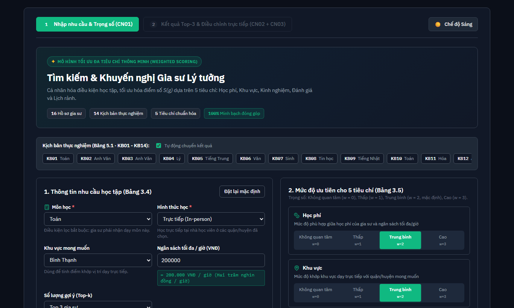
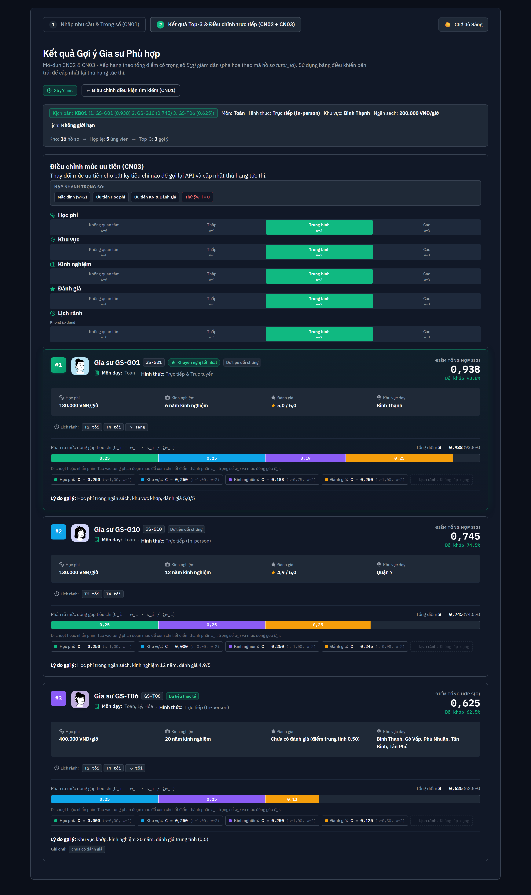
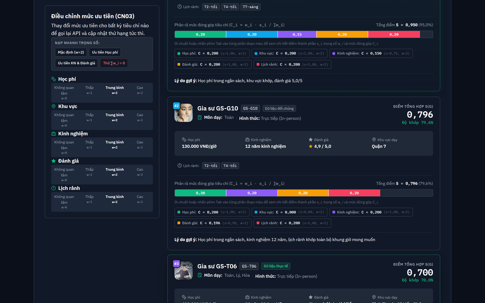
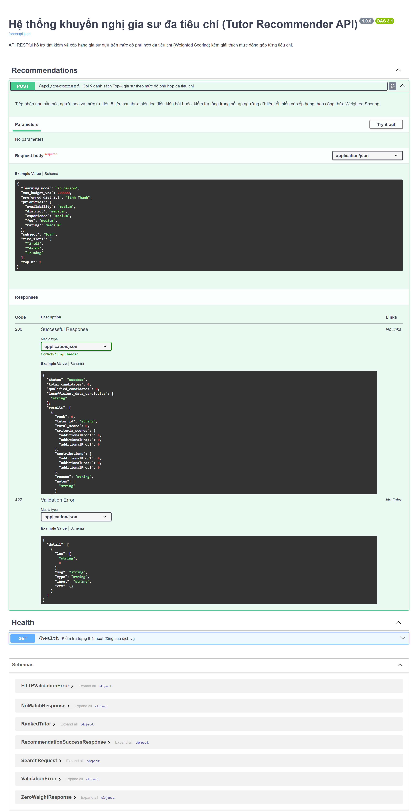
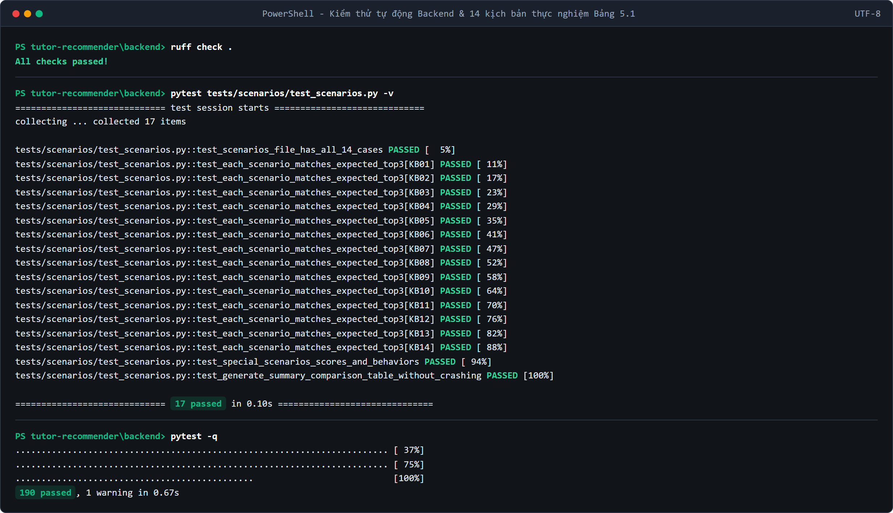

> [!NOTE]
> **Đề xuất, nhóm xác nhận**

# Báo cáo tiến độ giữa kỳ — Đồ án Khoa học máy tính 1 (Kết thúc Sprint 5)

- **Đề tài:** Hệ thống khuyến nghị gia sư dựa trên mức độ phù hợp đa tiêu chí
- **Học phần:** Đồ án Khoa học máy tính 1 — Khoa Công nghệ thông tin, Trường Đại học Kỹ thuật Công nghệ Cần Thơ
- **Giảng viên hướng dẫn:** TS. Lê Anh Nhã Uyên
- **Nhóm thực hiện:**
  - Cao Khánh Ngọc (`KHMT2411025` — Nhóm trưởng, Product Owner)
  - Trần Nguyễn Đức (`KHMT2411011` — Scrum Master các Sprint 1, 3, 5)
  - Lê Thị Bích Chuyền (`KHMT2411037` — Scrum Master các Sprint 2, 4, 6)
- **Kỳ báo cáo:** Sprint 1 đến Sprint 5, số liệu tính đến ngày 02/11/2026 (nhánh `main`, commit `6cc690b`)
- **Mã nguồn:** https://github.com/tnduckhmt2411011-design/tutor-recommender
- **Đường dẫn ứng dụng trực tuyến (Demo Live):** https://tutor-recommender-khmt.vercel.app
- **Tài liệu API tương tác (Swagger UI Live):** https://tutor-recommender-api.onrender.com/docs

---

## 1. Tóm tắt

Đến ngày 02/11/2026, nhóm đã hoàn thành 5 trong 6 sprint, gồm 31 trên 36 user story chính thức (54 trên 63 story point). Ba chức năng `CN01`, `CN02` và `CN03` của đề cương đã chạy được từ giao diện React đến API FastAPI. Trên 14 kịch bản của Bảng 5.1, Top-3 do hệ thống trả về trùng với Top-3 kỳ vọng ở cả 14 kịch bản; riêng `KB04` có điểm số lệch so với phép tính tay trong đề cương, nguyên nhân đã được xác định ở mục 3.3.

Phần chưa làm gồm khảo sát độ nhạy tham số (Mục 5.2), viết Chương 5 và Chương 6 cùng các phụ lục, cập nhật `README.md`, làm slide và đóng gói bản `v1.0`. Các việc này nằm trong Sprint 6, hạn `2027-01-01`.

---

## 2. Tiến độ thực hiện

### 2.1. Theo cấu trúc đề cương

Chương 1 đến Chương 3 đã có trong đề cương đã nộp, nên Bảng 1 chỉ ghi phần nhóm bổ sung hoặc chốt thêm sau đó.

| Chương | Trạng thái | Nội dung và sản phẩm |
|:---|:---:|:---|
| **1. Tổng quan** | Đã xong | Khảo sát ba nền tảng (Bảng 1.1) có sẵn trong đề cương. Phần so sánh với đồ án GS360 ở Mục 1.3 được bổ sung tại `docs/thesis/outline/muc-1.3-gs360.md` (`PR #59`). |
| **2. Cơ sở lý thuyết và công nghệ** | Đã xong | Giữ nguyên như đề cương. |
| **3. Phân tích và thiết kế** | Đã chốt | Công thức Bảng 3.6, bảng ngưỡng dữ liệu tối thiểu, hợp đồng API và từ điển dữ liệu được ghi trong `docs/design/` (`PR #46`, `PR #49`, `PR #50`). Nhóm đã báo cáo phần khóa bài toán với Cô ngày 01/11/2026 (`PR #58`). |
| **4. Xây dựng hệ thống** | Đã xong | Dữ liệu 16 hồ sơ (`data/processed/`), module chấm điểm (`backend/app/scoring/`), API `POST /api/recommend`, giao diện hai màn hình (`frontend/src/`). Chi tiết ở mục 3.1. |
| **5. Kiểm thử và đánh giá** | Đang làm | Xong Mục 5.1 (ca biên) và Bảng 5.1 (14 kịch bản). Chưa làm Mục 5.2 (độ nhạy $\delta$, $E_{\max}$, ngân sách); Mục 5.3 chưa viết thành văn bản. |
| **6. Kết luận và hướng phát triển** | Mới có bản nháp | Có bản nháp Mục 6.1 và khung Bảng 6.1 tại `docs/thesis/outline/muc-6.1-bang-6.1.md` (`PR #60`). Mục 6.2, 6.3 và các phụ lục chưa viết. |

**Bảng 1 - Tiến độ theo các chương của đề cương**
*(Nguồn: kho mã nguồn của nhóm, nhánh `main`)*

Đối chiếu với bốn mục tiêu ở Mục 1.4: mục tiêu (a) mô hình hóa và module lọc, tính điểm; (b) API FastAPI; (c) giao diện ReactJS đã hoàn thành. Mục tiêu (d) mới xong phần kịch bản: 14 kịch bản đã chạy và đối chiếu, tác động của mức ưu tiên được minh họa bằng `CN03`, còn khảo sát độ nhạy ở Mục 5.2 chưa thực hiện.

### 2.2. Theo sprint

| Sprint | Nội dung chính | Số US, SP | PR chính |
|:---:|:---|:---:|:---|
| **1** | Chốt công thức và hợp đồng API; chuẩn hóa 16 hồ sơ và 14 kịch bản; dựng khung backend, frontend, CI | 10 US, 12 SP | `#40` đến `#53`, `#58` đến `#61` |
| **2** | Nạp dữ liệu, bộ lọc bắt buộc, năm hàm điểm thành phần, quy đổi trọng số, unit test | 5 US, 10 SP | `#54` đến `#57`, `#62` |
| **3** | Kiểm tra ngưỡng dữ liệu, xếp hạng Weighted Scoring, test tự động 14 kịch bản, phân tích sai lệch | 5 US, 9 SP | `#63` đến `#67` |
| **4** | API `POST /api/recommend`, kiểm thử tích hợp, màn hình nhập nhu cầu (`CN01`) | 6 US, 11 SP | `#68` đến `#70` |
| **5** | Màn hình kết quả và thanh xếp chồng (`CN02`), điều chỉnh ưu tiên (`CN03`), ca biên Mục 5.1, điền Bảng 5.1 | 5 US, 12 SP | `#71` đến `#74` |

**Bảng 2 - Các sprint đã hoàn thành**
*(Nguồn: `docs/scrum/product-backlog.md` và lịch sử PR trên GitHub. Danh sách PR gồm cả các PR biên bản sprint)*

---

## 3. Kết quả kỹ thuật

### 3.1. Hệ thống đã xây dựng

Backend gồm các module tách rời tầng API: nạp dữ liệu (`repository.py`), lọc điều kiện bắt buộc (`filters.py`), kiểm tra ngưỡng dữ liệu tối thiểu (`eligibility.py`), năm hàm điểm thành phần theo Bảng 3.6 (`criteria.py`), quy đổi trọng số (`weights.py`) và xếp hạng Weighted Scoring, đồng điểm thì xếp theo mã gia sư (`ranker.py`). Endpoint `POST /api/recommend` kiểm tra đầu vào bằng Pydantic, trả ba loại kết quả `success`, `no_match`, `zero_weight`; dữ liệu sai trả mã `422`.

Giao diện có hai màn hình. Ở `CN01`, người học chọn môn học, hình thức học, khu vực (tự khóa khi chọn học trực tuyến), ngân sách, khung giờ rảnh trên lưới 7 ngày × 3 buổi và mức ưu tiên cho năm tiêu chí; có nút nạp nhanh 14 kịch bản của Bảng 5.1. Ở `CN02`, mỗi gia sư hiện thành một thẻ gồm hạng, mã, điểm tổng $S$, điểm thành phần, thanh xếp chồng thể hiện đóng góp của từng tiêu chí, lý do gợi ý và ghi chú dữ liệu; thẻ gắn nhãn `"Hồ sơ thực tế"` cho `GS-T06`, `GS-T07` và `"Hồ sơ đối chứng"` cho các hồ sơ còn lại. Ở `CN03`, người học đổi mức ưu tiên ngay trên màn hình kết quả; giao diện gọi lại API, hiển thị thời gian phản hồi và số bậc tăng hoặc giảm của từng gia sư. Hình 1 đến Hình 4 minh họa giao diện thực tế của hệ thống.


**Hình 1 - Giao diện nhập nhu cầu học tập và nạp nhanh 14 kịch bản thực nghiệm (CN01)**


**Hình 2 - Giao diện danh sách gợi ý Top-3, biểu đồ thanh xếp chồng và lời giải thích ở kịch bản KB01 (CN02)**


**Hình 3 - Điều chỉnh mức ưu tiên trực tiếp trên màn hình kết quả và biến động thứ hạng (CN03)**


**Hình 4 - Tài liệu OpenAPI (Swagger UI) của endpoint POST /api/recommend trên FastAPI**

Các lệnh chạy kiểm thử và khởi động hệ thống:

```powershell
# 1. Chạy bộ 190 bài kiểm thử tự động & kiểm tra chuẩn code Backend (tại thư mục backend/)
.\.venv\Scripts\ruff.exe check .
.\.venv\Scripts\python.exe -m pytest -v -rs

# 2. Khởi động máy chủ API FastAPI tại http://localhost:8000 (Swagger UI tại http://localhost:8000/docs)
.\.venv\Scripts\python.exe -m uvicorn app.main:app --reload --port 8000

# 3. Khởi động giao diện ReactJS tại http://localhost:5173 (tại thư mục frontend/)
npm run dev
```

### 3.2. Kiểm thử và chất lượng mã nguồn

| Hạng mục | Kết quả | Nguồn số liệu |
|:---|:---|:---|
| Kiểm thử tự động backend | `190 passed, 0 skipped`: 132 unit test (có 3 test môi trường), 17 test kịch bản, 41 test API và ca biên Mục 5.1 | Chạy lại ngày 02/11/2026 trên commit `6cc690b` |
| Kiểm tra mã backend | `ruff check`: `All checks passed` | Chạy lại ngày 02/11/2026 trên commit `6cc690b` |
| Độ bao phủ `backend/app/` | `96%` | Biên bản Sprint 5 |
| Thời gian phản hồi `POST /api/recommend` | Trung bình khoảng `4,75 ms` trên 14 kịch bản (yêu cầu dưới 1 giây) | Biên bản Sprint 4 |
| Frontend | `oxlint`: 0 cảnh báo, 0 lỗi; `vite build` thành công | Biên bản Sprint 5 |

**Bảng 3 - Kết quả kiểm thử**
*(Các dòng ghi "Biên bản" lấy từ `docs/scrum/sprints/`, chưa chạy lại cho báo cáo này)*


**Hình 5 - Kết quả chạy bộ 190 bài kiểm thử tự động (pytest) và đối chiếu 14 kịch bản thực nghiệm**

### 3.3. Kết quả 14 kịch bản (Bảng 5.1 của đề cương)

Bảng 4 ghi Top-3 do hệ thống trả về qua API. Top-3 kỳ vọng và điểm tính tay lấy nguyên từ `backend/tests/scenarios/scenarios.json`; nhóm không sửa các giá trị này sau khi chốt. Mọi kịch bản dùng mức ưu tiên Trung bình ($w=2$) cho cả năm tiêu chí, trừ `KB10`.

| Mã | Truy vấn | Top-3 kỳ vọng (Đề cương) | Top-3 hệ thống (điểm $S$) | Khớp kỳ vọng |
|:---:|:---|:---|:---|:---:|
| **KB01** | Toán; trực tiếp; Bình Thạnh; 200.000đ | `1. GS-G01 (0,938); 2. GS-G10 (0,745); 3. GS-T06 (0,625)` | `GS-G01 (0,938); GS-G10 (0,745); GS-T06 (0,625)` | `3/3` |
| **KB02** | Anh Văn; trực tiếp; Quận 2; 220.000đ | `1–2. GS-G11 = GS-G12 (0,881, đồng hạng); 3. GS-T07 (0,5625)` | `GS-G11 (0,881); GS-G12 (0,881); GS-T07 (0,5625)` | `3/3` |
| **KB03** | Anh Văn; trực tiếp; Thủ Đức; 220.000đ | `1. GS-G12 (0,881); 2. GS-G11 (0,631); 3. GS-T07 (0,5625)` | `GS-G12 (0,881); GS-G11 (0,631); GS-T07 (0,5625)` | `3/3` |
| **KB04** | Lý; trực tuyến; 200.000đ; `T2-tối, T4-tối` | `1. GS006 (0,848); 2. GS020 (0,715)` | `GS006 (0,886); GS020 (0,786)` | `2/2` |
| **KB05** | Tiếng Trung; không yêu cầu hình thức | `(không có)` | Không có gia sư thỏa điều kiện (`no_match`) | `Đạt` |
| **KB06** | Văn; trực tiếp; Quận 1; 180.000đ | `1. GS-G04 (0,934)` | `GS-G04 (0,934)` | `1/1` |
| **KB07** | Sinh; không yêu cầu hình thức; Thủ Đức; 200.000đ | `1. GS-G05 (0,825)` | `GS-G05 (0,825)` | `1/1` |
| **KB08** | Tin học; trực tuyến; 250.000đ; `T2-tối, T6-tối` | `1. GS-G07 (0,876)` | `GS-G07 (0,876)` | `1/1` |
| **KB09** | Tiếng Nhật; không yêu cầu hình thức; Phú Nhuận; 280.000đ | `1. GS-G08 (0,928)` | `GS-G08 (0,9275)` | `1/1` |
| **KB10** | Toán; trực tiếp; Quận 7; không nhập ngân sách; kinh nghiệm ưu tiên Cao | `1. GS-G10 (0,994); 2. GS-G01 (0,607); 3. GS-G09 (0,593)` | `GS-G10 (0,994); GS-G01 (0,607); GS-G09 (0,593)` | `3/3` |
| **KB11** | Hóa; trực tiếp; Quận 10; 220.000đ | `1. GS-G06 (0,985); 2. GS-T06 (0,375)` | `GS-G06 (0,985); GS-T06 (0,375)` | `2/2` |
| **KB12** | Anh Văn; trực tiếp; Bình Chánh; 200.000đ | `1. GS-T07 (0,8125); 2–3. GS-G11 = GS-G12 (0,631, đồng hạng)` | `GS-T07 (0,8125); GS-G11 (0,631); GS-G12 (0,631)` | `3/3` |
| **KB13** | Toán; không yêu cầu hình thức; 150.000đ | `1. GS-G10 (0,993); 2. GS-G01 (0,783); 3. GS-T06 (0,50)` | `GS-G10 (0,993); GS-G01 (0,783); GS-T06 (0,500)` | `3/3` |
| **KB14** | Anh Văn; trực tuyến | `1. GS-G03 (0,70)` | `GS-G03 (0,700)` | `1/1` |

**Bảng 4 - Kết quả 14 kịch bản**
*(Nguồn: `docs/thesis/report/muc-5.1-bang-5.1-ket-qua.md` và `docs/thesis/report/discrepancy_analysis.md`. "Khớp" là số gia sư trùng trên số gia sư trong Top-3 kỳ vọng, theo quy ước chấm ở `backend/tests/scenarios/README.md`)*

Có ba điểm cần giải thích trong bảng:

- **KB04:** Đề cương tính tay `0,848` cho `GS006` và `0,715` cho `GS020`; hệ thống trả `0,886` và `0,786`. Phép tính tay chỉ cộng ba tiêu chí (học phí, kinh nghiệm, đánh giá) và bỏ sót lịch rảnh, trong khi truy vấn có nhập khung giờ nên hệ thống tính đủ bốn tiêu chí. Với `GS006`, hệ thống cho $(2 \times 1{,}000 + 2 \times 0{,}625 + 2 \times 0{,}920 + 2 \times 1{,}000) / 8 = 7{,}09 / 8 = 0{,}88625$, còn phép tính tay cho $5{,}09 / 6 \approx 0{,}848$. Hai gia sư cùng có điểm lịch rảnh $1{,}000$ nên thứ hạng không đổi.
- **KB09:** Điểm đúng là $3{,}71 / 4 = 0{,}9275$. Đề cương làm tròn lên thành `0,928`, còn hàm làm tròn của Python cho `0,927`. Hệ thống giữ nguyên `0,9275` và không làm tròn giữa chừng.
- **KB02 và KB12:** `GS-G11` và `GS-G12` có điểm bằng nhau (`0,88125` ở `KB02`, `0,63125` ở `KB12`). Hệ thống xếp `GS-G11` trước theo mã; đề cương coi hai gia sư này đồng hạng.

Khi đọc kết quả `14/14` cần lưu ý Top-3 kỳ vọng do chính nhóm xác định và tập dữ liệu chỉ có 16 hồ sơ, trong đó 14 hồ sơ là dữ liệu đối chứng. Kết quả cho thấy hệ thống tính đúng theo công thức đã chốt; đây chưa phải bằng chứng độc lập về chất lượng gợi ý. Nhóm sẽ ghi rõ điều này ở Mục 5.3.

Ví dụ cho `CN03`: với `KB01`, khi đưa ưu tiên học phí và đánh giá về Không quan tâm và nâng kinh nghiệm lên Cao, `GS-T06` (20 năm kinh nghiệm) tăng từ hạng 3 lên hạng 1 với $S = 1{,}000$, thời gian phản hồi khoảng 4 đến 6 ms. Ca này nằm trong `backend/tests/api/test_boundary_muc_5_1.py`.

---

### 3.4. Bản chất thuật toán và cơ chế đo độ tương đồng theo chỉ dẫn của GVHD

Theo chỉ dẫn chuyên môn trực tiếp từ GVHD, bản chất bài toán khuyến nghị gia sư trong đồ án là quá trình ghép nối đặc trưng giữa hai tác nhân: người học (hoặc phụ huynh đại diện) và gia sư. Trong đó, mô hình tổng hợp điểm có trọng số (Weighted Scoring) mà nhóm triển khai thực chất là một **hàm đo độ tương đồng đa thuộc tính có trọng số (Weighted Attribute-based Similarity Metric)**:

$$S(g) = Sim(L, T) = \frac{\sum_{i=1}^n w_i \cdot s_i(L_i, T_i)}{\sum_{i=1}^n w_i}$$

trong đó mỗi hàm thành phần $s_i(L_i, T_i) \in [0, 1]$ biểu diễn mức độ tương đồng cục bộ trên từng thuộc tính (mức độ phù hợp học phí, độ khớp khu vực, số năm kinh nghiệm, điểm đánh giá và tỷ lệ trùng khớp lịch rảnh). Trên cơ sở đó, hệ thống tìm kiếm tập hợp $K$ ứng viên có độ tương đồng gần nhất (Nearest Neighbors) so với vector nhu cầu của người học để xuất ra danh sách Top-$k$ gợi ý kèm phân rã điểm thành phần cho người học lựa chọn, thay vì chỉ gán ghép cứng 1:1.

---

## 4. Khó khăn và việc tồn đọng

| Vấn đề | Tình trạng | Hướng xử lý |
|:---|:---|:---|
| Điểm `KB04` lệch so với phép tính tay trong đề cương | Đã tìm ra nguyên nhân (mục 3.3); thứ hạng không đổi | Giữ nguyên `scenarios.json`; thêm chú thích dưới Bảng 5.1 trong báo cáo cuối kỳ |
| Nhãn nguồn dữ liệu của `GS-T06` và `GS-T07` | Học phí và lịch rảnh của hai hồ sơ là ước tính, nhưng trường `data_source` vẫn ghi `public_collected` theo Phụ lục A. Nhóm chưa quyết định đổi nhãn | Xin ý kiến Cô (mục 6, câu 2); chốt trước khi viết Phụ lục A |
| Top-3 kỳ vọng do nhóm tự xác định; dữ liệu nhỏ | Là hạn chế đã nêu ở Mục 5.3 của đề cương; chưa có đánh giá từ người dùng thật | Ghi rõ ở Mục 5.3; không chỉnh kỳ vọng để khớp kết quả |
| Biên bản Scrum chưa đầy đủ | Biên bản review Sprint 2 đến 5 mới có dữ kiện lấy từ repo; ngày họp, thành phần tham dự và kết luận còn để trống | Điền khi họp tổng kết Sprint 6 |
| Mở rộng tổ hợp Môn – Cấp lớp – Mục tiêu học tập | Tiếp thu chỉ dẫn của Cô về tổ hợp nhu cầu và ma trận tương thích năng lực gia sư; đã hoàn thiện thiết kế kỹ thuật (Mục 4.2) | Xin ý kiến Cô (mục 6, câu 5) về áp dụng cơ chế Gợi ý trọng số thích ứng hoặc thêm tiêu chí $s_6$ trong Sprint 6 |

**Bảng 5 - Vấn đề tồn đọng và hướng xử lý**

---

### 4.2. Đề xuất mở rộng mô hình: Tổ hợp Cấp lớp và Mục tiêu học tập theo chỉ dẫn của GVHD

Tiếp thu chỉ dẫn từ GVHD, nhóm nhận thấy nhu cầu thực tế của người học không chỉ dừng lại ở tên môn học đơn thuần (ví dụ: môn Toán), mà là một **tổ hợp 3 chiều: $\text{Nhu cầu} = (\text{Môn học}, \text{Cấp lớp / Level}, \text{Mục tiêu học tập})$**. Cùng một môn học, hai người học khác nhau sẽ có mục tiêu và kỳ vọng hoàn toàn khác biệt:
- **Học sinh A (Toán lớp 8):** Mục tiêu đạt 10 điểm cuối kỳ hoặc luyện thi chuyên/học sinh giỏi $\rightarrow$ Hệ thống ưu tiên ghép với gia sư có trình độ chuyên môn cao (giảng viên, thạc sĩ, thủ khoa), nhiều năm kinh nghiệm và đánh giá xuất sắc, chấp nhận mức học phí cao.
- **Học sinh B (Toán lớp 9):** Mục tiêu vừa đủ điểm đậu tốt nghiệp hoặc lấy lại kiến thức căn bản $\rightarrow$ Hệ thống ưu tiên gợi ý gia sư là sinh viên khá/giỏi, trẻ trung, nhiệt tình, kiên nhẫn, học phí vừa phải và ở gần nhà để có thể kèm cặp sát sao (thậm chí giảng viên dạy chuyên sâu học thuật sẽ không phù hợp với học sinh mất gốc).

**Đề xuất giải pháp kỹ thuật cho Sprint 6:** Để hiện thực hóa ý tưởng trên mà không làm phá vỡ 14 kịch bản và 190 tests đã nghiệm thu, nhóm đề xuất hai phương án:
1. *Phương án 1 (Gợi ý trọng số thích ứng - Adaptive Weight Mapping, khuyến nghị):* Mục tiêu học tập sẽ đóng vai trò tự động gợi ý bộ trọng số khởi tạo $w_i$ (ví dụ: mục tiêu Điểm 10 tự động đẩy trọng số Kinh nghiệm và Đánh giá lên mức Cao $w=3$; mục tiêu Vừa đủ đậu đẩy trọng số Học phí lên mức Cao), sau đó người học vẫn có thể tinh chỉnh tiếp trên thanh CN03.
2. *Phương án 2 (Tiêu chí thành phần thứ 6 - Goal Compatibility):* Xây dựng thêm hàm $s_6$ đo độ tương thích trực tiếp giữa Mục tiêu người học và Phân hạng gia sư.

---

## 5. Kế hoạch giai đoạn cuối kỳ

Sprint 6 gồm 5 user story, tổng 9 story point, hạn `2027-01-01` theo milestone trên GitHub. Người phụ trách từng việc sẽ được phân công ở buổi lập kế hoạch Sprint 6.

| Story | Công việc | SP | Sản phẩm dự kiến |
|:---|:---|:---:|:---|
| **US-30 (#32)** | Khảo sát độ nhạy Mục 5.2: $\delta$, $E_{\max}$, ngân sách, so sánh các bộ mức ưu tiên | 2 | `test_sensitivity_muc_5_2.py`, `muc-5.2-danh-gia-do-on-dinh.md` |
| **US-33 (#33)** | Viết Chương 5, Chương 6 và phụ lục A đến D | 3 | `chuong-05-...md`, `chuong-06-...md` |
| **US-34 (#34)** | Cập nhật `README.md` để người chấm cài và chạy thử trong 5 phút | 1 | `README.md`, ảnh giao diện |
| **US-35 (#35)** | Làm slide bảo vệ và kịch bản demo cho 3 thành viên | 2 | Thư mục `docs/thesis/slides/` |
| **US-36 (#36)** | Cập nhật mục lục, đóng gói hồ sơ, gắn tag `v1.0` | 1 | `muc-luc-va-ho-so-ban-giao.md`, tag `v1.0` |

**Bảng 6 - Công việc Sprint 6**
*(Nguồn: `docs/scrum/sprints/sprint-06/planning.md`)*

Ba story Could Have (chuyển sang SQLite, lưu lịch sử tìm kiếm, xuất PDF) chưa xếp vào sprint nào; nhóm chỉ làm nếu còn thời gian sau khi xong năm story trên.

---

## 6. Nội dung xin ý kiến của Giảng viên hướng dẫn

1. Khoảng giá trị khảo sát ở Mục 5.2: $\delta$ lấy các giá trị `0,25; 0,30; 0,50; 0,70; 0,75; 1,00`; $E_{\max}$ lấy `5, 6, 8, 10, 12`; ngân sách thay đổi `±5%, ±10%, ±20%`; kèm so sánh thứ hạng dưới các bộ mức ưu tiên khác nhau. Phạm vi này đã đủ hay cần thêm thí nghiệm nào.
2. Nhãn nguồn của `GS-T06` và `GS-T07`: giữ `public_collected` như Phụ lục A hay thêm nhãn `estimated` cho phần học phí và lịch rảnh.
3. Cách trình bày `KB04` trong Bảng 5.1 của báo cáo cuối kỳ: nhóm dự định giữ cột kỳ vọng như đề cương, ghi điểm hệ thống ở cột kết quả và thêm chú thích về nguyên nhân chênh lệch.
4. Thời điểm nhóm gửi bản thảo Chương 5 và Chương 6 để Cô góp ý trước khi nộp.
5. Về ý tưởng "Tổ hợp Môn – Cấp lớp – Mục tiêu học tập" mà Cô vừa chỉ dẫn cho nhóm: Nhóm đề xuất phương án áp dụng cơ chế Gợi ý trọng số thích ứng (Adaptive Weight Mapping) trong Sprint 6 để vừa hiện thực hóa chỉ dẫn của Cô vừa giữ nguyên vẹn 190 test case hiện có, hay Cô muốn nhóm bổ sung thêm một tiêu chí điểm thành phần thứ 6 ($s_6$) vào công thức tổng hợp?

---

## 7. Biên bản ghi nhận ý kiến phản hồi của Giảng viên hướng dẫn

- **Giảng viên hướng dẫn:** TS. Lê Anh Nhã Uyên
- **Ngày báo cáo tiến độ giữa kỳ:** *[Chờ nhóm điền]*
- **Kênh trao đổi:** *[Tin nhắn Zalo / Email / Gặp trực tiếp — chờ nhóm điền]*
- **Ý kiến nhận xét và chỉ đạo của Giảng viên hướng dẫn:**
  1. Về tiến độ thực hiện giữa kỳ (Chương 4, Mục 5.1 và Bảng 5.1): *[Chờ nhóm cập nhật sau khi nhận phản hồi của Cô]*
  2. Về cách trình bày Bảng 5.1, nhãn nguồn dữ liệu `GS-T06`/`GS-T07` và phạm vi khảo sát độ nhạy Mục 5.2: *[Chờ nhóm cập nhật sau khi nhận phản hồi của Cô]*
  3. Các yêu cầu bổ sung hoặc điều chỉnh cho giai đoạn cuối kỳ (Sprint 6): *[Chờ nhóm cập nhật sau khi nhận phản hồi của Cô]*
- **Minh chứng trao đổi:** *[Chờ nhóm đính kèm ảnh chụp hoặc trích xuất tin nhắn xác nhận nếu cần]*
